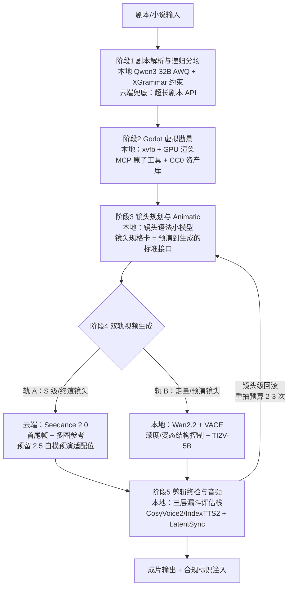
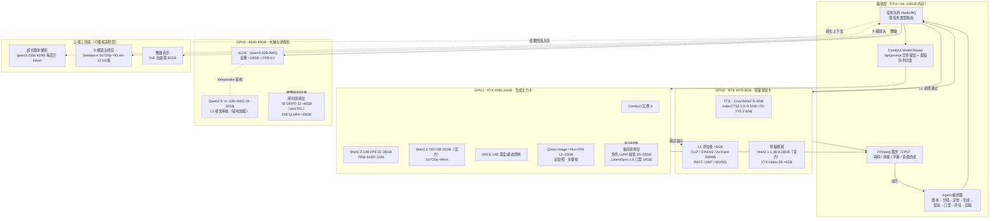
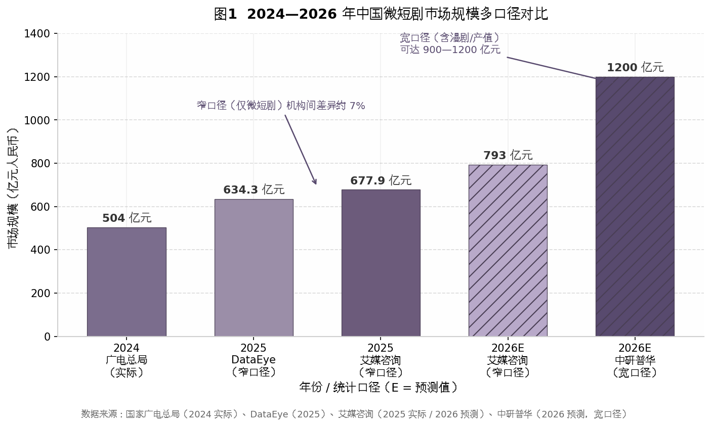
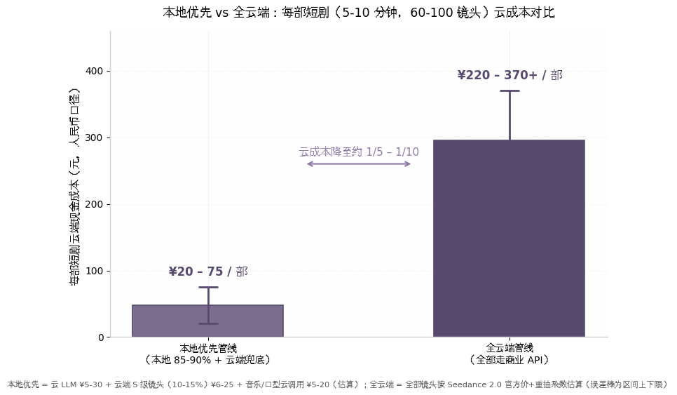

# Godot 虚拟制片 + Agent 闭环 AI 短剧方案：事实核查校准与本地三卡可执行部署方案

本报告以 2026-07-22 为校准基准日，对原方案作全量事实核查与工程校准（八维度检索、四级置信分级、T1/T2 来源分层）。第 1 章为核查结论总表，第 2—4 章重构工作流、三卡部署与理论对照，第 5—6 章校准市场合规与成本，第 7 章给出风险矩阵与路线图；文末附统一编号的参考文献。

---

# 1. 事实核查总表与校准结论

本章针对原方案《流程重构后的全新工作流》草稿中涉及模型能力、工具链、理论出处与市场数据的全部关键声明，给出核查结论总表与校准口径。核查基准日为 2026 年 7 月 22 日；结论仅覆盖"声明是否成立、如何修正"，对应的解决方案细节留待第 2–7 章展开。总体判断是：原方案的技术方向（虚拟制片预演 + 参考驱动视频生成 + Agent 调度 + 自动评估优选）成立，但五处关键事实声明被证伪或需重大修正，另有若干数据点处于多口径冲突区，须降级标注后使用。

## 1.1 核查方法与置信度框架

### 1.1.1 八维度并行核查、四级置信分级与来源优先级

本次核查采用八个维度并行推进的方式，分别覆盖：Seedance 模型能力与定价、视频生成模型格局、Godot 与模型上下文协议（Model Context Protocol，MCP）虚拟制片生态、理论概念学术出处、视频评估与奖励模型、市场规模与平台政策、本地部署显存适配、平台运营与合规。每个维度独立完成 15–45 组检索查询，并对关键结论实读一手页面（火山方舟官方文档、Artificial Analysis 官方榜单、GitHub API 实测数据、arXiv 论文原文），避免仅依赖二手转述。

核查结论按四级置信度归档：**高置信**指至少两个维度的独立来源交叉确认，可直接作为方案决策依据；**中置信**指单一权威来源支撑，可引用但需标注口径；**低置信**指单一低权威来源，降级为"据报道"处理，不作为决策依据；**冲突区**指多个来源口径不一致且无法归并，在报告中并列呈现并注明差异成因。来源优先级设定为两级以上分层：第一级（T1）为官方文档、官方公告与同行评议论文；第二级（T2）为权威媒体与一线行业数据机构；低于 T2 的来源仅作线索，且在使用处强制标注。按此框架，原方案声明被归入三类处置结果：被证伪或需重大修正（1.2 节，表 1）、被验证成立（1.3 节，表 2）、冲突区与低置信数据（1.4 节，表 3）。

## 1.2 被证伪或需重大修正的声明

原方案的五处关键声明经核查不成立或已过时，集中分布于视频模型能力假设、Godot 无头渲染认知、评估模型选型与理论引用四处。表 1 按"原声明 → 核查结论 → 修正方案"逐项列出。

**表 1 被证伪或需重大修正的声明总表**

| 原声明（摘要） | 核查结论 | 置信度 | 修正方案 |
|---|---|---|---|
| "Seedance 2.0 若支持类似 ControlNet 的结构条件输入（Canny、深度图、语义分割），则可做强控制生成" | 前提证伪：Seedance 全系（API 与即梦）输入仅文本/图片/视频/音频四类，无任何深度、边缘、姿态、分割条件接口  [(Godot Engine)](https://godotengine.org/asset-library/asset/4961) ；2.5 官宣的 3D 白模预演截至 2026-07-22 未正式可用  [(Godot Engine)](https://godotengine.org/blog/release/)  | 高 | 改为"参考驱动控制（首尾帧+多图参考+参考视频）+ 开源 VACE 结构控制兜底 + 为 2.5 白模预演预留接口位"  [(Godot Engine)](https://godotengine.org/asset-library/asset/4961)  |
| "主流视频模型（Sora、Kling 等）尚未开放精细控制" | 表述过时：Sora 消费端已于 2026-04-26 停止服务，Videos API 定于 2026-09-24 移除  [(Github)](https://github.com/tomyud1/godot-mcp) ；"精细结构控制缺位"对闭源旗舰大体成立，但可灵运动笔刷、Runway 相机控制、开源 VACE 已使该表述不再构成硬约束  [(Github)](https://github.com/rosskarchner/godot-mcp-plugin)  | 高 | 删除 Sora 依赖；将"控制缺位"改写为选型问题，注明闭源 API 仍无结构条件输入 |
| "Godot 对 headless 渲染支持良好（可编译为服务器版本，支持 CLI 渲染）" | 证伪：`--headless` 仅为 `--display-driver headless --audio-driver Dummy` 的快捷方式，搭配 dummy 光栅化器，不执行任何 GPU 渲染  [(Loomal)](https://loomal.ai/marketplace/godot-mcp) ；社区实测 headless 模式截图脚本不产出图像  [(MCP Servers)](https://mcpmarket.com/server/godot-6)  | 高 | 无头渲染改用 `xvfb-run` 虚拟显示包裹正常显示驱动以启用 GPU 渲染，无 GPU 机器退回 xvfb+lavapipe 软件渲染  [(MCP Toplist)](https://mcptoplist.com/server/glama%2FLeeSinLiang%2Fgodot-mcp)  |
| "奖励模型可用开源模型（如 VideoMAE、ImageReward）" | 概念误用加选型过时：VideoMAE 是 2022 年自监督视频表征模型（掩码自编码器），并非人类偏好奖励模型  [(aiprompt.co)](https://aiprompt.co/mcp/godot-mcp-server) ；ImageReward 为 2023 代图像奖励模型，视频域已被全面取代  [(Github)](https://github.com/LeeSinLiang/godot-mcp)  | 高 | 视频评估改用 VideoReward / VideoScore2 / VisionReward 第一梯队，指标体系对齐 VBench  [(arXiv.org)](https://arxiv.org/pdf/2507.11810)  |
| "LLM Agent 具备 L3 工具使用能力"（隐含引用智能体综述分级） | 出处需修正：L3=LLM+工具的唯一明确学术出处为 Huang（arXiv:2405.06643）的 L0–L5 体系  [(arXiv.org)](https://arxiv.org/pdf/2505.22477v1) ；《A Survey on LLM-based Autonomous Agents》以 Profile/Memory/Planning/Action 模块组织，并无 L1–L3 数字分级  [(arXiv.org)](https://arxiv.org/html/2308.11432v6)  | 高 | 引用时写明依据 Huang（2024）体系；避免与 OpenAI 五级口径（L3=Agents）混用  [(firstmovers.ai)](https://firstmovers.ai/openai-agi-levels/)  |

表 1 显示，五处修正中仅"Godot headless 渲染"属于工程实现层的认知偏差，其余四处均触及原方案的核心前提假设：Seedance 结构控制前提的证伪直接改变了"强控制生成"环节的技术路线，Sora 关停则使对照组表述失去时效性。值得注意的是，五处证伪均由 T1 级来源（官方文档、官方公告、论文原文）直接确认，无一是依赖低权威来源得出的判断，因此修正方向本身的确定性较高。同时应看到，证伪不等于方向否定——Seedance 的参考驱动控制与 2.5 白模预演路线图、开源 VACE 的深度/姿态控制，为原方案提供了替代路径，修正后的管线在能力上等效甚至更强，这一点将在 1.3 节的正面验证中进一步印证。

### 1.2.1 Seedance 结构控制前提证伪

原方案将"Seedance 开放 ControlNet 式结构条件输入"作为强控制生成环节的触发条件，并计划"待接口成熟后立即切换"。核查确认该前提不成立：火山方舟应用程序编程接口（Application Programming Interface，API）文档中 Seedance 2.0 的输入仅文本、图片、视频、音频四类，无任何深度、边缘、姿态或分割条件接口，即梦官方手册亦无 ControlNet 类入口  [(Godot Engine)](https://godotengine.org/asset-library/asset/4961) 。2026 年 6 月 23 日官宣的 Seedance 2.5 提出"3D 白模预演"——输入约 10 万面低精度白模与材质参考输出稳定渲染视频——与原方案"Godot 预渲染"思路同源，但官宣口径为"预计 7 月初上线"，而财新 7 月 14 日报道其"至今还未正式亮相"，截至核查日未 GA（General Availability，正式发布）  [(Godot Engine)](https://godotengine.org/blog/release/) 。当下唯一可落地的逐帧结构控制路径是开源侧：阿里 Wan2.1-VACE 支持深度图、光流、线稿、姿态等控制信号  [(lobehub.com)](https://lobehub.com/ar/mcp/lifeiscontent-godot-mcp) 。

### 1.2.2 Sora 相关表述已过时

原方案以"Sora、Kling 等尚未开放精细控制"论证行业控制能力的缺位。核查显示该表述需双重修正：其一，Sora 已退出供给——消费端网页与 App 于 2026 年 4 月 26 日停止服务，Videos API（sora-2、sora-2-pro 及快照）定于 2026 年 9 月 24 日从 API 移除且官方未给出替代模型，任何新方案不应再以 Sora 为依赖或对照  [(Github)](https://github.com/tomyud1/godot-mcp) ；其二，"精细控制缺位"的绝对化表述在 2026 年已不成立，可灵 3.0 的运动笔刷与多镜头逐镜运镜、Seedance 2.5 的 3D 白模输入等，使运动与结构控制从"空白"变为"选型问题"  [(Github)](https://github.com/rosskarchner/godot-mcp-plugin) 。保留成立的仅有"闭源旗舰 API 普遍不开放深度/姿态/边缘条件输入"这一收窄后的判断  [(Godot Engine)](https://godotengine.org/asset-library/asset/4961) 。

### 1.2.3 Godot headless 渲染认知偏差

原方案认为"Godot 对 headless 渲染支持良好"。核查确认这是社区高频误解：`--headless` 在官方命令行文档中的定义是 headless 显示驱动加 Dummy 音频驱动的组合，配套的 dummy 光栅化器不执行任何 GPU 渲染，属于引擎的架构性设计  [(Loomal)](https://loomal.ai/marketplace/godot-mcp) ；2025 年 11 月的社区实测进一步证实 headless 模式下截图脚本不产出图像  [(MCP Servers)](https://mcpmarket.com/server/godot-6) 。标准可行方案是保留正常显示驱动并以 `xvfb-run` 虚拟显示包裹，从而在无头服务器上启用 GPU 渲染；2026 年的 AI 驱动 Godot 项目 godogen 的截图管线文档亦明确"任何无头渲染（包括 GPU）都需要 xvfb"，无 GPU 机器可退回 lavapipe 软件渲染  [(MCP Toplist)](https://mcptoplist.com/server/glama%2FLeeSinLiang%2Fgodot-mcp) 。该偏差不推翻管线可行性，但直接决定部署架构，须在第 3 章的部署方案中落实。

### 1.2.4 奖励模型选型的概念误用与代际过时

原方案建议"用 VideoMAE、ImageReward 部署在消费级 GPU 做奖励模型推理"。核查确认两处问题：VideoMAE 系概念误用——它是 2022 年提出的自监督视频表征学习模型（掩码自编码器），用于视频理解特征提取，业界不以之训练或使用奖励模型  [(aiprompt.co)](https://aiprompt.co/mcp/godot-mcp-server) ；ImageReward 系代际过时——作为 2023 代图像域人类偏好奖励模型，其视频域地位已被 2025–2026 年第一梯队的 VideoReward、VideoScore2、VisionReward 全面取代，三者均开源且基于多模态大模型底座训练  [(Github)](https://github.com/LeeSinLiang/godot-mcp) 。同时，原方案的指标体系未对齐 VBench 这一事实标准，并缺失动态程度（Dynamic Degree）指标，存在"静止镜头刷高平滑分"的漏洞  [(arXiv.org)](https://arxiv.org/pdf/2405.06643v1) 。第 5 章将据此给出三层漏斗式评估栈。

### 1.2.5 "L3 工具使用能力"的出处校准

原方案将 Agent 定位为"具备 L3 工具使用能力"。核查确认：在已发表文献中，明确给出"L0–L5 数字分级且 L3 与 LLM+工具直接对应"的仅 Huang《Levels of AI Agents: from Rules to Large Language Models》（arXiv:2405.06643），其 L3 定义为"LLM-based AI + Tools + Reasoning & Decision Making + Memory & Reflection"  [(arXiv.org)](https://arxiv.org/pdf/2505.22477v1) ；被广泛引用的《A Survey on LLM-based Autonomous Agents》（Wang et al., arXiv:2308.11432）并未提出 L1–L3 数字分级，若将 L3 归于该综述则出处错误  [(arXiv.org)](https://arxiv.org/html/2308.11432v6) 。此外存在口径冲突风险：OpenAI 五级体系中 L3=Agents（可长期自主行动），含义显著高于"工具使用"  [(firstmovers.ai)](https://firstmovers.ai/openai-agi-levels/) 。本报告统一采用 Huang（2024）口径，并在第 4 章理论对照中说明"自主规划镜头的导演 Agent"在该体系中实际更接近 L4。

## 1.3 被验证成立的声明

与证伪项相对，原方案的六处关键声明经核查成立，构成方案可以继续推进的事实基础。表 2 逐项列出核查结论与关键证据。

**表 2 被验证成立的声明总表**

| 原声明（摘要） | 核查结论 | 关键证据 |
|---|---|---|
| "Godot 预渲染帧 + I2V/首尾帧管线驱动视频生成" | 成立，且与官方推荐用法高度吻合：渲染首/尾帧可直接进首尾帧接口，中间关键帧与角色三视图可作多图参考（单次最多 9 图+3 视频+3 音频）  [(Godot Engine)](https://godotengine.org/asset-library/asset/4961)  | 火山方舟 API 文档与即梦手册的接口定义；官方最佳实践建议参考素材 4–5 个  [(Godot Engine)](https://godotengine.org/asset-library/asset/5245)  |
| Seedance 为当前最强视频模型之一的判断 | 成立：Seedance 2.0 居 Artificial Analysis 文生视频榜第 2（Elo 1,227，10,617 票），图生视频榜第 1–2 区间（Elo 1,196）  [(Blck Alpaca)](https://blckalpaca.at/en/knowledge-base/ai-agents/what-are-ai-agents/autonomy-levels-of-ai-agents)  | 官方榜单 2026-07-22 一手实读 |
| "AnimationPlayer 可被脚本化控制以生成关键帧动画" | 成立：`Animation` 资源支持 `add_track` 与 `track_insert_key` 脚本化写入关键帧，3D 变换有专用轨道类型，属官方 API  [(wzbj1616.com)](http://m.wzbj1616.com/art_info/927)  | Godot 官方类文档及自带示例 |
| "开源社区已有 godot-mcp-plugin 雏形" | 成立但已过时：生态达中度成熟，头部项目 Coding-Solo/godot-mcp 达 4,849 星（2026-07-22 GitHub API 实测），商业版 godot-mcp-pro 提供 162 个 MCP 工具（含动画）  [(sina.cn)](https://k.sina.cn/article_7857201856_1d45362c001907o7z6.html)  | GitHub API 实测与官方资产库 |
| "用 GRPO 在虚拟环境中训练导演 Agent"方向 | 方向成立、直接先例空白：GRPO 出自 DeepSeekMath 无误  [(艾媒网)](https://www.iimedia.cn/c400/110974.html) ；ShotVL 证明 SFT+GRPO 可教 3B 小模型电影镜头语言  [(dianyingjie.com.cn)](https://www.dianyingjie.com.cn/2026/0312/403702.shtml) ；FilmAgent 证明 3D 引擎内多 Agent 制片可行  [(qq.com)](https://so.html5.qq.com/page/real/search_news?docid=70000021_17467d9707009252)  | arXiv 论文原文核实 |
| "LLM Agent 通过 MCP 调度工具"的协议基础 | 成立：MCP 由 Anthropic 于 2024 年 11 月发布，2026 年公开 server 达一万量级并获主流厂商一方支持  [(sina.cn)](https://cj.sina.cn/articles/view/7879922982/1d5ae15260190a37cg?froms=ggmp&vt=4)  | Anthropic 公告与生态统计 |

表 2 的六项成立声明覆盖了原方案管线的三个支柱：预渲染帧与首尾帧接口的吻合意味着"Godot 预演→视频生成"的主链路无需等待任何未发布能力；评估与训练侧的 ShotVL、FilmAgent 先例则将"GRPO 导演 Agent"从纯构想降级为"有先例支撑的高风险外推"。需要指出的是，成立声明中有两项附带时效性保留：Seedance 2.0 的榜单排名基于 2026 年 7 月 22 日快照、随投票波动，稳定结论应表述为"全球前二梯队"；Godot MCP 生态虽中度成熟，但开源头部项目不覆盖关键帧级动画工具，多数实现绑定运行中的编辑器实例且单连接，自研薄层的工作量不可省略  [(sina.cn)](https://k.sina.cn/article_7857201856_1d45362c001907o7z6.html) 。这些保留条件将分别汇入第 2 章的工作流细化与第 3 章的部署设计。

### 1.3.1 预渲染帧管线与官方用法的吻合度

核查确认原方案"Godot 预渲染帧 + I2V/首尾帧"管线不仅可行，而且是官方文档与社区实测共同推荐的用法：首尾帧接口接受首帧图、尾帧图与可选文本提示词，多模态参考接口接受最多 9 张参考图、3 段参考视频与 3 段音频  [(Godot Engine)](https://godotengine.org/asset-library/asset/4961) ；官方建议的最佳实践包括参考素材控制在 4–5 个、角色一致性用"一张纯头像+一张全身照"分工、跨镜头以上一段输出作下一段参考衔接  [(Godot Engine)](https://godotengine.org/asset-library/asset/5245) 。榜单侧，Seedance 2.0 在 Artificial Analysis 文生视频榜以 Elo 1,227 列第 2，图生视频榜处于第 1–2 区间，是含音频视频生成的标杆之一  [(Blck Alpaca)](https://blckalpaca.at/en/knowledge-base/ai-agents/what-are-ai-agents/autonomy-levels-of-ai-agents) 。这意味着原方案的主链路在 2026 年年中的可用能力范围内即可闭环。

### 1.3.2 引擎脚本化、MCP 生态与 GRPO 先例

引擎侧，AnimationPlayer 的脚本化关键帧控制属官方 API，GDScript 可直接创建动画轨道并写入关键帧，3D 位置/旋转/缩放有专用轨道类型；限制在于旋转以四元数存储、压缩后的轨道不可再编辑，需在工作流中规避  [(wzbj1616.com)](http://m.wzbj1616.com/art_info/927) 。生态侧，Godot MCP 已从"雏形"发展为中度成熟：头部项目 4,849 星、商业版 162 个工具显式覆盖动画，但开源实现的动画控制与编辑器无关运行仍是盲区  [(sina.cn)](https://k.sina.cn/article_7857201856_1d45362c001907o7z6.html) 。训练侧，GRPO 的出处（DeepSeekMath）核对无误  [(艾媒网)](https://www.iimedia.cn/c400/110974.html) ；ShotVL 以 SFT+GRPO 两阶段在 7 万条电影摄影问答上训练 Qwen2.5-VL-3B，在镜头尺寸、构图、运镜等维度超过 GPT-4o，证明小模型可习得镜头语言  [(dianyingjie.com.cn)](https://www.dianyingjie.com.cn/2026/0312/403702.shtml) ；FilmAgent 在 Unity 3D 空间内以多 Agent 完成创意开发、编剧与逐镜头机位选择，是与本方案设定最接近的已发表工作  [(qq.com)](https://so.html5.qq.com/page/real/search_news?docid=70000021_17467d9707009252) 。

## 1.4 冲突区与低置信数据处理

原方案引用的市场与价格类数据中，有三组处于多口径冲突区、两组来自单一低权威来源。按 1.1 节的框架，冲突区数据并列呈现并注明口径差异，低置信数据降级标注、不进入决策链路。表 3 逐项列出处置结果。

**表 3 冲突区与低置信数据处理表**

| 数据项 | 口径 A | 口径 B | 处置方式 |
|---|---|---|---|
| 2025 年微短剧市场规模 | 艾媒咨询：677.9 亿元，同比 +34.4%  [(lmtw.com)](https://lmtw.com/mzw/content/detail/id/252390)  | DataEye（经开源证券研报引用）：约 634.3 亿元  [(艾媒网)](https://www.iimedia.cn/c1020/109019.html)  | 并列引用，注明统计机构口径差约 7%；2024 年基线 504 亿元（广电总局口径）作锚点  [(艾媒网)](https://www.iimedia.cn/c400/108457.html)  |
| 2026 年市场规模预测 | 艾媒咨询：793.3 亿元，增速降至 17.0%  [(chinairn.com)](https://m.chinairn.com/news/20260703/14241960.shtml)  | 中研普华：有望达 1200 亿元  [(lmtw.com)](https://v.lmtw.com/mzs/content/detail/id/253020)  | 并列呈现；793 亿为窄口径延续预测，1200 亿疑含漫剧等宽口径，测算一律采用双口径区间 |
| Seedance 2.0 生成单价 | 官方：5 秒 720p 约 5.44–12.10 元/条（约合 $0.7–1.7）  [(36氪)](https://m.36kr.com/p/3588058597048325)  | 第三方渠道：$0.022–0.685/秒，高度离散  [(moonfox.cn)](https://www.moonfox.cn/insight/article/1798)  | 成本测算以官方价为准，渠道价标注为离散区间并注明渠道稳定性风险 |
| "抖音下架违规低质 AI 短剧超 7 万部" | 单一来源：《视听界》转载抖音审片标准报道  [(万物出海)](https://www.wanwuchuhai.com/post/173.html)  | 红果侧可核数据：5 月单月拦截下架违规漫剧 20,941 部  [(经济参考网)](https://www.jjckb.cn/20260207/f799547cd03e4fb6b850524a7892426f/c.html)  | 降级为"据报道"，不作为决策依据；治理力度以红果官方可核数据佐证 |
| "抖音新剧过审率约 30%" | 同上单一 C 级来源  [(万物出海)](https://www.wanwuchuhai.com/post/173.html)  | 无独立佐证 | 标注低置信，仅用于方向性判断，不进入过审率相关测算 |

表 3 的五组数据呈现两种截然不同的处置逻辑。C1、C2、C3 三项属统计口径差异：两个市场规模的绝对差约 7%，在战略测算的误差容忍范围内，并列引用即可；2026 年预测的 793 亿与 1200 亿差异达 51%，已超出误差范围，实质上反映了"微短剧"与"微短剧+漫剧"的口径分裂，本报告在涉及市场空间测算时统一采用双口径区间。C4、C5 两项则属来源权威性不足：二者均出自同一篇 C 级转载报道，虽然其方向与红果官方可核的治理数据（单月下架逾两万部）一致  [(经济参考网)](https://www.jjckb.cn/20260207/f799547cd03e4fb6b850524a7892426f/c.html) ，但具体数字无法独立复核，故全部降级。Seedance 价格冲突的成因不同——官方按 token 计费、渠道按秒报价且含转售加价或补贴，离散区间达 30 倍——处置上以官方价格页为基准，渠道价仅用于上限敏感性测算  [(36氪)](https://m.36kr.com/p/3588058597048325) 。

### 1.4.1 冲突区处理的总体原则

综合表 3 的处置，本报告对市场与价格数据确立三条原则：其一，凡多机构并存的统计，一律并列引用并显式标注口径，不做算术平均式的伪精确归并；其二，单一低权威来源的数字，无论方向多么可信，均以"据报道"降级，并优先寻找同方向的可核数据替代支撑——例如以红果官方治理通报替代"7 万部"的转引数字  [(万物出海)](https://www.wanwuchuhai.com/post/173.html) ；其三，价格类数据区分"官方基准价"与"渠道离散价"两个层级，成本模型以官方价为主口径、渠道价做敏感性边界，避免因渠道波动造成预算失真  [(36氪)](https://m.36kr.com/p/3588058597048325) 。上述原则同样适用于后续第 5 章市场测算与第 6 章成本测算中的全部数据引用。

---

# 2. 校准后的端到端工作流细化

第 1 章的核查结论表明，原方案的五阶段流程框架（剧本解析→Godot 预演→动态故事板→视频生成→剪辑终检）在方法论上依然成立，但几乎每个阶段的技术选型与执行假设都需要按 2026 年 7 月的现实替换。本章在保留该框架的前提下，逐阶段给出校准后的工作流细化；架构层面的总原则是"本地优先 + 云端三处兜底"，双轨生成与三层评估栈则是其中两个新增的结构性设计。本地三卡（RTX 4070 8G / RTX 4090 24G / A100 40G）的显存测算与服务编排细节不在本章展开，见第 3 章。

## 2.1 总体架构修订：从"云端 API 闭环"到"本地优先 + 云端三处兜底"的双轨闭环

原方案的成本模型隐含一个前提：剧本解析、视频生成、质量评估全部依赖云端应用程序接口（Application Programming Interface，API）。三处核查结论使该前提不再成立。其一，Seedance 全系不提供 ControlNet 式的深度、边缘、姿态等结构条件接口，原方案"等接口开放再做强控制"的路径已被证伪 [(Godot Engine)](https://godotengine.org/asset-library/asset/4961) ；其二，Sora 消费端已于 2026 年 4 月停止服务，Videos API 计划于 2026 年 9 月 24 日移除，纯闭源 API 组合的供应商风险显著上升 [(互联网数据资讯网-199IT)](https://www.199it.com/archives/1779959.html) ；其三，本地开源栈在 2026 年已可覆盖剧本大模型推理、草稿视频生成、角色 LoRA（Low-Rank Adaptation，低秩适配）训练、配音与评估等 85%–90% 的环节，剩余云端需求收敛为三类兜底任务：超长剧本的云端解析、S 级镜头的闭源终渲、整曲音乐生成 [(新浪财经)](https://finance.sina.com.cn/tech/roll/2025-08-19/doc-infmpqhx2496424.shtml) 。架构因此从"云端为主、本地为辅"反转为"本地为主、云端三处兜底"，视频生成环节进一步拆分为闭源参考驱动与开源结构控制两条轨道（见 2.5 节）。

### 2.1.1 五阶段流程框架保留，每阶段技术栈按 2026-07 现状替换

表 2-1 给出五个阶段的原技术栈与校准后技术栈对照。替换原则有三：被证伪的假设直接改写（如结构控制）；已过时的选型更换为同生态位的当前主力（如 CogVideoX→Wan2.2）；原方案未覆盖的环节显式补入（如口型同步、口播配音）。

**表 2-1 五阶段工作流技术栈替换对照（2026-07 口径）**

| 阶段 | 原方案技术栈 | 校准后技术栈 | 本地/云端归属 |
|---|---|---|---|
| 1 剧本解析与分场 | GPT-4o / Claude 3.5 API，提示工程 | 本地 Qwen3-32B（AWQ 量化）+ XGrammar/GBNF 约束解码；超长剧本走云端 API 兜底 | 本地为主、云端兜底 |
| 2 Godot 虚拟勘景 | Godot headless 渲染 + 自研 MCP 雏形 + Luma Genie 补资产 | xvfb 包裹的 GPU 渲染 + 基于 Coding-Solo/godot-mcp 二次开发（补齐动画工具）+ CC0 资产库与 Meshy/Tripo3D/Hunyuan3D 按需生成 | 本地 |
| 3 镜头规划与 Animatic | LLM Few-shot 规划 + 通用多模态评分 | 镜头语法小模型 + 镜头规格卡（shot spec card）标准映射接口 + AnimationPlayer 脚本化关键帧 | 本地 |
| 4 视频生成与优选 | Seedance 结构控制（假设）+ 开源模型降依赖 | 轨 A：Seedance 2.0 首尾帧 + 多图参考（S 级终渲）；轨 B：本地 Wan2.2 + VACE 深度/姿态控制 + TI2V-5B（走量/预演） | 双轨：云端 + 本地 |
| 5 剪辑终检与音频 | MoviePy/FFmpeg + GPT-4o 抽查 + 通用 TTS | 三层漏斗评估栈（L1 硬指标 / L2 专用评审 / L3 语义复核）+ CosyVoice2/IndexTTS2 配音 + LatentSync 口型同步 + 合规终检 | 本地为主、音乐云端 |

下图为校准后的端到端数据流，标注各环节的本地/云端归属与两轨分工：



该架构的核心变化不是环节增减，而是控制权的重新分配：阶段 2 的 Godot 预渲染帧从"可选的规划辅助"升级为管线的中枢资产——它既是阶段 3 镜头规格卡的数据源，又是阶段 4 双轨生成共同的参考锚点，还是阶段 5 一致性核查的比对基准。这意味着预演质量第一次成为全管线质量的乘性因子，而非局部变量。同时需要说明，"本地优先"并不等于"本地全包"：原生音画同步对白、4K 交付与闭源旗舰的物理真实感仍是本地开源栈的短板，这正是轨 A 与云端兜底位存在的原因。

## 2.2 阶段 1 剧本解析：本地 32B 模型为主、云端超长上下文兜底

原方案以 GPT-4o / Claude 3.5 做剧本通读与分场，单次调用成本约 0.1–0.3 美元。校准后，该阶段主执行体替换为本地部署的 Qwen3-32B：其 AWQ INT4 量化权重约 18–20 GB，可在 24 GB 级显卡上以 vLLM 服务化运行，在 40 GB 显卡上则可开启长上下文与大批量并发 [(微信公众号(徐徐叨叨的sun))](http://mp.weixin.qq.com/s?__biz=MjM5MTI3NjM0Mw==&mid=2653346665&idx=1&sn=d1dadca0135536311b76f962678d610f) 。Qwen3 系列原生支持 32K 上下文、经 YaRN 可扩展至 131K，足以覆盖多数单集剧本；超出此窗口的长篇小说改编任务，则路由至云端超长上下文 API 做一次性粗切，再回本地细切，这是三处云端兜底的第一处 [(Affordable AI Models & API Access)](https://unifically.com/blogs/veo-3.1) 。

### 2.2.1 分场 Schema 保留；递归分场 + XGrammar/GBNF 结构化输出约束

原方案的分场 JSON Schema 设计合理，予以保留（示例字段：scene_id、location、time、characters、conflict、emotional_arc、estimated_duration_sec、key_props、required_shots）。递归分场策略（先切大段、再逐段细切）同样保留，但输出合法性不再依赖提示工程与事后校验，而改由约束解码（constrained decoding）在推理期保证：Outlines 将 JSON Schema 编译为有限状态机，逐步屏蔽非法词元，可实现接近 100% 的结构合规 [(stop Content Creation Platform)](https://clipcanva.com/blog/openai-sora-video-generation-availability-2026) ；XGrammar 以字节级下推自动机实现同类能力，单词元开销低于 40 微秒 [(Midjourney API for AI Image Generation)](https://apiframe.ai/guides/luma-api-guide) ；llama.cpp 生态的 GBNF（GGUF BNF）语法则是离线单发任务的备选。本地自托管推理框架（vLLM、SGLang、llama.cpp）均原生集成上述能力，这意味着"结构化输出必须合法"从概率性问题变为确定性问题，下游阶段 2/3 无需再设计容错分支。需注意约束解码只保证格式合法、不保证语义正确，分场质量仍依赖模型能力与递归切分策略，建议在阶段 1 保留原方案中的人工审核节点作为可选卡点。

## 2.3 阶段 2 Godot 虚拟勘景：xvfb 无头渲染 + MCP 工具封装 + CC0 资产库

阶段 2 有三处事实修正。第一，Godot 的 `--headless` 模式使用 dummy 光栅化器，不执行任何图形处理器（Graphics Processing Unit，GPU）渲染，社区实测截图脚本在该模式下不产出图像 [(MCP Servers)](https://mcpmarket.com/server/godot-6) ；标准可行路径是以 xvfb（X virtual framebuffer，虚拟显示缓冲）包裹正常显示驱动，在无头服务器上启用 GPU 渲染，无 GPU 时退回 lavapipe 软件渲染 [(MCP Toplist)](https://mcptoplist.com/server/glama%2FLeeSinLiang%2Fgodot-mcp) 。第二，模型上下文协议（Model Context Protocol，MCP）的 Godot 生态已非"雏形"：头部开源项目 Coding-Solo/godot-mcp 在 2026 年 7 月达 4,849 星，覆盖编辑器启动、项目运行、场景/节点操作与调试输出捕获 [(sina.cn)](https://k.sina.cn/article_7857201856_1d45362c001907o7z6.html) ；但其缺口同样明确——开源实现普遍缺少关键帧级动画工具，而关键帧写入恰是 AnimationPlayer 的官方脚本化接口（`add_track` + `track_insert_key`），自研补齐属于小工程量工作 [(wzbj1616.com)](http://m.wzbj1616.com/art_info/927) 。第三，资产供应链从 Luma Genie 切换（见 2.3.2）。

### 2.3.1 MCP 原子工具清单

基于 Coding-Solo/godot-mcp 二次开发，按"场景操作—资产操作—布光相机—动画—渲染输出"五族组织约 26 个原子工具。其中动画族与部分渲染输出工具为自研补齐项（开源头部项目未覆盖关键帧动画，商业版 godot-mcp-pro 的 162 个工具虽含动画，但按 MIT 路线自研更利于管线可控性）。

**表 2-2 Godot MCP 原子工具清单（校准后封装方案，共 26 个）**

| 工具族 | 原子工具 | 来源 |
|---|---|---|
| 生命周期（4） | launch_editor、run_project、stop_project、get_debug_output | Coding-Solo 已有 [(sina.cn)](https://k.sina.cn/article_7857201856_1d45362c001907o7z6.html)  |
| 场景/节点（6） | create_scene、add_node、delete_node、set_node_property、reparent_node、get_scene_tree | Coding-Solo 已有，按 previs 语义重命名封装 |
| 资产（4） | search_asset_library、import_asset、instantiate_asset、list_license_metadata | 自研（对接 CC0 资产索引与许可台账） |
| 布光/相机（5） | set_lighting、set_environment、place_camera、set_camera_path、attach_look_at_constraint | 部分已有，路径与注视约束自研 |
| 动画（4） | create_animation、add_track、insert_keyframe、set_animation_length | 自研（开源缺口，官方 API 完备 [(wzbj1616.com)](http://m.wzbj1616.com/art_info/927) ） |
| 渲染/输出（3） | render_viewport、write_movie、capture_aux_buffer（深度/语义分割缓冲） | 自研（基于 xvfb + MovieWriter [(Loomal)](https://loomal.ai/marketplace/godot-mcp) ） |

这张清单对应原方案设想的 create_scene/place_character/set_lighting/render_viewport 等调用，但有两点工程增量值得注意。其一，`insert_keyframe` 等动画工具是把 Animatic（动态故事板）从"手工活"变为"Agent 可调"的关键，缺失它们则阶段 3 无法闭环；其二，`capture_aux_buffer` 输出深度图与语义分割图，虽然闭源 API 不消费这些控制图，但轨 B 的 VACE 结构控制链路直接以深度/姿态为条件，该工具因此是双轨架构在预演侧的落点。此外多数开源 MCP 实现绑定运行中的编辑器实例且仅支持单连接，服务器化部署需以 xvfb 包裹并实测稳定性，建议将渲染实例池化作为里程碑 M0 的验收项之一。

### 2.3.2 资产策略：CC0 占位 + 按需生成，不再依赖 Luma Genie

占位资产以全站 CC0（Creative Commons Zero，公有领域贡献宣告）来源为白名单：Poly Haven 的高动态范围图像（HDRI）、贴图与模型明确允许商用、免署名、可再分发 [(Midjourney API for AI Image Generation)](https://apiframe.ai/blog/best-runway-api-providers-2026) ；Kenney 的风格化低模与 Quaternius 的 CC0 动画库面向的正是"blocking、previs、prototyping"场景 [(Manifold Markets)](https://manifold.markets/CalibratedGhosts/will-openai-keep-the-soravideos-api) 。Sketchfab 与 OpenGameArt 因许可混杂（CC-BY、CC-BY-SA、GPL 并存），仅按模型级许可元数据登记后选择性引入，管线内维护许可台账以防污染商用交付 [(Manifold Markets)](https://manifold.markets/CalibratedGhosts/will-openai-keep-the-soravideos-api) 。占位之外的定制资产按需调用生成式 3D 接口：Meshy 6（文/图生 3D、PBR 贴图、单模型约 0.10–0.30 美元）、Tripo3D（约 10 秒出模、四边面拓扑）、Rodin（几何细节最强、0.50 美元以上/模型），单价区间整体处于 0.05–0.50 美元/模型 [(Milvus)](https://milvus.io/ai-quick-reference/does-sora-support-api-access-for-developers) ；需要自托管时 Hunyuan3D 为当前最强开源选项 [(Editly)](https://editly.art/blog/seedance-2-5-vs-kling-3-0) 。原方案依赖的 Luma Genie 已被厂商降级维护（Luma 重心转向视频生成、3D 产品线更新停滞），不宜再作为单一依赖 [(NeuroSelect)](https://neuroselect.net/en/sora-vs-veo) 。考虑到 3D 生成厂商迭代快（Genie 即前车之鉴），资产获取层应抽象为可替换的 provider 接口。

## 2.4 阶段 3 镜头规划与 Animatic：镜头语法小模型 + 镜头规格卡机制

原方案在阶段 3 暴露的短板是"LLM 直接规划镜头"的质量不稳定。校准后改为两层结构：上层由镜头语法小模型（3B–7B 量级，经监督微调与强化学习训练）负责把分场 JSON 编译为镜头序列——ShotVL 的研究已证明 SFT+GRPO 可以让 3B 小模型在镜头语言任务上超过通用大模型；下层由 Godot AnimationPlayer 执行关键帧化，渲染 6–12 fps 的 Animatic。导演（人）在 Animatic 层面确认叙事节奏后再进入生成环节，这与"先剪 animatic 定节奏、再按节奏生成镜头"的行业经验法则一致 [(Crazyrouter)](https://crazyrouter.com/en/blog/ai-video-generation-api-pricing-may-2026-comparison) 。

### 2.4.1 镜头规格卡作为预演→生成的标准映射接口

核查确认，原方案最严重的隐性断点是"Animatic→视频生成"之间没有标准映射：没有任何主流视频模型直接消费 3D 相机数据，Godot 预演的焦距、机位、运动轨迹若不能翻译为模型可消费的输入，预演红利就无法传递到生成侧 [(Crazyrouter)](https://crazyrouter.com/en/blog/ai-video-generation-api-pricing-may-2026-comparison) 。校准方案引入镜头规格卡（shot spec card）作为该接口的标准载体——工业界的对应实践即为每镜头记录时长、参考图、提示词、负向提示词、连续性备注的结构化卡片 [(来源)](https://lotix.io/blog/comparisons/runway-pricing-alternatives/) 。本管线中每张规格卡包含：相机参数（焦距/机位/轨迹的自然语言化描述）、角色位与动作、时长与帧率、情绪标签、首尾帧与参考图引用（指向 Godot 预演帧与角色资产库）、负向约束与种子值。规格卡由 LLM 按目标模型适配器翻译成具体调用：对轨 A 编译为首尾帧 + 多图参考 + 运镜指令，对轨 B 编译为提示词 + VACE 深度/姿态序列。这一机制同时解决了三个问题：预演参数的结构化下传、多模型适配的可插拔性、以及 2.7 节回滚机制所需的镜头级版本定位。

## 2.5 阶段 4 双轨视频生成：闭源参考驱动 + 开源 VACE 结构控制

强控制路径的整体重构是本次校准的核心。由于闭源旗舰不提供结构条件接口，而开源侧 Wan2.1-VACE（Video All-in-one Creation and Editing，阿里 2025 年 5 月开源）已统一支持深度、姿态、光流、线稿等控制信号与参考图驱动 [(lobehub.com)](https://lobehub.com/ar/mcp/lifeiscontent-godot-mcp) ，原方案单一的"Seedance 结构控制"假设被替换为双轨分工。

**表 2-3 双轨视频生成分工对照（2026-07 口径）**

| 维度 | 轨 A：S 级/终渲镜头（云端） | 轨 B：走量/预演镜头（本地） |
|---|---|---|
| 模型 | Seedance 2.0（首尾帧 + 多图参考） | Wan2.2 A14B FP8 / TI2V-5B + VACE-14B 深度/姿态控制 |
| 控制方式 | 参考驱动：首尾帧锁构图、多图参考锁角色与风格、参考视频复刻运镜 [(Godot Engine)](https://godotengine.org/asset-library/asset/5245)  | 结构控制：深度图/姿态序列逐帧约束 + 参考图 [(lobehub.com)](https://lobehub.com/ar/mcp/lifeiscontent-godot-mcp)  |
| 适用镜头 | 主角特写、情绪高潮戏、成片终渲 | 打戏/舞蹈等强动作镜头、分镜预演、批量草稿 |
| 单段成本 | 5 秒 720p 约 5.44–12.10 元；样片/Mini 档 0.28–2.81 元 [(36氪)](https://m.36kr.com/p/3588058597048325)  | 本地算力边际成本（电费+折旧） |
| 分辨率/时长上限 | 4K、4–15 秒 [(Godot Engine)](https://godotengine.org/asset-library/asset/5245)  | 720p、约 5 秒/段 |
| 原生音频 | 有（音画同生、多语言唇形） [(Godot Engine)](https://godotengine.org/asset-library/asset/5245)  | 无，依赖阶段 5 音频链路 |
| 主要短板 | 无结构条件接口；价格波动与渠道碎片化 | 无原生音频、无 4K；物理真实感低于闭源旗舰 |

双轨的价值不在成本摊薄而在风险对冲：轨 A 锁定了当前全球前二梯队的画质上限（Artificial Analysis 文生视频榜 Elo 1,227、图生视频榜 Elo 1,196 [(Blck Alpaca)](https://blckalpaca.at/en/knowledge-base/ai-agents/what-are-ai-agents/autonomy-levels-of-ai-agents) ），轨 B 则把供应商锁定、价格重抽与结构控制三类不确定性留在本地消化。两轨通过镜头规格卡与统一角色资产库衔接，保证跨轨镜头在同一角色、同一空间设定下混剪不穿帮。需要审慎对待的是本地轨的速度现实：TI2V-5B 在 4090 上生成 5 秒 720p 约需 9 分钟 [(arXiv.org)](https://www.arxiv.org/pdf/2512.21450) ，本地轨定位应为"草稿、预演与特殊控制镜头"，最终画质交付仍以轨 A 为锚。

### 2.5.1 轨 A：Seedance 2.0 参考驱动最佳实践

轨 A 的操作规范直接采用官方手册与实测社区沉淀的最佳实践 [(Godot Engine)](https://godotengine.org/asset-library/asset/5245) ：参考素材宁少勿多，单次以 4–5 个为宜（1–2 张角色图、1 张场景图、1 段运镜视频），超过 4 个参考人物稳定性明显下降；角色一致性采用"一张纯头像 + 一张全身照"的分工，不上传多视图设定图（会被误读为多个人物）；跨镜头衔接以上一段成功输出作为下一段参考，或首尾帧串联；时长用参数控制而非写进提示词；每段提示词固定挂同一张风格参考图。成本节奏上，以 1.5 Pro 样片模式（Draft，480p 无声条约 0.28 元/5 秒）或 2.0 Mini 做构图预演，确认后再用标准版出成片 [(36氪)](https://m.36kr.com/p/3588058597048325) 。另需预留 Seedance 2.5 的适配位：其已官宣的"3D 白模预演"（输入约 10 万面白模与材质参考直接输出渲染视频）与 Godot 预演路线同源，但该功能截至 2026 年 7 月 14 日尚未正式发布，管线应以适配器形式预留、上线后验证其对"渲染帧当参考图"路径的替代率 [(Godot Engine)](https://godotengine.org/blog/release/) 。

### 2.5.2 轨 B：本地 Wan2.2 + VACE 结构控制，CogVideoX 弃用

轨 B 基座为 Wan2.2（Apache 2.0 许可证，商用友好）：TI2V-5B 为官方明确支持 24 GB 显存的图/文生视频模型，A14B 经 FP8 量化亦可运行于 24 GB 档 [(arXiv.org)](https://www.arxiv.org/pdf/2512.21450) ；VACE-14B 承担深度/姿态/参考图控制，1.3B 轻量版可下沉至 8 GB 卡做动作测试 [(lobehub.com)](https://lobehub.com/ar/mcp/lifeiscontent-godot-mcp) 。原方案选作"开源降依赖"的 CogVideoX 已明确弃用：其为 2024 年代模型，分辨率上限 1360×768、16fps，A100 生成 5 秒约需 1000 秒，且 5B 系列商用需单独授权 [(arXiv.org)](https://arxiv.org/pdf/2604.11554) 。轨 B 的典型负载序列是：Godot 预演帧 → 深度/姿态序列提取 → VACE 结构控制生成 → L1 评估初筛；对于强动作镜头（打戏、舞蹈），结构控制的一致性优势使其即使进入终渲候选也优先走轨 B。

### 2.5.3 角色一致性工程：资产库 + LoRA + 预演帧锚点

角色一致性采用三层组合。第一层为项目级角色资产库（"角色圣经"）：三视图、表情集、服装状态表全部由 Godot 角色资产渲染生成，随镜头规格卡自动注入为首尾帧或参考图，替代逐镜头手动挂图。第二层为每主角一个角色 LoRA：24 GB 显存即可训练（musubi-tuner 官方口径图像 12 GB 起、视频 24 GB 起），典型 1,500–2,500 步、6–8 小时/角色、产出 200–800 MB 文件 [(arXiv.org)](https://arxiv.org/pdf/2505.12346) 。第三层即 Godot 预演帧本身作为一致性锚点——这是本管线相对纯参考图方案的独特优势。投入依据是一组可量化对比：纯参考图方案在全场景（转头、换光、复杂动作）下的平均一致性仅约 67%，而 LoRA 方案的 CLIP 一致性评分可达 0.90 以上 [(arXiv.org)](https://arxiv.org/html/2507.10593v3) 。分级策略为主角 2–3 人训 LoRA、配角用资产库参考图，以控制每部剧的 LoRA 训练开销。

## 2.6 阶段 5 剪辑终检与音频链路补齐

### 2.6.1 三层漏斗评估栈

原方案的奖励模型选型（CLIP/LAION Aesthetics/VideoMAE/ImageReward）有一半过时或概念误用——VideoMAE 是自监督视频表征模型而非人类偏好奖励模型，ImageReward 系 2023 年代图像域模型。校准后替换为三层漏斗：L1 硬指标层做大批量候选初筛，L2 专用评审层做主决策精排，L3 语义复核层做剧本对齐终审。

**表 2-4 三层漏斗评估栈（替换原 CLIP/LAION/VideoMAE/ImageReward 选型）**

| 层级 | 功能定位 | 模型与指标 | 部署档位 |
|---|---|---|---|
| L1 硬指标层（每镜头 <1 秒） | 大批量候选初筛 | CLIP-T 文-视频对齐、DINOv2 主体一致性、ArcFace（InsightFace buffalo_l，326 MB）角色身份相似度、AMT 运动平滑 + RAFT 动态程度 + MAD 时域闪烁、MUSIQ 成像质量 [(arXiv.org)](https://arxiv.org/pdf/2405.06643v1)  | 8 GB 全量可跑 |
| L2 专用评审层（每镜头 2–5 秒） | 通过者精排、输出可用分数与理由 | VideoScore2（Qwen2.5-VL-7B 底座，SFT+GRPO 训练，先推理后打分，可直接用于 Best-of-N 优选） [(arXiv.org)](https://arxiv.org/pdf/2405.06643v2) 、VisionReward（多维可解释诊断） [(arXiv.org)](https://arxiv.org/pdf/2605.16508) 、Q-Insight（画质回归） [(arXiv.org)](https://arxiv.org/html/2604.03964v1) 、HPSv3（关键帧人类偏好） [(arXiv.org)](https://arxiv.org/html/2508.02979v1)  | 24 GB |
| L3 语义复核层（按需） | 剧本/叙事对齐终审 | Qwen3-VL-8B/32B 做镜头-剧本核对清单与候选成对排序 [(arXiv.org)](https://arxiv.org/pdf/2402.03300)  | 40 GB 或云端 |

漏斗设计的依据有两条实证结论。其一，运动质量必须是三元组联合：仅用光流平滑与闪烁检测会导致静止镜头虚高分无法被惩罚，RAFT 动态程度是原方案缺失的配套指标 [(arXiv.org)](https://arxiv.org/pdf/2405.06643v1) 。其二，通用多模态大模型做绝对打分并不可靠——前沿视觉语言模型在 5 分制上与人类的完全一致率仅 32%–34%，相关系数仅 0.30–0.46，但成对排序显著更可靠，故 L3 一律采用成对比较而非绝对打分 [(arXiv.org)](https://arxiv.org/html/2604.08224v1) 。经济性上，L1 全量指标可常驻 8 GB 显卡，使"每镜头生成 5–8 候选自动优选"的边际成本趋近于零，这是本地架构相对纯 API 方案的独特优势；需附带说明的是 InsightFace 识别模型包为非商业研究许可，产品化时须替换授权或自训 [(arXiv.org)](https://arxiv.org/pdf/2601.23135) 。

### 2.6.2 音频链路：配音、口型与音乐版权边界

音频是原方案完全缺失的链路，而 2026 年它已是平台过审的硬指标：抖音 AI 短剧审片标准将"机械配音、音画不同步"列入直接拒审项 [(万物出海)](https://www.wanwuchuhai.com/post/173.html) 。校准后音频链路设为视频生成之后、终检之前的独立工序："文本转语音（Text-to-Speech，TTS）→ 情绪标签表 → 口型同步 → 音画对齐校验"。配音采用 CosyVoice2（0.5B，官方口径 6–8 GB 显存、流式首包约 150 毫秒）与 IndexTTS2（情感标签可控，短句实测 3.2–3.9 GB） [(MDPI)](https://www.mdpi.com/1999-5903/18/6/326) ；口型同步采用 LatentSync（1.5 版推理最低 8 GB、1.6 版 18 GB，Apache 2.0 可商用） [(arXiv.org)](https://arxiv.org/html/2606.08790v1) ，多人同框口型这一 2025 年以前的瓶颈已随 SekoTalk 类方案（至多 3 人各自精准对口型）的突破而工程可解 [(Expand Video Background Online | Ltx Scaler)](https://ltx.io/blog/open-source-video-generation-models-guide) 。音乐生成则需设置版权红线：Suno 在 2025 年末的泄露事件曝光其大规模爬取流媒体平台训练素材，相关诉讼中"合理使用"抗辩承压，商用配乐应优先选择授权链明确的平台并留存凭证 [(melies.comelies.co)](https://melies.co/compare/hailuo-02-vs-wan-v2-2) 。

## 2.7 失败回滚与镜头级迭代机制

### 2.7.1 镜头级颗粒度回滚与重抽预算化

回滚颗粒度必须是镜头而非集——重新生成一集约等于重做全部镜头。依托镜头规格卡与镜头级版本库（script/shotlist/frames/animatic/assets/shots/audio/exports 八层目录），终检发现问题仅回退至对应镜头的阶段 4 重抽，不触发上游连锁返工 [(来源)](https://lotix.io/blog/comparisons/runway-pricing-alternatives/) 。重抽次数按镜头等级预算化：普通镜头 2 次、S 级镜头 3 次封顶，超限自动降级镜头复杂度或切换轨道/模型——该 2–3 次系数为行业经验值，置信度一般，应在量产中按实测废片率校准。成本侧的对冲设计针对一组已被多源证实的风险：单镜头生成 5–10 次并不罕见，实际生成成本可达名义报价的 5–10 倍 [(Will It Run AI)](https://willitrunai.com/blog/hunyuanvideo-1-5-vram-requirements) 。对冲手段有二：一是"先评估后放大"，一切镜头先走本地轨 B 或样片模式低成本预演，L1 评估通过后才放大到轨 A 标准档终渲；二是废片率仪表盘，废片率超阈值自动触发模型切换或镜头降级。这使成本结构从"名义单价 × 镜头数"变为受控的"名义单价 × 重抽系数 × 分级放大率"，为第 6 章的成本重估提供可计算的输入。

---

# 3. 本地三卡算力部署架构

第 2 章确立了"本地优先 + 云端三兜底"的总体架构，本章给出其落地形态：如何把一张 RTX 4070 8GB、一张 RTX 4090 24GB 与一张 A100 40GB 组织成一条可复现、可排队、可扩缩的短剧生产管线。本章所有显存数字均标注来源；无可靠来源者注明"估算"，读者在复现部署时应以实测标定为准（显存占用随框架版本、分辨率与并发数浮动）。

## 3.1 硬件盘点与总体分工原则

### 3.1.1 三张卡的梯度恰好匹配任务的梯度

硬件清单为：GPU0 = RTX 4070 8GB、GPU1 = RTX 4090 24GB、GPU2 = A100 40GB（PCIe/SXM 未知，不影响本章结论），CPU 若干，系统内存 64–128GB。这套配置的第一个关键判断是**不做异构张量并行**：三张卡显存 8G/24G/40G 异构、算力代际不同（Ada/Ada/Ampere），跨卡 TP 的通信开销会直接吃掉收益——即便同构的双 4090 做 vLLM 张量并行，扩展效率也只有约 0.70× [(EvoLink)](https://evolink.ai/blog/best-ai-video-generation-models-2026-pricing-guide) ；异构混部（如 4090D 做 Prefill、双 A100 做 Decode）属于实验性方案，需要 pipeline-parallel 或 Prefill/Decode 拆分，工程风险高 [(seedance.tv)](https://www.seedance.tv/blog/seedance-2-0-vs-pika-2-2-which-ai-video-generator-wins-in-2026) 。相比之下，短剧流水线的各环节（剧本解析→分镜→定妆→生成→配音→口型→评估→剪辑）天然可并行、可排队，因此正确姿势是**静态分工 + 任务队列动态路由**：每张卡绑定固定服务角色，Redis/RQ 队列按任务类型路由，削峰填谷由队列完成而非由并行框架完成。

第二个关键判断是**显存梯度恰好匹配任务梯度**。短剧流水线的任务按显存需求自然分成三档：8GB 级（TTS、口型、L1 评估指标、1.3B–2B 草稿视频）、24GB 级（14B 视频生成 FP8、5B I2V、角色 LoRA 训练）、40GB 级（32B 量化 LLM/VLM 服务 + 大 KV cache、7B 级 GRPO 训练）。三张卡的容量正好与这三档一一对应，不存在"某个环节没有卡能跑"的断档。表 3-1 给出分工总表。

**表 3-1 三卡分工总表**

| 显卡 | 角色定位 | 常驻/主要服务 | 典型显存预算 | 错峰与切换策略 |
|---|---|---|---|---|
| RTX 4070 8GB | 轻量常驻卡 | CosyVoice2 / IndexTTS2 / F5-TTS（2.8–8 GB [(MDPI)](https://www.mdpi.com/1999-5903/18/6/326) ）；L1 评估栈（CLIP/DINOv2/ArcFace 326MB/RAFT/MUSIQ，合计 <6 GB [(arXiv.org)](https://arxiv.org/pdf/2405.06643v1) ）；Wan2.1-T2V-1.3B 草稿（官方 8.19 GB [(VibeDex)](https://vibedex.ai/blog/minimax-hailuo-vs-pixverse-2026) ）；LTX-Video 2B 草稿（约 6 GB [(fal.ai)](https://fal.ai/models/fal-ai/minimax/hailuo-02/standard/image-to-video) ） | 任一时刻单服务独占，合计 ≤7.5 GB | 7×24 常驻；草稿生成与评估串行排队 |
| RTX 4090 24GB | 生成主力卡 | ComfyUI 实例 A：Wan2.2-14B FP8（T5 常驻 GPU 时 22–26 GB [(aimagicx.com)](https://www.aimagicx.com/blog/open-source-ai-video-models-comparison-2026) ）；Wan2.2-TI2V-5B（官方 22–24 GB [(spheron.network)](https://www.spheron.network/blog/deploy-wan-2-1-ai-video-generation-gpu-setup/) ）；VACE-14B 结构控制；Qwen-Image/Flux FP8 定妆与关键帧（FP8 12–15 GB [(快科技)](https://news.mydrivers.com/1/1128/1128871.htm) ）；LatentSync 1.6 口型（官方 18 GB [(arXiv.org)](https://arxiv.org/html/2606.08790v1) ）；角色 LoRA 训练（峰值 20–22 GB [(arXiv.org)](https://arxiv.org/html/2507.10593v1) ） | 单工作流 18–26 GB | ComfyUI 自带模型卸载，多模型共卡串行执行 [(sohu.com)](https://m.sohu.com/a/1035232883_258768?scm=10001.325_13-325_13.0.0-0-0-0-0.5_1334) ；夜间切换为训练位 |
| A100 40GB | 大脑与训练位 | vLLM：Qwen3-32B-AWQ（权重约 18 GB + KV cache [(sohu.com)](https://m.sohu.com/a/1035312058_122066678?scm=10001.325_13-325_13.0.0-0-0-0-0.5_1334) ）；Qwen2.5-VL-32B-AWQ 视觉审核（约 18–20 GB [(微信公众号(徐徐叨叨的sun))](http://mp.weixin.qq.com/s?__biz=MjM5MTI3NjM0Mw==&mid=2653346665&idx=1&sn=d1dadca0135536311b76f962678d610f) ）；训练位：7B GRPO（32–40 GB [(手机新浪网)](https://www.sina.cn/news/detail/5306741702001099.html) ）、32B QLoRA（约 26 GB [(sohu.com)](https://m.sohu.com/a/1035254751_119778?scm=10001.325_13-325_13.0.0-0-0-0-0.5_1334) ） | 推理 18–28 GB；训练 26–40 GB | 推理闲时（夜间/队列空窗）切训练；4090 排队时可客串视频备份 |

**表 3-1 解读**：这张表的设计哲学是"一卡一职、显存独占"。4070 与 4090 的服务几乎不存在跨档流动——8GB 卡跑不动任何 24GB 档任务的实用配置，24GB 卡也不应被 8GB 档小任务长期占用（机会成本太高）。唯一的双向弹性在 A100：它既是 32B 级模型的宽松住所，又是本地唯一能承担 7B GRPO 全量训练与 32B QLoRA 的卡，因此用"推理闲时切训练"的时序复用榨干 40GB。需要强调的是"显存预算"一列是峰值口径：例如 TI2V-5B 官方口径 22 GB、FP8 可压到 10–15 GB [(spheron.network)](https://www.spheron.network/blog/deploy-wan-2-1-ai-video-generation-gpu-setup/) ，部署时应以官方/实测峰值预留 10% 余量，避免与 ComfyUI 的模型卸载机制互相踩踏。

## 3.2 A100 40G：大脑与训练位

### 3.2.1 vLLM 主服务：剧本解析 Agent 与视觉审核

A100 承担整条管线的"大脑"：Qwen3-32B-AWQ 作为剧本解析与 Agent 规划的主模型。选择 32B 档的理由有三：其一，剧本结构化解析、多镜头规划属于复杂长链推理，7B–14B 档在分镜一致性上明显不足；其二，AWQ INT4 量化后权重约 18 GB、16K 上下文 KV（FP8）总计约 22.7 GB，在 4090 上是"刚好塞下"（需 `--enforce-eager`、并发上限 8、实测 65 tok/s [(sohu.com)](https://m.sohu.com/a/1035312058_122066678?scm=10001.325_13-325_13.0.0-0-0-0-0.5_1334) ），而在 A100 40GB 上则可开大 batch、长上下文与更高并发，属于宽松配置 [(微信公众号(徐徐叨叨的sun))](http://mp.weixin.qq.com/s?__biz=MjM5MTI3NjM0Mw==&mid=2653346665&idx=1&sn=d1dadca0135536311b76f962678d610f) ；其三，把 LLM 主服务放 A100 可让 4090 专职生成，避免 32B-AWQ（18 GB）与 Wan-14B-FP8（22 GB）同卡互斥的问题。推荐启动配置：

```bash
# A100 主服务（宽松档：长上下文 + 大 batch）
vllm serve Qwen/Qwen3-32B-AWQ \
  --gpu-memory-utilization 0.92 \
  --max-model-len 32768 \
  --kv-cache-dtype fp8 \
  --enable-prefix-caching \
  --port 8000

# 4090 应急客串（紧档：必须 eager 省 CUDA graph 开销）
vllm serve Qwen/Qwen3-32B-AWQ \
  --gpu-memory-utilization 0.95 --enforce-eager \
  --max-model-len 16384 --kv-cache-dtype fp8 \
  --enable-sleep-mode --port 8001
```

L3 语义复核层（评估栈的视觉审核位）由 Qwen2.5-VL-32B-AWQ 承担，AWQ 后约 18–20 GB [(微信公众号(徐徐叨叨的sun))](http://mp.weixin.qq.com/s?__biz=MjM5MTI3NjM0Mw==&mid=2653346665&idx=1&sn=d1dadca0135536311b76f962678d610f) 。注意 VLM 比同参数量纯文本模型更吃显存（视觉编码器 + 图像 token），不可用纯文本口径估算——Qwen3-VL-32B 的 FP16 约需 70 GB、INT8 约 40 GB [(codefather.cn)](https://ai.codefather.cn/news/2049879457174409221) 。工程上建议 LLM 与 VLM **错峰加载**（vLLM sleep/wake_up API 切换）而非双实例常驻：两者 AWQ 后合计约 36–40 GB，双开几乎没有 KV cache 余量。剧本 Agent 的典型用法是"生成→自检→重写"循环，prefix caching 对剧本这种长公共前缀场景收益显著（估算可省 30–50% prefill 时间）。

### 3.2.2 训练位：推理闲时的第二身份

A100 的第二身份是训练位，在推理队列空窗（通常为夜间）切换。三个梯度的训练任务恰好都落在 40GB 内：

- **7B GRPO 全量强化学习**（镜头语法小模型、导演 Agent 的策略训练）：verl/TRL 框架下 G=8、T=512 的单节点显存需求为 32–40 GB，A100 40GB "刚好可行"——rollout 与 trainer 同卡需省着用 [(手机新浪网)](https://www.sina.cn/news/detail/5306741702001099.html) ；4090 24GB 只能以 GRPO-Zero 式优化器 offload 跑小规模实验 [(yuanma321.com)](http://www.yuanma321.com/?internet/256.html) 。
- **32B QLoRA**（剧本风格微调）：4-bit 量化训练约 26 GB，40GB 宽裕、24GB 放不下 [(sohu.com)](https://m.sohu.com/a/1035254751_119778?scm=10001.325_13-325_13.0.0-0-0-0-0.5_1334) 。
- **3B–7B SFT/LoRA**：7B QLoRA 约 5–6 GB、14B QLoRA 约 8.5 GB [(sohu.com)](https://m.sohu.com/a/1035254751_119778?scm=10001.325_13-325_13.0.0-0-0-0-0.5_1334) ，三张卡都能跑，但集中到 A100 便于统一管理。

verl 单卡 GRPO 的最小可行配置示例：

```bash
python3 -m verl.trainer.main_ppo \
  actor_rollout_ref.model.path=Qwen/Qwen3-8B \
  actor_rollout_ref.rollout.name=vllm \
  actor_rollout_ref.rollout.gpu_memory_utilization=0.5 \
  actor_rollout_ref.actor.fsdp_config.param_offload=true \
  actor_rollout_ref.actor.fsdp_config.optimizer_offload=true \
  data.train_batch_size=8 actor_rollout_ref.rollout.n=8
```

训练切换的纪律是"显存归零再进"：vLLM 先 `sleep` 释放权重与 KV cache，确认 `nvidia-smi` 占用清零后启动训练；训练结束保存 checkpoint 后 `wake_up` 恢复服务。7B 全参 SFT（>100 GB [(搜狐)](https://www.sohu.com/a/1035378326_122094386) ）与 32B GRPO（100–120 GB [(手机新浪网)](https://www.sina.cn/news/detail/5306741702001099.html) ）明确超界，上云。

## 3.3 RTX 4090 24G：生成主力卡

### 3.3.1 ComfyUI 服务化与视频/图像工作流组织

4090 是镜头资产的唯一量产位，全部生成任务通过一个 ComfyUI 实例服务化承载：ComfyUI 自带模型卸载机制，多模型共卡串行执行可行 [(sohu.com)](https://m.sohu.com/a/1035232883_258768?scm=10001.325_13-325_13.0.0-0-0-0-0.5_1334) ；服务化走 `/api/prompt` 异步提交、`/api/history` 轮询，前置 Redis 队列与 Model Router 做最短队列分发 [(36氪)](https://m.36kr.com/newsflashes/3788866900729094) 。启动时按卡绑定并打开显存策略：

```bash
# 4090 上的生成实例
CUDA_VISIBLE_DEVICES=1 python main.py \
  --port 8188 --cuda-device 0 \
  --highvram --disable-smart-memory   # 实测不稳时改回默认
# 4070 上的轻量实例（草稿/TTS 工作流）
CUDA_VISIBLE_DEVICES=0 python main.py --port 8189 --cuda-device 0 --lowvram
```

工作流组织按"四板斧"划分：**①文/图生视频主力**——Wan2.2-14B FP8（T5 常驻 GPU 时 720p 22–26 GB；T5 offload 到内存时 12–16 GB），RTX 4090 实测 4 秒 720p（50 步）60–120 秒 [(aimagicx.com)](https://www.aimagicx.com/blog/open-source-ai-video-models-comparison-2026) ，配合 TeaCache 免训练缓存约 1.6–2× 提速 [(caizhongshe.cn)](https://m.caizhongshe.cn/news-8854472464496226116.html) ；**②I2V 主力**——Wan2.2-TI2V-5B，官方口径 22 GB@720p，4090 上 5 秒 720P 约 9 分钟 [(spheron.network)](https://www.spheron.network/blog/deploy-wan-2-1-ai-video-generation-gpu-setup/) ，是"定妆帧→镜头"一致性链路的核心；**③结构控制**——VACE-14B 提供深度/姿态/参考/局部编辑，这是本地相对闭源 API 的独有控制面（闭源 API 普遍不提供 ControlNet 式结构输入）；**④定妆与关键帧**——Qwen-Image FP8（中文文字渲染最强，适合海报/字幕卡）与 Flux.1 dev FP8（12–15 GB [(快科技)](https://news.mydrivers.com/1/1128/1128871.htm) ）出角色定妆照与首尾关键帧。

### 3.3.2 角色 LoRA 训练与高清口型

角色一致性资产也在 4090 上生产：musubi-tuner 官方要求视频训练 24GB 起 [(arXiv.org)](https://arxiv.org/pdf/2505.12346) ，典型角色 LoRA 训练 1500–2500 步、峰值 20–22 GB、6–8 小时/角色，产出 200–800MB 文件即插即用 [(arXiv.org)](https://arxiv.org/html/2507.10593v1) ——4090 是本地唯一能训视频 LoRA 的卡（4070 显存不够，A100 要留给 LLM 服务与 GRPO）。LatentSync 1.6 的 512px 高清口型推理官方要求 18 GB [(arXiv.org)](https://arxiv.org/html/2606.08790v1) ，同样只能放 4090（或 A100）；4070 上常驻的是 8GB 档的 LatentSync 1.5 [(arXiv.org)](https://arxiv.org/html/2606.08790v1) ，用于日常对白镜头，1.6 只服务特写与主镜头。LoRA 训练与镜头生成天然错峰：白天生成镜头、夜间训 LoRA，互不抢卡。

**表 3-2 组件显存适配表**

| 组件 | 精度/配置 | 显存 | 部署卡 | 来源标注 |
|---|---|---|---|---|
| Qwen3-32B（剧本 Agent） | AWQ INT4 + FP8 KV | 权重约 18 GB；含 16K 上下文约 22.7 GB | A100 主服务 / 4090 应急（eager） | 实测口径 [(sohu.com)](https://m.sohu.com/a/1035312058_122066678?scm=10001.325_13-325_13.0.0-0-0-0-0.5_1334)  |
| Qwen2.5-VL-32B（视觉审核） | AWQ INT4 | 约 18–20 GB | A100（与 LLM 错峰） |  [(微信公众号(徐徐叨叨的sun))](http://mp.weixin.qq.com/s?__biz=MjM5MTI3NjM0Mw==&mid=2653346665&idx=1&sn=d1dadca0135536311b76f962678d610f)  |
| Wan2.2-14B（T2V 主力） | FP8，T5 常驻 GPU | 720p 约 22–26 GB | 4090 |  [(aimagicx.com)](https://www.aimagicx.com/blog/open-source-ai-video-models-comparison-2026)  |
| Wan2.2-TI2V-5B（I2V 主力） | FP16/BF16 官方口径 | 官方 22 GB@720p | 4090 | 官方/实测 [(spheron.network)](https://www.spheron.network/blog/deploy-wan-2-1-ai-video-generation-gpu-setup/)  |
| VACE-14B（深度/姿态） | FP8/GGUF | 约 14–24 GB（估算） | 4090 | 估算（同族 14B FP8 口径 [(aimagicx.com)](https://www.aimagicx.com/blog/open-source-ai-video-models-comparison-2026) ） |
| Qwen-Image / Flux.1 dev（定妆） | FP8 | 约 12–15 GB | 4090 |  [(快科技)](https://news.mydrivers.com/1/1128/1128871.htm)  |
| LatentSync 1.6 / 1.5（口型） | 官方口径 | 18 GB / 8 GB | 4090 / 4070 | 官方 [(arXiv.org)](https://arxiv.org/html/2606.08790v1)  |
| CosyVoice2-0.5B / IndexTTS2 / F5-TTS | 官方/实测 | 6–8 GB / 3.2–3.9 GB / 2.8 GB | 4070 常驻 |  [(MDPI)](https://www.mdpi.com/1999-5903/18/6/326)  |
| L1 评估栈（CLIP/DINOv2/ArcFace/RAFT/MUSIQ） | 串行加载 | 合计 <6 GB（含 buffalo_l 326MB） | 4070 常驻 |  [(arXiv.org)](https://arxiv.org/pdf/2405.06643v1)  |
| Wan2.1-T2V-1.3B（草稿） | FP16 官方口径 | 官方 8.19 GB | 4070（需 offload） | 官方 [(VibeDex)](https://vibedex.ai/blog/minimax-hailuo-vs-pixverse-2026)  |
| LTX-Video 2B distilled（草稿） | — | 约 6 GB | 4070 | 社区实测 [(fal.ai)](https://fal.ai/models/fal-ai/minimax/hailuo-02/standard/image-to-video)  |
| 7B GRPO（verl/TRL，G=8） | 全量 | 32–40 GB | A100 闲时 |  [(手机新浪网)](https://www.sina.cn/news/detail/5306741702001099.html)  |
| 32B QLoRA / 7B QLoRA | 4-bit | 约 26 GB / 5–6 GB | A100 / 任意卡 | 官方表 [(sohu.com)](https://m.sohu.com/a/1035254751_119778?scm=10001.325_13-325_13.0.0-0-0-0-0.5_1334)  |
| 角色 LoRA（musubi-tuner） | Wan2.2 视频训练 | 峰值 20–22 GB，官方 24GB 起 | 4090 夜间 |  [(arXiv.org)](https://arxiv.org/html/2507.10593v1)  |

**表 3-2 解读**：读这张表要抓住"三档断点"。第一处断点在 8GB 与 18GB 之间——本地任务要么小巧（TTS、评估、草稿），要么直接跳到 18GB 以上（32B AWQ、14B 视频 FP8），中间几乎没有 10–16GB 档任务，这意味着 4070 与 4090 之间不存在值得调度器操心的灰色地带，静态分工的代价极低。第二处断点在 26GB：超过 26GB 的任务（7B GRPO、32B QLoRA、32B INT8 约 34–36 GB [(thecover.cn)](https://m.thecover.cn/news_details.html?from=web&eid=m/Yis7G9SeCH90qSdq8Jkw==) ）只能去 A100。第三处断点在 40GB：以上全部上云。另外注意表中两类"估算"标注——VACE-14B 与评估栈合计值——复现时应先用小样本实测标定再写进队列的准入规则（例如队列按显存预算拒绝并发提交）。

## 3.4 RTX 4070 8G：轻量常驻卡

### 3.4.1 高频低单价环节的免费边际成本位

4070 的角色是把高频、低单价、对生成速度不敏感的环节从主力卡上剥离，使其边际成本趋近于零。常驻三类服务：

**TTS 配音**。CosyVoice2-0.5B 为首选（官方口径 6–8 GB，流式首包约 150ms [(MDPI)](https://www.mdpi.com/1999-5903/18/6/326) ），IndexTTS2 做情感可控配音（实测短句 3.2–3.9 GB、多轮情感 5.5 GB+，官方建议 8 GB 稳妥 [(digitalapplied.com)](https://www.digitalapplied.com/blog/mcp-adoption-statistics-2026-model-context-protocol) ），F5-TTS 做零样本克隆兜底（实测 2.8 GB、RTF 0.039 [(veo3ai.io)](https://www.veo3ai.io/blog/veo-3-vs-pika-2-2-2026) ）。三者错型号常驻或按角色音色路由，8GB 刚好容下一个实例加系统余量——这是 4070 上唯一需要"独占式"规划的服务。

**L1 评估栈**。每条镜头生成后自动跑初筛：CLIP/ViCLIP 文-视频对齐、DINOv2 主体一致性、InsightFace buffalo_l（326MB 模型包，RetinaFace 检测 + ArcFace 识别）做定妆照↔视频帧的人脸相似度、RAFT 光流做 Dynamic Degree、AMT 先验做运动平滑、MAD 做时域闪烁、MUSIQ 做成像质量 [(arXiv.org)](https://arxiv.org/pdf/2405.06643v1) 。这套指标与 VBench 协议对齐，串行加载合计 <6 GB，每镜头秒级完成，与 TTS 错峰无冲突。注意 buffalo_l 为非商业研究许可，产品化时需替换授权方案 [(arXiv.org)](https://arxiv.org/pdf/2601.23135) 。

**草稿视频**。Wan2.1-T2V-1.3B 官方口径 8.19 GB，4070 上需 offload 可跑，用于分镜预演 [(VibeDex)](https://vibedex.ai/blog/minimax-hailuo-vs-pixverse-2026) ；LTX-Video 2B distilled 约 6 GB、4090 上 3.5 秒 1216×704 约 2 分钟 [(fal.ai)](https://fal.ai/models/fal-ai/minimax/hailuo-02/standard/image-to-video) ，在 4070 上更慢但仍远快于 14B 精渲，适合"先看构图再决定是否精渲"的两段式生产。草稿—评估—重 roll 的闭环完全在 4070 内部完成，只有过关的镜头描述才进入 4090 的精渲队列。

## 3.5 云边协同：只兜底三类任务

### 3.5.1 三类兜底的边界与成本

本地优先不等于本地全能。云端只保留三类本地物理上不可行或经济上不划算的任务：

**其一，超长剧本解析**。整剧剧本超过 100K token 时超出本地 32B 的实用上下文，走云端 qwen3-235b-a22b API（中国内地输入 ¥2/百万 token、输出 ¥8/百万 token [(中国经济网)](http://finance.ce.cn/home/jrzq/dc/202604/t20260430_2940318.shtml) ）。一部短剧全剧本解析加多轮改写按 1–3 百万 token 计，约 ¥5–30/部（估算）。

**其二，S 级镜头终渲**。海报级主镜头与宣传物料走 Seedance：Seedance 2.0 标准版官方按 token 计费，5 秒 720p 约 ¥5.44–12.10/条（随档位与内容复杂度浮动），1080p 更高 [(36氪)](https://m.36kr.com/p/3588058597048325) ；上一代 1.0 pro 按 ¥0.015/千 tokens 计费、pro fast 档 5 秒 1080p 约 ¥1.03、较 pro 降价 72% [(手机新浪网)](https://www.sina.cn/news/detail/5293514120495499.html) （两组数字分属不同代际与档位，不可混用）；第三方渠道（如 fal.ai 上 Seedance 2.0）720p $0.3034/s、1080p $0.682/s，价格离散度大，调用前须逐渠道核价 [(DoNews)](https://www.donews.com/news/detail/4/6520839.html) 。对比本地 Wan2.2-14B 一条 5 秒镜头在 4090 上 2–10 分钟、电费加机会成本约 ¥0.3–1.5/条（估算）——量产镜头本地、S 级镜头云端，按 10% 云端比例估算一部 60 镜头短剧云成本约 ¥6–25。

**其三，整曲音乐**。YuE 全曲（4+ session）需 80GB 显存，本地任何单卡都放不下 [(腾讯新闻)](https://view.inews.qq.com/a/20260416A02YJ500) ，建议云端按需调用；日常 BGM 用本地 ACE-Step（最低 8 GB，恰好是 4070 能跑的唯一开源音乐模型 [(手机新浪网)](https://www.sina.cn/news/detail/5288239185529671.html) ）。

**表 3-3 云端兜底成本表**

| 兜底任务 | 服务/档位 | 单价口径 | 单部短剧用量（60–100 镜头、5–10 分钟） | 单部成本 |
|---|---|---|---|---|
| 超长剧本解析 | qwen3-235b-a22b API | 输入 ¥2、输出 ¥8 每百万 token [(中国经济网)](http://finance.ce.cn/home/jrzq/dc/202604/t20260430_2940318.shtml)  | 1–3 百万 token（估算） | ¥5–30（估算） |
| S 级镜头终渲 | Seedance 2.0 标准版 / 1.0 pro fast | 2.0 标准版 token 计费：5s 720p 约 ¥5.44–12.10/条 [(36氪)](https://m.36kr.com/p/3588058597048325) ；1.0 pro fast 5s 1080p 约 ¥1.03（档位差异见正文） [(手机新浪网)](https://www.sina.cn/news/detail/5293514120495499.html)  | 6–10 条（约 10% 镜头，估算） | ¥6–25（估算） |
| 整曲音乐 | YuE 云端实例 | 全曲需 80GB 显存，按实例时租（估算） | 1–2 首/部（估算） | ¥5–20（估算） |
| 合计 | — | — | — | **¥20–75/部（估算）** |

**表 3-3 解读**：这张表的价值在于给出"云端支出的天花板"与对比基准。若整片全部走云端视频生成，一部短剧需 ¥220–370+；本地优先架构把云成本压到 ¥20–75/部，且其中弹性最大的是 S 级镜头一项——fast 档与 pro 档相差 72% 的价差 [(搜狐)](https://www.sohu.com/a/1016776961_114760) 意味着"哪些镜头配得上 pro"本身就是一个值得写进 Agent 规划逻辑的决策变量。三个"估算"标注必须强调：用量（百万 token 数、S 级镜头比例、曲目数）随剧本规模与品控标准浮动极大，表中是 60–100 镜头中短剧的经验区间，立项时应按实际分镜表重算。另外本地生成的隐性成本（电费、折旧、人力运维）未计入此表，其量级参考为本地 1 分钟视频综合成本约 $1.2、约为商业 API 会员方案的 28.6% [(搜狐)](https://www.sohu.com/a/1010092455_122094386) 。

### 3.5.2 服务编排架构图

完整的部署架构如下：任务队列是所有环节的咽喉，三个 GPU 服务池按显存梯度静态绑定，FFmpeg 剪辑跑在 CPU 上，云端三兜底以适配层接口挂接、可插拔。



**架构图解读**：图中所有虚线都是"时序复用"关系而非数据流——LLM 与 VLM 错峰、推理与训练错峰、生成与 LoRA 训练错峰，这是异构三卡架构能成立的根本原因：把"同时需要"转化为"先后需要"。实线数据流体现评估闭环的独特位置：L1 评估栈（4070）既筛草稿（4070 内部闭环）也筛精渲（4090→4070 回流），只有双过关的镜头才进 FFmpeg。云端三兜底以可插拔适配层挂接——视频模型迭代周期已缩至 2–4 个月，适配层须写死"模型版本 + 渠道 + 单价"三要素并支持多 provider 比价。整个编排层（队列、Agent、FFmpeg、Router）不占用任何 GPU 显存，只消耗 CPU 与内存；T5-XXL offload 需 24–32 GB 系统内存 [(aimagicx.com)](https://www.aimagicx.com/blog/open-source-ai-video-models-comparison-2026) ，64–128GB 内存预算足够支撑。

---

# 4. 理论部分学术对照

前章讨论了部署架构的工程可行性，本章转入理论层面，对原方案赖以立论的三个学术构件——Agent 能力分级口径、GRPO 训练导演 Agent 的方法论、双通道控制语言——逐一做出处校准与文献定位。本章的分析原则是严格区分两类陈述：凡标注"已发表证据"者，均有可检索的论文或官方文档支撑；凡属本报告基于证据链作出的"推断"，均显式标明，不将其包装为已有文献结论。

## 4.1 Agent 能力分级与 MCP 生态的出处校准

### 4.1.1 "L3 工具使用能力"的口径校准

原方案在描述导演 Agent 能力时使用了"L3 工具使用能力"这一表述。经核查，在已发表文献中，明确给出"L0–L5 数字分级且 L3 与'LLM+工具'直接对应"的体系只有一个：Yu Huang《Levels of AI Agents: from Rules to Large Language Models》（arXiv:2405.06643，2024） [(arXiv.org)](https://arxiv.org/pdf/2505.22477v1) 。该文仿照 SAE 自动驾驶分级，将 AI Agent 划分为 L0（无 AI，仅工具）至 L5（L4+个性与多智能体协作）六级，其中 L3 的定义为"LLM-based AI + Tools（感知+动作）+ Reasoning & Decision Making + Memory & Reflection"，即 L3 的标志性变化是智能体核心从规则/模仿学习/强化学习演进到 LLM 并标配工具调用。若方案的"L3 工具使用"指此含义，则出处成立，属已发表证据。

但必须指出两套广泛流传的替代口径下该表述均不准确。其一，OpenAI 于 2024 年公布的五级 AGI 分类（L1=Chatbots、L2=Reasoners、L3=Agents、L4=Innovators、L5=Organizations）中，L3 指"可长期自主行动的智能体"，"能使用工具"远低于该级 [(搜狐)](https://www.sohu.com/a/1010196389_655634) 。其二，源自 Anthropic 对 workflow 与 agent 之区分的工业界自主性分级中，L3 仅为"Workflow-Agent"（LLM 在代码固定路径的确定性流水线中工作），L4 才是动态控制步骤与工具选择的真正 Agent [(搜狐)](https://www.sohu.com/a/1010202238_121885030) 。此外需特别警示：被高频引用的《A Survey on Large Language Model based Autonomous Agents》（Wang et al.，arXiv:2308.11432，发表于 Frontiers of Computer Science 2024）以 Profile/Memory/Planning/Action 模块框架组织综述，全文并无 L1–L3 数字分级 [(arXiv.org)](https://arxiv.org/html/2308.11432v6) ，不可引作"L3"的出处——这是文献综述中常见的误引。

由此得出两条修订建议：第一，方案应写明"L3 依据 Huang (2024, arXiv:2405.06643) 的 L0–L5 分级"，避免与 OpenAI 五级口径混用；第二，存在一处内部张力——能"自主规划镜头序列、动态选择工具"的导演 Agent，在 Huang 体系中实际更接近 L4（L3+Autonomous Learning+Generalization），在 OpenAI 体系中对应 L3（Agents）。方案若同时宣称"L3"与"自主导演能力"，需作说明或上调分级表述。此为推断性分析，供撰写时取舍。

### 4.1.2 MCP 生态的设定核查

方案对 MCP（Model Context Protocol）的设定经核查基本成立。已发表证据如下：MCP 由 Anthropic 于 2024 年 11 月 25 日发布并开源，定位为"连接 AI 助手与外部数据源/工具的通用标准"，架构基于 JSON-RPC 2.0，采用 host/client/server 三层，server 暴露 resources/tools/prompts 三类原语 [(sina.cn)](https://cj.sina.cn/articles/view/7879922982/1d5ae15260190a37cg?froms=ggmp&vt=4) 。治理层面，2025 年 12 月 9 日 Anthropic 宣布将 MCP 捐赠给 Linux 基金会旗下的 Agentic AI Foundation（AAIF），OpenAI 与 Block 为共同发起方，标志其从单一厂商协议转为基金会治理的中立标准 [(sina.cn)](https://cj.sina.cn/articles/view/1496814565/593793e502001zx9o?froms=ggmp&vt=4) 。

生态量级方面需区分两个口径，引用时不可混淆：Anthropic 官方 2025 年 12 月生态更新给出的口径是"超过 10,000 个活跃公共 MCP server、Python+TypeScript SDK 月下载量 97M+"，且 ChatGPT、Claude、Cursor、Gemini、Microsoft Copilot、VS Code 均提供一方支持 [(sina.cn)](https://cj.sina.cn/articles/view/1496814565/593793e502001zx9o?froms=ggmp&vt=4) ；而 2026 年 5 月 24 日对官方 MCP Registry API 的独立快照仅计得 9,652 条 latest server 记录（28,959 条 server/version 记录），GitHub `mcp-server` topic 仓库约 15,926 个 [(DoNews)](https://www.donews.com/news/detail/8/6512778.html) 。"10K+ 活跃公共 server"是官方活跃口径，"registry 收录约 9.7K"是登记口径，两者不应混写为"registry 收录超一万"。综合判断：方案将 MCP 设定为"由 Anthropic 发布、已获主流厂商一方支持、公开 server 达万级规模的成熟生态"准确，可作为工具接入层的既定事实使用。

## 4.2 GRPO 训练导演 Agent：文献支撑与风险清单

### 4.2.1 文献支撑链

原方案提出"用 GRPO 在 Godot 虚拟环境中大规模训练导演 Agent，专门优化镜头设计策略"。这一构想并非凭空而来，可以被拆解为一条由已发表文献逐级支撑的证据链，如表 1 所示。

**表 1 GRPO 训练导演 Agent 的文献支撑链对照表**

| 文献（标题 / 作者 / 年份 / arXiv） | 核心贡献 | 与本方案的关系 | 支撑类型 |
|---|---|---|---|
| DeepSeekMath: Pushing the Limits of Mathematical Reasoning（Shao 等，DeepSeek，2024，arXiv:2402.03300） [(艾媒网)](https://www.iimedia.cn/c400/110974.html)  | 提出 GRPO：放弃 critic 模型，以组内平均奖励为 baseline，大幅降低 PPO 资源开销 | 方案所选训练算法的原始出处，算法机制引用准确 | 已发表证据 |
| DeepSeek-R1（DeepSeek-AI，2025，arXiv:2501.12948；后刊于 Nature 645:633–638） [(腾讯网)](https://news.qq.com/rain/a/20260415A0645A00)  | 用 GRPO 证明纯 RL 可激发涌现式推理能力 | 证明 GRPO 在小模型上可形成"策略直觉"，为"导演直觉"类比提供依据 | 已发表证据 |
| ToolRL（Qian 等，2025-04，arXiv:2504.13958） [(搜狐)](https://www.sohu.com/a/1009997223_121956424) ；Tool-R1（2025-09，arXiv:2509.12867） [(腾讯新闻)](https://view.inews.qq.com/a/20260415A075CV00)  | 系统研究工具学习奖励设计；Tool-R1 用 1,300 样本的 response-masked GRPO 即超越 2 万样本 SFT 基线 | 证明"GRPO 训练工具调用 Agent"路径成立且样本效率高——导演 Agent 本质上是调用镜头/渲染工具的 Agent | 已发表证据 |
| GUI-R1 / UI-R1 / InfiGUI-R1（2025，综述见 arXiv:2509.11543） [(电脑之家PChome.net)](https://article.pchome.net/info/12836.html)  | 用 GRPO 训练 GUI 动作策略，提升任务完成率 | 证明 GRPO 可训练"在图形环境中执行多步动作"的智能体，与 Godot 内镜头控制同构 | 已发表证据 |
| DanceGRPO（Xue 等，ByteDance Seed & HKU，2025-05，arXiv:2505.07818） [(IT之家)](https://www.ithome.com/0/939/587.htm) ；Flow-GRPO（2025-05，arXiv:2505.05470） [(网易)](https://www.163.com/dy/article/KQISO2BR053469KC.html)  | 首个将 GRPO 统一适配 diffusion 与 rectified flow 的 RLHF 框架，覆盖 T2I/T2V/I2V，最高超基线 181% | 证明 GRPO 可用于优化视频生成质量，支撑"奖励模型驱动生成侧优化"的可行性 | 已发表证据 |
| FilmAgent（Xu 等，哈工大（深圳）& 清华，2025-01，arXiv:2501.12909） [(qq.com)](https://so.html5.qq.com/page/real/search_news?docid=70000021_17467d9707009252)  | LLM 多智能体（导演/编剧/演员/摄影师）在 Unity 3D 虚拟空间内完成端到端制片，15 场景、65 机位、272 镜头 | 与本方案设定最接近的已发表工作：证明"3D 引擎内做镜头/摄影决策"是合理设定——但其为 prompt 驱动的冻结模型管线，未做 RL 训练 | 已发表证据 |
| ShotBench / ShotVL（Liu 等，2025-06，arXiv:2506.21356，NeurIPS 2025） [(dianyingjie.com.cn)](https://www.dianyingjie.com.cn/2026/0312/403702.shtml)  | 用 SFT+GRPO 两阶段在 7 万条电影摄影 QA（ShotQA）上训练 Qwen2.5-VL-3B，8 个摄影维度超 GPT-4o 与 72B 模型（+19.0%） | 直接证明"SFT+GRPO 教小模型掌握电影镜头语言"路径已被验证可行 | 已发表证据 |

**表 1 解读**：这条支撑链的特点是"每一环都有据、链条整体无缝"，但细察可见各环节支撑的粒度并不相同：DeepSeekMath/DeepSeek-R1 支撑的是算法本身，ToolRL 与 GUI-R1 支撑的是"GRPO 训练环境内动作 Agent"这一范式，DanceGRPO/Flow-GRPO 支撑的是生成侧奖励优化，FilmAgent 支撑的是"3D 引擎内的导演决策"这一任务设定，而 ShotVL 是整条链上唯一同时命中"镜头语言"与"SFT+GRPO"两个要素的工作。换言之，链上每个节点单独成立，但"Godot 环境 + 导演 Agent + GRPO 训练"三元组的交集在已发表文献中为空——截至本报告核查日，所有 LLM 导演系统（FilmAgent、MovieAgent 等）均为 prompt/CoT 驱动的冻结模型管线，未见在 3D 引擎环境内用 RL 训练导演/镜头规划 Agent 的先例。因此该构想的准确定位是"有充分文献邻接支撑的原创外推"，方案行文应表述为 proposed method 而非"基于已验证方法"，这一定性属于本报告的推断，但其基础事实（先例空白）是检索证据。

### 4.2.2 风险清单

方向可行不等于路径平坦。以下五项风险均有文献佐证，方案应予显式回应：

**（1）多轮 RL 的崩溃风险。** RAGEN（arXiv:2504.20073，2025）系统研究了多轮 Agent RL 的训练动态，发现将 PPO/GRPO 从单轮直接套用到多轮场景会出现"Echo Trap"崩溃：早期指标有效提升，随后策略退化为重复模板，梯度范数出现尖峰后不可逆；在稀疏符号环境中 PPO 反而比 GRPO 更稳定 [(东方财富网)](https://finance.eastmoney.com/a/202604153706003416.html) 。导演任务是典型的长程、结果导向任务（仅"成片质量"终端奖励），恰处于该风险的高发区。

**（2）稀疏奖励需整形。** 稀疏的成败型奖励（成功+1/失败-1）在多轮设置下被证明不足以支撑稳定训练，需要额外的奖励整形 [(东方财富网)](https://finance.eastmoney.com/a/202604153706003416.html) 。本方案的一个结构性优势是：第 2 章所述三层漏斗评估栈（硬指标→专用评审→MLLM 成对排序）天然提供了稠密、分层的代理奖励，可将"镜头语法合规率""ShotBench 式 8 维评分"作为中间奖励注入——但"评估栈分数作为 GRPO 奖励的有效性"本身未经已发表文献验证，属推断。

**（3）Rollout 开销。** GRPO 每组需 G 条采样轨迹，每条轨迹需在 Godot 中执行多步镜头控制并渲染评估。DART-GUI（arXiv:2509.23866，2025）明确指出长程多模态交互的 RL rollout 计算开销是主要瓶颈，需解耦式异步训练架构应对 [(youngju.dev)](https://www.youngju.dev/blog/culture/2026-05-16-3d-model-creation-blender-unreal-houdini-tripo3d-meshy-luma-gaussian-splatting-nerf-2026-deep-dive.en) 。Godot 的渲染成本（即使 headless 模式仍需 xvfb 虚拟显示，见第 3 章）会进一步放大该开销，方案应预留工程预算。

**（4）Sim-to-real 差距。** Godot 引擎内学到的镜头策略迁移到真实视频生成模型或真实观众偏好时存在双重分布差距。已有 Godot DRL 实验证明：不加 domain randomization 的 Q-Learning 从虚拟环境迁移到实体平台时性能显著下降（Actor-Critic 虚拟 99.49% vs 实体 81.88%），环境保真度与随机化不可或缺 [(BuildMVPFast)](https://www.buildmvpfast.com/articles/best-llms-2026-guide/3d-modeling-ai) 。至于"虚拟镜头评分→真实观众偏好"的差距，目前无任何已发表基准，属完全开放的推断性问题。

**（5）评估信号本身不可靠。** ShotBench 显示，即使最强 VLM 在镜头语言理解基准上的平均准确率也不足 60% [(dianyingjie.com.cn)](https://www.dianyingjie.com.cn/2026/0312/403702.shtml) ——这意味着用作奖励模型的"镜头评审"自身噪声很大，奖励 hacking 与标注噪声问题在视频奖励建模中已被专门研究（如 SoliReward）。镜头语言理解仍是未解决问题，方案的奖励设计须内含对评审噪声的鲁棒机制。

## 4.3 双通道控制语言的学术定位与工程修正

### 4.3.1 三条文献脉络定位

原方案的"双通道控制语言"构想为：语义 Prompt（高层意图，自顶向下）+ 稀疏 logit bias（低层硬控制，自底向上）双通道，并用一个 SFT+GRPO 训练的小策略模型把抽象目标"编译"为 bias 配置。将这一构想放入文献坐标系，它恰好处于三条成熟脉络的拼接点上，如表 2 所示。

**表 2 双通道控制语言与已有工作的重叠对照表**

| 已有工作（标题 / 作者 / 年份 / 出处） | 所属脉络 | 与本方案的重叠点 | 差异化空间 |
|---|---|---|---|
| PPLM（Dathathri 等，2019） [(Trellis 2)](https://trellis2.app/blog/what-is-tripo3d) ；FUDGE（Yang & Klein，2021） [(Trellis 2)](https://trellis2.app/blog/meshy-ai-vs-trellis-vs-tripo) ；GeDi（Krause 等，2021） [(Trellis 2)](https://trellis2.app/blog/meshy-ai-vs-trellis-vs-tripo) ；DExperts（Liu 等，2021） [(Trellis 2)](https://trellis2.app/blog/meshy-ai-vs-trellis-vs-tripo)  | 可控文本生成（CTG）：属性级软控制 | 机制同源——通过外部判别器/小模型对 logits 或 hidden states 作加性干预，引导生成方向；logit bias 是该家族的退化特例 | 本方案偏向硬禁区/偏好而非属性控制，但"逐 token 干预损害流畅度"的已知缺陷（PPLM 需 KL 约束保 fluency）同样适用 |
| Outlines（Willard & Louf，2023，arXiv:2307.09702） [(stop Content Creation Platform)](https://clipcanva.com/blog/openai-sora-video-generation-availability-2026) ；XGrammar（Dong 等，2025） [(Midjourney API for AI Image Generation)](https://apiframe.ai/guides/luma-api-guide) ；OpenAI Structured Outputs（2024-08） [(Midjourney API for AI Image Generation)](https://apiframe.ai/guides/luma-api-guide) ；llama.cpp GBNF | 约束/引导解码：语法级硬控制 | 重叠高——FSM/PDA 逐步屏蔽非法 token，本质即"动态 -∞ bias"；已集成进 vLLM/SGLang，保证 100% 结构合规 | 本方案的静态稀疏 bias 是其退化形式（无状态、上下文无关）；差异仅在于 bias 值非二元屏蔽而是连续偏好 |
| DSPy（Khattab 等，2023，arXiv:2310.03714，ICLR 2024） [(scenario.com)](https://help.scenario.com/articles/1263568892-comparing-generative-3d-models) ；OPRO（Yang 等，2023，arXiv:2309.03409） [(gitcode.com)](https://gitcode.com/WonderfulLife/godogen)  | 提示编译与自动优化 | 范式相同——将高层声明式目标自动编译/搜索为底层控制配置，并用下游指标迭代优化 | 已有工作的搜索空间限定在自然语言提示；本方案把 RL 优化目标换成 logit bias 数值空间，这是主要差异点 |
| Proxy-tuning（Liu 等，2024，arXiv:2401.08565，ACL 2024） [(Trellis 2)](https://trellis2.app/zh/blog/meshy-ai-vs-trellis-vs-tripo)  | 小模型 logit 引导大模型 | **重叠最大**——同样"训练小模型→产出 logit 级控制信号→叠加到大模型解码"，在 LLaMA2-70B 上以 7B 代理弥合 88% 差距 | Proxy-tuning 的 logit 偏移由小模型逐位置前向动态产生；本构想是小模型离线产出静态稀疏 bias 表——动态性反而退化 |

**表 2 解读**：横向比对可以得出一个对本方案并不乐观但必须正视的结论：双通道控制语言的每一个组件都已有明确的先行工作。logit 数值偏移控制与 DExperts/Proxy-tuning/FUDGE 机制同源；"稀疏可解释的 bias 配置表"与 OpenAI logit_bias 参数及约束解码的 token mask 高度重叠（Outlines 的屏蔽操作正是 -∞ bias 的特例）；"小模型编译抽象目标为控制配置"与 DSPy/OPRO 的编译范式同构，只是目标空间不同；"软语义+硬约束双通道"则早已是 structured outputs 与 system prompt 并用的工程惯例。真正可成立的新颖点（narrow novelty）只有一处：把 RL（GRPO）的优化对象从提示文本显式改为稀疏 logit bias 配置，并以镜头语法合规率等可验证指标作为奖励信号——文献中未见完全相同的组合。因此建议的学术定位是"Proxy-tuning 思想在静态稀疏控制配置上的变体 + DSPy 式编译范式在 logit 空间的扩展"，避免宣称全新机制。此外，表 2 最后一行揭示了一个反直觉的事实：与最接近的 Proxy-tuning 相比，本构想的静态 bias 在表达能力上是退化而非改进，这直接引出下一节的概念风险。

### 4.3.2 概念风险与工程修正

logit_bias 机制本身真实存在、可用，但其能力上限决定了它无法独立承担导演级控制。已发表证据包括四条硬性限制：其一，OpenAI/Azure 的 `logit_bias` 只接受"token ID→-100~+100 整数"的映射，偏置在采样前静态加到 logits 上，官方文档明确"效果因模型而异"，-100/100 近似封禁或独占某 token [(3daistudio.com)](https://www.3daistudio.com/blog/best-3d-model-generation-apis-2026) ；其二，只能按 token ID 指定，同一概念常对应多个分词形态，稀疏覆盖天然不全；其三，偏置是上下文无关的——同一 token 在所有位置受同一偏置，无法表达"只在句首鼓励、句中禁止"这类位置/状态条件控制；其四，Anthropic API 不暴露 logit_bias，跨厂商通用性不成立 [(Epic Dev)](https://dev.epicgames.com/community/learning/tutorials/aq6O/unreal-engine-production-concepts) 。

概念层面的错位更为根本：导演级控制（镜头序列规划、节奏安排、情绪节拍的逐镜分配）本质是序列级、状态依赖问题，而约束解码文献已经表明，精细结构控制需要 FSM/PDA 式的状态跟踪（Outlines、XGrammar），纯静态 bias 是其退化形式 [(stop Content Creation Platform)](https://clipcanva.com/blog/openai-sora-video-generation-availability-2026) 。以静态、上下文无关的稀疏 bias 去编码状态依赖的导演意图，是本构想最大的概念性风险——此为基于上述证据的分析性推断。

据此提出工程修正：控制通道的落地形态应从"稀疏 logit bias 配置文件"改为"小策略模型（SFT+GRPO）编译 → XGrammar/GBNF 结构化约束 + 本地 vLLM LogitsProcessor 动态 logit 处理"的组合系统。其中，结构化约束承担"硬禁区"（镜头参数 schema、禁用词表），动态 LogitsProcessor 承担"上下文相关的软偏好"（按解码位置与状态调整 logits，这正是 Proxy-tuning 的动态性所在），编译策略模型承担"抽象目标→控制配置"的映射学习。值得注意的是，第 3 章确立的本地自托管 vLLM 部署在此反而构成优势：自托管推理栈允许注入任意 LogitsProcessor 与引导解码，彻底绕开闭源 API 对 logit_bias 的取值范围与厂商支持限制——云 API 上的概念短板，在本地架构下自然消解。

### 4.3.3 与原构想的关系

修正并非推翻。原构想的概念骨架——语义通道负责"该做什么、用什么风格"的自顶向下引导，控制通道负责自底向上的硬性约束与软偏好——在学术上是合法且清晰的分工，予以保留。需要升级的只是控制通道的载体：从"稀疏 logit bias 配置文件"单一载体，升级为"结构化约束（XGrammar/GBNF）+ 动态 logits 处理器（vLLM LogitsProcessor）+ 编译策略模型（SFT+GRPO 小模型）"三元组。编译产物依然是"既是给上层 Agent 看的技能说明书、也是给解码器看的运行时配置"的结构化文件，只是其中 bias 表的角色从主角降为约束参数的一种。如此修正后，原构想与已发表文献的关系从"机制重叠但表达力退化"转为"成熟组件的合理组合 + 一处真实的新颖点（GRPO 优化控制配置）"，学术定位反而更加稳固。

---

# 5. 市场运营校准与合规路径

前文对照了方案的技术假设与业界现状；本章转向市场侧，用多源数据校准目标市场规模、平台激励与合规门槛，并据此修正运营切入点。核心判断先行：微短剧大盘仍在增长但增速换挡，AI 短剧细分处于高增速与高淘汰并存的"供给过剩"阶段，监管与平台规则在 2026 年上半年完成了从"放任跑量"到"精品化筛选"的换挡——这直接决定了本项目应以何种姿态进入市场。

## 5.1 市场规模多口径校准

### 5.1.1 大盘规模：窄口径 500—800 亿，宽口径逼近千亿

中国微短剧市场的规模表述在不同机构间存在系统性口径差异，引用时必须注明口径，否则会造成约一倍的估值落差。

按最常被引用的窄口径（仅统计微短剧内容市场）：国家广电总局数据显示，截至 2024 年 12 月，微短剧用户规模达 6.62 亿、占网民规模 59.7%，全年市场规模 504 亿元，首次超过同年电影票房总额（约 425 亿元） [(艾媒网)](https://www.iimedia.cn/c400/108457.html) 。2025 年出现两组权威数据并列：艾媒咨询口径为 677.9 亿元、同比 +34.4% [(lmtw.com)](https://lmtw.com/mzw/content/detail/id/252390) ；DataEye（经券商研报引用）口径约 634.3 亿元 [(艾媒网)](https://www.iimedia.cn/c1020/109019.html) 。两者相差约 7%，主要源于付费充值、广告分账与投流 GMV 的纳入口径差异，属于统计口径分歧而非事实冲突，本章并列呈现。

2026 年的预测分歧明显扩大，须以审慎措辞对待：艾媒咨询预测 793.3 亿元、增速降至 17.0%，并预计 2027 年突破千亿 [(chinairn.com)](https://m.chinairn.com/news/20260703/14241960.shtml) ；中研普华则给出 1200 亿元的乐观预期 [(lmtw.com)](https://v.lmtw.com/mzs/content/detail/id/253020) 。宽口径数据可解释这一落差——DataEye 研究院称 2025 年"微短剧+漫剧"合计约 1000 亿元（单一来源，置信度偏低），流媒体网《2026 年第一季度微短剧报告》称 2025 年行业产值已达 900 亿元、2026 全年有望突破 1100 亿元 [(CSDN博客)](https://blog.csdn.net/weixin_31509753/article/details/162855028) 。综合来看：2026 年市场仍在增长，但增速换挡已成共识；窄口径约 800 亿元是相对稳健的锚点，"千亿"表述对应的通常是含漫剧、投流与出海产值的宽口径。



*图 1 数据来源：国家广电总局（2024 实际） [(艾媒网)](https://www.iimedia.cn/c400/108457.html) 、DataEye（2025） [(艾媒网)](https://www.iimedia.cn/c1020/109019.html) 、艾媒咨询（2025 实际 / 2026 预测） [(lmtw.com)](https://lmtw.com/mzw/content/detail/id/252390) 、中研普华（2026 预测，宽口径） [(lmtw.com)](https://v.lmtw.com/mzs/content/detail/id/253020) 。*

### 5.1.2 AI 短剧细分：高增长与高淘汰并存

AI 短剧（含 AI 漫剧）是大盘中增速最快的细分：澎湃新闻对 20 余位从业者的调研显示，2025 年国内 AI 短剧市场规模约 168 亿元，2026 年预计突破 240 亿元 [(Github)](https://github.com/tmilker/godot-animationplayer_spriteframes_helper) ；艾媒咨询口径下，2025 年中国动画微短剧（漫剧）市场规模 189.8 亿元、同比激增 276.3%，2030 年有望超 850 亿元 [(lmtw.com)](https://lmtw.com/mzw/content/detail/id/252390) 。两组数据定义不同（前者含 AI 仿真人剧，后者仅动画类），但共同指向 168—190 亿元的 2025 年实际区间与 240 亿元以上的 2026 年预期。

然而，供给端的爆发远超需求承接能力，这是 2026 年最突出的结构性特征。一份行业汇总（低权威来源，标注待核）称 2026 年上半年上线微短剧 13.4 万部、AI 占比 96.3%，但 AI 短剧仅贡献约 4% 播放量，AI 短剧万播收益从 2025 年的 30—100 元下滑至 2026 年一季度末的 10—25 元 [(ideate.xyz)](https://ideate.xyz/blogs/posts/ai-3d-model-comparison-trellis-tripo-meshy-rodin-hunyuan) 。方向一致的权威佐证是平台治理数据：抖音专项治理后日上新量据报道从峰值 2000 余部降至约 350 部，红果 2026 年 5 月单月拦截下架违规漫剧 20941 部 [(万物出海)](https://www.wanwuchuhai.com/post/173.html) 。对本项目而言，这意味着市场空间的"名义增量"与"可获取收益"之间存在巨大落差——进入策略必须建立在"通过品质筛选"而非"吃增量红利"的假设之上。

## 5.2 平台格局与政策风向

### 5.2.1 红果短剧：一手扶持、一手治理

红果短剧（字节/番茄系）已成为免费短剧赛道的绝对头部：2026 年 1 月 DAU 突破 1 亿（字节第五款日活过亿的独立 App），QuestMobile 数据显示 2026 年 2 月 MAU 达 3.04 亿、同比 +84%，月人均单日使用时长 125 分钟 [(艾媒网)](https://www.iimedia.cn/c1020/109019.html) 。

其对 AI 内容的政策可概括为"激励与治理双轨并行"。激励侧：2026 年 2 月发布漫剧激励政策，AI 仿真人短剧分成系数高达 60、为漫剧类最高，即以分成杠杆主动引导 AI 供给 [(arXiv.org)](https://arxiv.org/html/2604.25427v1) ；2026 年 3 月宣布全年内容总投入预算增加超 40%，二季度起启动"短剧内容分账透明化"项目，主创可在后台查看剧集收入与分账明细 [(arXiv.org)](https://arxiv.org/pdf/2509.11543) ；4 月抖音集团宣布 5 亿元专项资金扶持真人短剧，并将短剧版权中心与红果创作服务平台合并为"短剧创作者中心"，提供从 IP 选取到数据复盘、签约结算的一站式服务 [(arXiv.org)](https://arxiv.org/html/2603.06623v1) 。治理侧：2026 年 4 月 7 日启动"低质漫剧专项治理"，首周拦截下架 3522 部，4 月单月处置破万部，5 月单月拦截下架违规漫剧 20941 部；曾登顶红果漫剧热播榜的 AI 仿真人爆款《菩提临世》亦因备案新规下架 [(经济参考网)](https://www.jjckb.cn/20260207/f799547cd03e4fb6b850524a7892426f/c.html) 。同期红果对真人短剧"全面取消保底"（头部精品除外），行业普遍解读为从"粗放跑量"转向精品化 [(arXiv.org)](https://arxiv.org/html/2604.25427v1) 。政策信号清晰：平台不反对 AI，反对的是低质；分成杠杆向"合规精品"集中。

### 5.2.2 抖音审片标准与快手创投计划

2026 年 5 月，抖音发布首个头部平台系统性的 AI 短剧审片标准（来源为 C 级行业媒体，框架可信、具体数字待核）：设立不良价值观、低俗擦边、封建迷信、观感不适、侵权与肖像滥用、危害未成年人六大零容忍红线；AI 生成内容占比 ≥50% 的作品须在片头前 3 秒、封面、简介三处标注"本作品含 AI 生成内容"，未达标直接限流或下架；该报道同时称专项治理以来下架违规低质 AI 短剧超 7 万部、新剧过审率约 30% [(万物出海)](https://www.wanwuchuhai.com/post/173.html) 。需要特别说明：“下架违规低质 AI 短剧超 7 万部”与“新剧过审率约 30%”均出自同一单一低权威来源（C 级转载），本章仅作方向性参考，不作为决策依据；但"审核显著收紧"这一方向与红果治理数据互证，置信度较高。合规精品在抖音侧可享保底收益、高分成与流量倾斜，据报道 2026 年真人短剧保底扶持预算超 15 亿元、另设 2 亿元差异化内容专项 [(万物出海)](https://www.wanwuchuhai.com/post/173.html) 。

快手侧走"模型+内容"联营路线：星芒短剧与可灵 AI 深度绑定，2024 年《山海奇镜之劈波斩浪》上线两周播放破 5000 万、全网曝光超 4.3 亿，2025 年《新世界加载中》（全球首部单元系列 AI 剧集）全球播放量 1.97 亿次、全网曝光 13.7 亿 [(arXiv.org)](https://arxiv.org/pdf/2509.23866) 。平台围绕 AI 内容设立三大创投计划——AI 创想剧场（征稿）、新影像创投计划（全资/联合出品先锋 AI 影像）、平遥电影节短剧创投计划，快手短剧负责人张兰兰明确表态"非常愿意主动拥抱 AI 短剧" [(arXiv.org)](https://arxiv.org/html/2509.23866v1) ；2026 年 4 月又发布"磁力新剧计划"，提供百万级现金投资、更高分成与亿级流量激励 [(arXiv.org)](https://arxiv.org/html/2603.06623v1) 。三大平台的政策组合共同勾勒出 2026 年的入场券形态：合规标注 + 精品品质 + 差异化题材。

## 5.3 商业化案例基准

表 1 汇总 2024—2026 年代表性 AI 短剧项目的商业化基准数据，作为本项目收益测算的对标锚点。

**表 1　AI 短剧商业化案例基准表（2024—2026）**

| 项目/主体 | 出品方与平台 | 上线时间 | 关键数据 | 模式要点 | 来源 |
|---|---|---|---|---|---|
| 《三星堆：未来启示录》 | 博纳影业 × 抖音 × 即梦AI | 2024-07 | 全网播放 1.6 亿次（博纳口径），获美国电影艺术奖金奖 | 大厂 IP + 平台联合出品；第二季升级为 90 分钟"+AI"长片 |  [(portkey.ai)](https://portkey.ai/error-library/input-value-error-10100)  |
| 《兴安岭诡事》 | 风芒（湖南广电） | 2025-02 | 上线 1 个月全网播放破 1 亿，抖音端破 6000 万 | **首部 AI 付费短剧**，付费转化率显著 |  [(Github)](https://github.com/MicrosoftDocs/azure-ai-docs/blob/main/articles/ai-services/openai/includes/api-versions/latest-inference.md)  |
| 《新世界加载中》 | 快手星芒 × 可灵AI | 2025 | 全球播放 1.97 亿次、全网曝光 13.7 亿 | 全球首部单元系列 AI 剧集，模型方深度参与 |  [(arXiv.org)](https://arxiv.org/pdf/2509.23866)  |
| 《山海奇镜之劈波斩浪》 | 快手星芒 × 可灵AI | 2024-07 | 两周播放破 5000 万、全网曝光 4.3 亿 | 十余人团队，文生图→图生视频流程 |  [(arXiv.org)](https://arxiv.org/pdf/2509.23866)  |
| 点众科技"双 10 亿"计划 | DramaBox/河马剧场 | 2026 | 首次披露 145 亿营收；国内 10 亿元内容扶持 + 海外 1.5 亿美元激励，纯分成最高 80% | 平台级 AIGC 共创计划 |  [(Github)](https://github.com/janhq/cortex.llamacpp/issues/263)  |
| 九州文化 | ShortMax | 2026 | 公司 4000 人、80% 为 AI 创作者，单月上线 1467 部 AI 短剧 | 规模化 AI 产能出海 |  [(Github)](https://github.com/janhq/cortex.llamacpp/issues/263)  |
| 《Five Brothers》 | 井英科技 Reel.AI | 2025 | 上线两周进入海外短剧畅销榜前 10 | 全 AI 欧美真人形象，出海盈利标杆 |  [(Github)](https://github.com/SnailSploit/AATMF-Adversarial-AI-Threat-Modeling-Framework/blob/main/docs/vol-2-core-tactics/08-t05-model-api.md)  |

**表 1 解读**：基准数据揭示了三条结构性规律。其一，已跑通"播放破亿 + 付费转化"完整闭环的头部案例（兴安岭诡事、三星堆、新世界加载中）无一例外带有"平台/国资/大厂"背景——博纳、湖南广电、字节、快手可灵均深度介入出品或分发，纯草根纯 AI 路线尚未产生同量级爆款，36 氪"AI 短剧卷到一分钟 60 块，却没诞生一个爆款"的观察与此互证 [(Github)](https://github.com/cloudwego/eino-ext/blob/main/components/model/qwen/README_zh.md) 。其二，商业化验证已从"播放量为王"转向"分账与付费"，《兴安岭诡事》作为首部 AI 付费短剧证明 C 端付费可行，但付费模式对内容品质与合规资质的要求显著高于免费分账。其三，产能规模化的代表（九州 4000 人、月产 1467 部）选择的是"AI 产能 + 出海分销"路线而非国内铺量，侧面印证国内跑量窗口的收窄。对本项目的启示是：收益测算应以"精品分账"而非"铺量收益"为基准情形，并优先绑定平台扶持计划以获取流量确定性。

## 5.4 合规硬约束与切入点修正

### 5.4.1 合规要求清单

2025 年下半年至 2026 年 7 月，AI 微短剧监管框架密集落地，合规已从"可选项"变为决定能否上线的硬门槛。表 2 按效力层级整理现行与即将施行的核心要求。

**表 2　AI 微短剧合规要求清单表（截至 2026-07）**

| 层级 | 规则 | 施行/状态 | 核心要求 | 对本项目的约束点 | 来源 |
|---|---|---|---|---|---|
| 部门规章（四部门） | 《人工智能生成合成内容标识办法》 | 2025-09-01 施行 | 显式标识（画面显著提示）+ 隐式标识（元数据嵌入）双标识；平台上线时核验，不得删除/篡改/伪造 | 管线终检须内嵌标识注入与元数据写入工序 |  [(OpenReview)](https://openreview.net/pdf/d4fd7d4e19ca8ccb76d03eb71b8d21a212bef1f5.pdf)  |
| 监管制度（广电总局） | 微短剧"分类分层审核"（2026-01 起门槛上调） | 现行 | 重点（≥300 万）总局备案、普通（100—300 万）省级审、其他（<100 万）平台审；无证/无备案号不得上线引流 | 须取得备案号或发行许可证并在片头标注 |  [(Github)](https://github.com/cloudwego/eino-ext/blob/main/components/model/qwen/README.md)  |
| 监管制度（广电总局网络视听司） | 《管理提示（AI 微短剧分类分层标准）》 | **2026-07-01 施行** | AI 微短剧单独划线：≥80 万或涉特殊题材按重点管理，30—80 万按普通，<30 万按其他 | 低成本 AI 短剧大概率落"其他"类（平台审），但涉政治/军事/民族/宗教等题材即升格 |  [(Github)](https://github.com/cloudwego/eino-ext/blob/main/components/model/openai/README.md)  |
| 部门规章（征求意见） | 《微短剧发展管理办法（征求意见稿）》 | 2026-06-24 发布，意见反馈截止 2026-07-23 | 拟改按一/二/三类管理，一类二类实行备案公示 + 发行许可 | 预计年内落地，合规模块须做成可配置以适配新规 |  [(博客园)](https://www.cnblogs.com/freedom-w/articles/18065555)  |
| 平台规则 | 抖音 AI 短剧审片标准 | 2026-05 起 | AI 占比 ≥50% 三处强制标注（片头前 3 秒、封面、简介）；六大红线；穿模/音画不同步/机械配音判低质 | 上线前须做平台规则适配性预审 |  [(万物出海)](https://www.wanwuchuhai.com/post/173.html)  |

**表 2 解读**：清单呈现两个值得重视的结构性特征。第一，监管颗粒度对 AI 内容显著加细——AI 微短剧的重点管理线（80 万元）比真人剧（300 万元）低 220 万元，官方明确这是对 AI 短剧"高产量低成本"特征的针对性回应 [(Github)](https://github.com/cloudwego/eino-ext/blob/main/components/model/openai/README.md) ；这意味着"低成本"不再自动等于"低监管"，题材选择对合规等级的牵动甚至大于投资规模。第二，规则体系处于快速换挡期：从 2025 年 9 月标识办法施行，到 2026 年 1 月分层门槛上调、4 月"先备案后上线"专项要求、6 月 AI 分类分层标准与管理办法征求意见，监管几乎每季度迭代一次 [(Github)](https://github.com/cloudwego/eino-ext/blob/main/components/model/openai/README.md) 。对本项目的工程含义是：合规能力必须作为管线的一等公民来建设——剧本期 IP 授权链核验与题材红线自查、生成期素材授权台账、终检期 AI 标识注入与备案号标注、上线期平台标注规则适配，四道检查点缺一不可；且合规模块应参数化、可配置，避免规则更新导致管线返工。

### 5.4.2 切入点修正：铺量窗口已关闭

综合 5.1—5.3 的证据，原方案"低成本量产铺量"的市场假设需要系统性修正。窗口关闭的证据链是完整的：需求侧，万播收益持续走低（从 30—100 元区间下滑至 10—25 元，低权威源但方向与平台政策一致） [(ideate.xyz)](https://ideate.xyz/blogs/posts/ai-3d-model-comparison-trellis-tripo-meshy-rodin-hunyuan) ；供给侧，平台 2026 年 4—6 月集中治理，红果单月下架超 2 万部、抖音日上新量大幅收缩 [(经济参考网)](https://www.jjckb.cn/20260207/f799547cd03e4fb6b850524a7892426f/c.html) ；政策侧，备案与标识成为前置门槛，无资质内容连上架资格都不具备 [(Github)](https://github.com/cloudwego/eino-ext/blob/main/components/model/qwen/README.md) 。若以低成本跑量模式投递，作品将直接进入被限流、下架的区间，算力投入的边际收益趋近于零。

修正后的可行切入点有四：其一，**人机混合精品**——真人情绪主线 + AI 场景特效的制作方式既规避纯 AI 的"低质"判定风险，又保留 AI 的降本红利，且与平台"品质扶持"方向同向；其二，**垂直题材差异化**——玄幻、悬疑、银发、文旅等细分赛道竞争烈度低于同质化爽感题材，且抖音差异化内容设有专项扶持资金 [(万物出海)](https://www.wanwuchuhai.com/post/173.html) ；其三，**出海分销**——AI 译配与多版本本地化成本仅增约 10%，海外市场（2025 年约 40—50 亿美元）仍以本土化内容短缺为主要矛盾，九州、井英科技的案例已验证路径 [(Github)](https://github.com/janhq/cortex.llamacpp/issues/263) ；其四，**品牌/文旅定制**——B 端定制提供确定性现金流，对冲 C 端分账的高方差。四条路径的共同前提是"先过审、再谈量"。

### 5.4.3 "平台数据反馈做 RL 奖励"的降级处理

原方案设想的"以平台播放数据作为强化学习奖励信号"闭环，与平台数据开放的现实不匹配，须降级表述。已核实的开放边界是：抖音创作者服务中心向创作者开放**自有作品**的播放量、完播率、5 秒完播率、平均观看时长与互动数据 [(博客园)](https://www.cnblogs.com/apachecn/p/19259476) ；红果自 2026 年二季度起提供分账透明化后台，"短剧创作者中心"包含数据复盘服务 [(arXiv.org)](https://arxiv.org/pdf/2509.11543) 。但未发现任何平台提供公开数据 API、用户级行为数据或他人作品数据的官方渠道——可得奖励信号仅限自有已发布作品的聚合指标，且只能以人工查看或导出方式获取。

信号质量同样需要打折：行业估计约 30% 的 AI 短剧播放量存在水分，且平台按内容质量与合规风险分级分配流量池，播放数据中混杂着平台调控因素，并非内容质量的纯净函数 [(万物出海)](https://www.wanwuchuhai.com/post/173.html) 。据此，可行的迭代形态是**天级、低频、离线的数据复盘闭环**（更接近数据驱动的 bandit 迭代而非在线 RL）：每部作品上线后以天为粒度回收后台聚合数据，人工或半自动归因后调整下一部的题材、节奏与镜头策略。奖励函数不宜直接使用播放量——在"低质限流"的规则下，以播放量为目标会激励被平台惩罚的方向；建议改为**"过审率 × 完播率 × 分账收益"的复合指标**，其中过审率是合规约束的代理、完播率是内容品质的代理、分账收益是商业结果的代理，三者相乘可同时惩罚"过审但没人看"与"有量但被限流"两类失败模式。稠密的过程性奖励（镜头语法正确性、角色一致性评分等）应来自自建评估栈，与平台数据形成"过程奖励 + 结果校准"的双层结构。

---

# 6. 成本重估：三口径成本模型

第 5 章的市场校准已经提示：AI 短剧的成本叙事在 2026 年高度依赖口径。同一部剧，"算力账单"可以是几十元，"商业交付"可以是十几万元，两者相差三个数量级却经常被混为一谈。本章将成本拆分为三个可各自验证的口径——**纯算力边际成本**、**本地优先混合成本**、**商业全成本**——并用官方定价与行业调研逐一锚定，为第 7 章的投入决策提供可比基准。除特别注明外，金额均为人民币口径；美元数字按引用来源原始币种保留。

## 6.1 口径拆分：纯算力边际成本 / 本地优先混合成本 / 商业全成本

### 6.1.1 全云端算力口径的校准：$0.5/5s 假设偏低

原方案对一部 3 分钟、30 镜头短剧给出的总成本是 $70–115，其中视频生成（Seedance API）占 $60–100，依据是"假设单次生成 5 秒 24fps 视频需 0.5 美元" [(tvoao.com)](https://www.tvoao.com/a/224167.aspx) 。这一数字属典型的"全云端算力"口径——不含本地硬件、不含人工、不含合规与发行——但它连这个最窄口径都低估了。

对照火山方舟官方价格页（2026 年 7 月实读），Seedance 2.0 标准档 5 秒 720p 的官方价格为 **5.44–12.10 元/条**（约 $0.76–1.7），即媒体概括的"1 秒 1 元"；1080p 为 13.56–30.13 元/条 [(36氪)](https://m.36kr.com/p/3588058597048325) 。原方案 $0.5/5s 的假设对标准档偏低约 40%–3 倍。但官方同时提供了显著的降本档位：2.0 Mini 5 秒 720p 仅 **2.72–6.05 元**，上一代 1.5 Pro 无声 720p 仅 **0.86 元**，1.5 Pro 样片模式（Draft）480p 无声低至 **0.28 元/条** [(36氪)](https://m.36kr.com/p/3588058597048325) 。第三方渠道价格则高度离散（$0.022–0.685/s），应以官方价为准、渠道价仅作区间参照。

因此，正确的做法不是接受或推翻 $0.5/5s，而是把"每镜头试 5 次"的预算改为**分档结构**：预览迭代用 1.5 Pro Draft/Mini（约 $0.04–0.9/5s），中期验证用 2.0 Fast（约 $0.6–1.3/5s），仅最终成片用标准版 720p/1080p（约 $0.76–4.2/5s）；Artificial Analysis 给出的 $9.07/分钟可作为上限参照 [(Blck Alpaca)](https://blckalpaca.at/en/knowledge-base/ai-agents/what-are-ai-agents/autonomy-levels-of-ai-agents) 。按每镜头 3 次低价预览 + 1–2 次标准成片估算（估算），30 镜头的生成账单约 **¥300–1350/部**——原方案 $70–115（约 ¥500–830）处于该区间的下半段，只在"大量镜头停留在 Mini/Draft 档"时成立。换言之，原方案的结论方向没错，但它隐含的成片画质档位必须显式化。

### 6.1.2 商业全成本基准：15 万元/部与纯算力口径不可直接对比

第二个口径锚点来自澎湃新闻对 20 多位从业者的调研：一部常规 AI 仿真人短剧（60 集 × 每集 2 分钟），**仅算力 + 抽卡 + 渲染的基础制作成本约 15 万元，不含任何人工**；在 Seedance 2.0 发布前，一部相对优质的 AI 仿真人剧需要 10 人做 45 天以上，关键岗位月薪 1–2.5 万元 [(Github)](https://github.com/tmilker/godot-animationplayer_spriteframes_helper) 。换算约 ¥1250/分钟，与 36 氪报道的"含抽卡实际算力成本约 60 元/分钟"相差约 20 倍 [(Github)](https://github.com/cloudwego/eino-ext/blob/main/components/model/qwen/README_zh.md) ——差异正来自抽卡系数、画质档位与是否计入渲染管线。商业全成本还需叠加剧本/IP 授权、人工、备案合规与投流发行，与 §6.1.1 的纯算力数字**不可直接对比**，它是商业交付的上限锚点而非本方案的目标成本。

## 6.2 本地优先后的成本结构

### 6.2.1 本地覆盖 85–90% 环节后，云成本降至 ¥20–75/部

本方案与前述两种口径的本质区别，在于三张已有显卡（RTX 4070 8G / RTX 4090 24G / A100 40G）构成的本地算力是**沉没成本**：硬件已购置，每多生成一条镜头的边际支出只剩电费与折旧。测算显示，本地可覆盖剧本解析（Qwen3-32B AWQ）、分镜 VLM、Wan2.2 视频生成、定妆照、配音、口型同步与质量评估等 **85–90% 的环节**；云端只保留三类兜底：超长上下文整剧本解析、S 级画质镜头、整曲音乐 [(手机新浪网)](https://www.sina.cn/news/detail/5273210582208289.html) 。汇总后每部 5–10 分钟短剧（60–100 镜头）的云端现金成本为：云 LLM ¥5–30 + 云端 S 级镜头（10–15% 比例）¥6–25 + 音乐/口型云调用 ¥5–20 ≈ **¥20–75/部**；若同样的镜头全部走云端生成，则需 **¥220–370+/部**（均为估算口径） [(手机新浪网)](https://www.sina.cn/news/detail/5273210582208289.html) 。作为旁证，本地 Wan2.1 生成 1 分钟视频的综合成本约为商业 API 会员价的 28.6% [(搜狐)](https://www.sohu.com/a/1010092455_122094386) ，方向一致。



图 1 的误差棒传达了与点估计同样重要的信息：全云端路线的成本区间宽度（¥220–370+）本身就是风险——它受抽卡良品率、渠道价差与重抽系数支配，任何一个变量恶化都会把账单推向区间上沿；而本地优先路线不仅均值低约一个数量级，区间的绝对宽度也收窄到 ¥55 以内，因为 85–90% 的生成量被转移到边际成本近零的本地显卡上，预算的不确定性随之被"吸收"。对第 7 章的路线图而言，这意味着本地优先不只是省钱策略，更是**成本可预测性**策略。

### 6.2.2 校准后分阶段成本表

**表 2　校准后的分阶段成本表（每部 5–10 分钟短剧、60–100 镜头；人民币，估算口径）**

| 阶段 | 本地优先管线 | 全云端对照 | 关键依据 |
|---|---|---|---|
| 1. 剧本解析与分场 | ≈0（本地 Qwen3-32B AWQ，电费 <¥1） | qwen3-235b API：输入 ¥2 / 输出 ¥8 每百万 token；1–3 百万 token/部约 **¥5–30** | 阿里云百炼官方价 [(中国经济网)](http://finance.ce.cn/home/jrzq/dc/202604/t20260430_2940318.shtml)  |
| 2. Godot 预演（Previs） | ≈0（本地 GPU/CPU 渲染，原方案 $2–5 云 GPU 租金取消） | 云 GPU 实例 $1–2/小时 | 原方案 [(tvoao.com)](https://www.tvoao.com/a/224167.aspx)  |
| 3. 动态故事板（Animatic） | ≈0（纯色块渲染 + 本地多模态评审） | $1–3（原方案口径） | 原方案 [(tvoao.com)](https://www.tvoao.com/a/224167.aspx)  |
| 4. 视频生成 | 本地 Wan2.2 承担 85–90% 镜头（电费+折旧约 ¥0.3–1.5/条，估算）；S 级镜头云端 Seedance 2.0 标准版 5 秒 720p 约 ¥5.44–12.10/条（火山方舟官方 token 计费；另有 2.0 Mini 2.72–6.05 元、1.5 Pro 样片 0.28 元等低价档位）→ **¥6–25** | 全部镜头云端，含重抽 → **¥220–370+** | 火山方舟官方价格页 [(36氪)](https://m.36kr.com/p/3588058597048325) ；本地测算 [(手机新浪网)](https://www.sina.cn/news/detail/5273210582208289.html)  |
| 5. 剪辑、配音与音频 | 本地 CosyVoice2 / LatentSync / ACE-Step ≈0；整曲音乐云端 → **¥5–20** | TTS + 音乐 + 终检 API $5 级 | 本地测算 [(手机新浪网)](https://www.sina.cn/news/detail/5273210582208289.html)  |
| **合计** | **云成本 ¥20–75/部** | **¥220–370+/部** | — |

表 2 揭示了两个结构性结论。其一，**成本重心发生了迁移**：原方案中占 85% 以上的"视频生成"一项，在本地优先管线中被压缩到 ¥6–25 的可选支出，新的主要现金流出反而是剧本解析的云 LLM 调用与音乐生成——这意味着管线优化的目标应从"压生成单价"转向"控制云端兜底的触发率"。其二，阶段 2、3 的成本归零具有战略含义：Godot 预演与 Animatic 原本就是低算力环节，本地化后它们成为"免费的质量阀门"——所有镜头在进入付费生成前先在本地完成构图、运镜与节奏验证，直接降低了阶段 4 的重抽次数。换言之，预演环节省下的不是自身那点渲染费，而是下游抽卡费，这是全云端方案在账单上看不见的隐性收益。

## 6.3 与手工 AI 短剧及行业报价对比

**表 1　三口径成本对比表（含行业锚点；人民币为主，保留来源原币）**

| 口径 / 档位 | 单部成本 | 周期 / 人力 | 覆盖范围 | 来源 |
|---|---|---|---|---|
| ① 纯算力边际成本（本方案，本地优先） | 云成本 **¥20–75** + 本地电费折旧（边际近零） | 自动化为主，人工终审 | 仅算力与云调用；不含人工/IP/合规/发行 | 估算 [(手机新浪网)](https://www.sina.cn/news/detail/5273210582208289.html)  |
| ② 全云端算力口径（原方案校准后） | **¥500–1350**（3 分钟 30 镜头，分档预算） | 2–3 天（原方案假设近零人力） | 同上，仅算力 | 官方价校准 [(tvoao.com)](https://www.tvoao.com/a/224167.aspx)  |
| ③ 手工跑量款（行业现货） | **¥3000–5000/部** | 3–5 天、4–5 人 | 算力 + 人力，交付级 | 行业报道 [(百度百科)](https://baike.baidu.com/item/%E4%BA%BA%E5%B7%A5%E6%99%BA%E8%83%BD%E7%94%9F%E6%88%90%E5%90%88%E6%88%90%E5%86%85%E5%AE%B9%E6%A0%87%E8%AF%86%E5%8A%9E%E6%B3%95/64898640)  |
| ④ 商业全成本（60 集×2 分钟仿真人剧） | 基础制作 **约 15 万元**（不含人工） | 10 人 × 45 天（Seedance 2.0 前） | 算力 + 抽卡 + 渲染；全成本另计人工/合规/发行 | 澎湃调研 [(Github)](https://github.com/tmilker/godot-animationplayer_spriteframes_helper)  |
| ⑤ 爆款级（《斩仙台》） | 算力 **10 万元**，播放 12.4 亿 | 12 人 × 30 天 | 精品全流程 | 搜狐报道 [(中国司法大数据服务网)](https://data.court.gov.cn/pages/news_detail.html?type=2&id=1964879084305281026)  |

表 1 的价值在于终止了三类常见的误读。第一，原方案"手工抽卡 $100–300 + 2–3 天"的对标**仅对第 ③ 档（跑量款）成立**，且更接近单集而非整部——财新个案（3000 元、10 天、近 300 万播放）证实了这一档的真实存在 [(微信公众号(C位数据谈))](http://mp.weixin.qq.com/s?__biz=Mzg3NDY1NzA3MA==&mid=2247488424&idx=1&sn=39562e811f4c9e2273a9c8e2d5e8f4bb) ，但若拿来对标整部付费短剧则低估约一个数量级。第二，本方案（口径 ①）与商业报价（口径 ④⑤）之间横亘着人工、合规与发行，二者是互补关系而非替代关系：本地优先管线压缩的是第 ④ 档中"算力 + 抽卡"那 30%–50% 的部分（行业共识为算力占 AI 短剧总成本 30%–50% [(澎湃新闻)](http://m.thepaper.cn/newsDetail_forward_31547777) ），并不能消除其余 50%–70%。第三，本方案的真实定位由此清晰——**"算力边际成本趋零 + 轻人工"的中段**：质量上限锚定第 ⑤ 档的人机共创精品路线，成本下限锚定第 ③ 档的跑量现货，用本地沉没算力把单位试错成本压到行业地板以下，再把省下的预算投向剧本、合规与少数 S 级镜头。这正是第 7 章路线图的投入逻辑起点。

---

# 7. 盲区分析、风险矩阵与执行路线图

前六章的校准结论可浓缩为一句话：原方案把最难的部分（剧本→预演→生成）想清楚了，但决定项目生死的是三件"管线外"的事——**合规、音频、分发**；而它最大的愿景（GRPO 数据飞轮）建立在当前拿不到的数据之上。本章不再重复前章细节，只做两件事：把盲区排成可决策的优先级矩阵，再翻译成有验收标准的六个月路线图。

## 7.1 盲区优先级矩阵

盲区排序不能用"技术难度"，要用"发生概率 × 影响 ÷ 缓解成本"。按此口径，P0 三席全部落在管线之外；角色一致性、数据飞轮这类"技术感"更强的问题反而只排 P1——贵但可分期，而 P0 便宜且致命。

**表 1　盲区优先级矩阵（风险等级：🔴 不解决则失败或违法 / 🟡 显著影响质量或成本 / 🟢 可后置）**

| 优先级 | 盲区 | 风险等级 | 发生概率 | 影响 | 缓解成本 |
|---|---|---|---|---|---|
| P0 | 合规：AI 标识 / 备案 / 分类分层 / IP 与肖像声音授权链 | 🔴 | 高（确定性法规） | 违法、下架、连带赔偿 | 中（流程 + 少量法务） |
| P0 | 平台审核：据报道新剧过审率约 30%（单一低权威来源）、漏标即限流 | 🔴 | 高 | 无分发 = 无收入 | 中（平台规则结构化进 Agent 约束层） |
| P0 | 音频链路：口型 / 配音已成过审硬指标 | 🔴 | 高（机械配音、音画不同步直接拒审） | 质量与过审双杀 | 中（管线补三道独立工序） |
| P1 | 角色一致性工程：参考图全场景约 67% vs LoRA 0.90+ | 🟡→🔴（视题材） | 高 | 质量、废片率 | 中（角色圣经 + LoRA 分级投入） |
| P1 | 数据飞轮假设：平台无 API、播放量约 30% 水分 | 🔴（对 GRPO 远景） | 高 | 战略路线错误 | 高（需自建小闭环） |
| P1 | 成本失控：废片重试 ×5–10，实际成本为宣传 3–5 倍 | 🟡 | 高 | 预算系统性低估 | 中（分档预算 + 废片率仪表盘） |
| P2 | 叙事同质化：78% 集中于爽感题材 | 🟡 | 中高 | 质量上限、审美疲劳 | 高（人类创意主导 + 反同质化指标） |
| P2 | 供应商锁定与价格波动：代际 3–6 个月一换 | 🟡 | 中高 | 成本结构、适配返工 | 中（多模型调度 + 开源兜底） |
| P2 | 训练素材负面风控库：LoRA 素材侵权敞口 | 🔴（若触发） | 中 | 侵权诉讼、素材被平台拦截 | 低（素材授权台账 + 资产原创） |
| P2 | 出海双套合规、监管季度换挡 | 🟢–🟡 | 中 | 扩展性、返工 | 低（合规模块可配置化） |

表 1 的读法是"先按概率 × 影响排生死，再按缓解成本排出手顺序"。P0 三项的共同点：全部发生在生成管线之外，缓解手段不涉及任何模型训练，纯粹是流程与法务工程——今天就可以动工，且动工与否直接决定后续所有技术投入能否变现。P1 三项共享另一特征：都有明确工程化解法且彼此依赖——角色资产库与废片率仪表盘是数据飞轮小闭环的前提，必须排在训练类工作之前。P2 的正确处置不是"解决"而是"买保险"：可配置合规模块对冲监管换挡、多模型调度对冲价格波动，一次性机制投入、长期生效，而非为每部剧重复付费。

### 7.1.1 P0：决定生死的是管线外三件事

**合规是第一个动工项，而不是第一个上线项。** 2025 年 9 月施行的《人工智能生成合成内容标识办法》要求显式角标 + 元数据隐式标识双轨并存（配套强制性国标 GB 45438-2025） [(OpenReview)](https://openreview.net/pdf/d4fd7d4e19ca8ccb76d03eb71b8d21a212bef1f5.pdf) ；2026 年 7 月 1 日起 AI 微短剧有了独立的分类分层刻度——≥80 万元或涉特殊题材按"重点"管理、30–80 万按"普通"、<30 万按"其他"，重点线比真人剧低 20 万元 [(微信公众号(湾区书院))](http://mp.weixin.qq.com/s?__biz=MzI1MDI3NTg3OQ==&mid=2247829345&idx=1&sn=a14a4f3f774b80f154b53dd7f4d6eeb0) ；《微短剧发展管理办法（征求意见稿）》还拟实行备案公示 + 发行许可双轨 [(澎湃新闻)](https://www.thepaper.cn/newsDetail_forward_31547777) 。落到工程上只有一句话：终检环节必须内嵌"标识注入"工序（角标 + 元数据写入 + 导出链路不剥离标识），并在剧本期、生成期、终检期、上线期各设合规检查点——这不是法务建议，是工序设计。

**平台审核决定分发，而分发决定一切。** 抖音 2026 年 5 月的审片标准把"机械配音、音画不同步、人物穿模"列入质量硬门槛，AI 占比 ≥50% 须片头前 3 秒、封面、简介三处标注，未达标直接限流或下架；据报道专项治理后新剧过审率仅约 30%（单一来源，低置信） [(万物出海)](https://www.wanwuchuhai.com/post/173.html) 。平台差异同样要结构化处理：字节系标注最严，快手明禁"超自然金手指、以暴制暴"，微信系更重诱导付费审核 [(微信公众号(广东文艺网))](http://mp.weixin.qq.com/s?__biz=MjM5NDIyMzgzNw==&mid=2651336017&idx=1&sn=3895132050001858568b8cb8e09fd248) 。可执行动作只有一个：把各平台审核规则写成 Agent 约束层的结构化清单，上线前跑自动化预审——不做这一步，过审率就向行业均值收敛。

**音频链路是原方案完全缺失的工序，已从"体验问题"升级为"过审硬指标"。** 口型同步的技术关口已过（2025 年 10 月起三人同框各自对口型已可商用 [(Expand Video Background Online | Ltx Scaler)](https://ltx.io/blog/open-source-video-generation-models-guide) ），但它是生成后处理工序，原方案的"视频生成→剪辑"流程没有给它留位置。真正的风险在法律侧：民法典第 1023 条下，录音制品授权不等于声音 AI 化授权，首例 AI 声音案已判赔 25 万元 [(微信公众平台)](http://mp.weixin.qq.com/s?__biz=MjM5NTY2NDYwMw==&mid=2656970092&idx=1&sn=9b6a3d3e392e9827b45c5fa5c165ce8e) 。行动：管线显式加入"TTS→情绪标签表→口型同步→音画对齐校验"独立工序；配音签含 AI 化条款的授权；配乐只用授权链完整的平台并留存凭证。

### 7.1.2 P1：角色一致性、数据飞轮假设与成本失控

**角色一致性是唯一"做对了就成为差异化壁垒"的盲区。** 行业实测：参考图方案全场景平均一致性仅约 67%，且 400 个镜头需手动挂 400 次参考图；角色 LoRA 的 CLIP 一致性可达 0.90+，代价是每角色 20–50 张训练图 [(arXiv.org)](https://arxiv.org/html/2507.10593v3) 。本方案的独特优势在于管线里已存在显式 3D 角色资产——Godot 渲染的角色帧本身就是最强的首尾帧锚点，但不做"预演帧→角色资产库→生成约束"的自动传递机制（第 2 章已给出设计），红利即被浪费。分级投入是成本最优解：主角 2–3 人训 LoRA，配角用参考图/主体库。

**数据飞轮假设必须冻结后重建。** 平台不开放行为数据 API，可得信号只有自有作品的聚合指标（口令/跳转链接归因），是稀疏转化数据而非稠密观看曲线 [(微信公众平台)](http://mp.weixin.qq.com/s?__biz=MzUyODU5NTYxMw==&mid=2247486894&idx=1&sn=a4b0460ef53c091cb87d36d883e5665f) ；且约 30% 的播放量存在水分，流量分配受平台调控污染 [(gkzhan.com)](https://wlw.gkzhan.com/news/184977.html) 。处置令：冻结"播放数据直接做 RL 奖励"，降级为"评估栈分数做稠密奖励 + 平台数据天级离线校准"，奖励函数改为"过审率 × 完播率 × 分账"复合指标——把过审率写进奖励，是避免训练出"审核对抗型"策略的唯一办法。

**成本失控点藏在重试里，不在单价里。** 单镜头生成 5–10 次很常见，实际成本可达报价的 5–10 倍；约 30% 的"千元成本"宣传不含隐性成本 [(Will It Run AI)](https://willitrunai.com/blog/hunyuanvideo-1-5-vram-requirements) 。第 6 章的成本分档落地了一半对策，另一半是工程件：镜头级版本库 + 废片率仪表盘，废片率超阈值自动切换模型或降级镜头复杂度——把"抽卡"变成可观测、可熔断的工艺参数。

### 7.1.3 P2：用机制对冲，而不是用投入硬解

**叙事同质化（78% 的 AI 短剧集中于爽感题材 [(gkzhan.com)](https://wlw.gkzhan.com/news/184977.html) ）是真正的质量天花板。** 全行业共用同一套底层模型，审美疲劳周期正在压缩；若奖励信号来自同质化的历史爆款，GRPO 只会加速同质化 [(微信公众平台)](http://mp.weixin.qq.com/s?__biz=MzAwNjQyMzU2MA==&mid=2247490926&idx=1&sn=ef12a8fb95a0786ab676ab5fb8501020) 。对策：剧本层保留人类创作主导，训练侧加入"反同质化"惩罚项（题材分布熵、桥段查重），对标平台精品扶持类目而非爆款模仿。**供应商锁定**的对冲是多模型调度层 + 开源兜底：模型代际每 3–6 个月更替、单价已从约 0.6 元/秒压到 0.04 元/秒 [(微信公众平台)](http://mp.weixin.qq.com/s?__biz=MzAwMzE4MTQ4NA==&mid=2649942363&idx=2&sn=300eb3e6b9faaef2ff73948b63c80698) ，提示词模板与角色资产必须与单一模型解耦，换模型只换适配器。**训练素材负面风控**是低成本保险：LoRA 训练图若含版权素材或真人肖像即构成侵权敞口，广电已要求平台接入经典影视 IP 视觉负面风控库，上传经典剧照作参考素材会被系统拦截 [(微信公众平台)](http://mp.weixin.qq.com/s?__biz=MzI2MTEwNjAyOA==&mid=2247548073&idx=3&sn=9991cffdda18ed567dcde2c1c0a353ed) ——角色资产必须原创并建素材授权台账。**出海与监管换挡**合并处理：出海涉及目标市场 AI 披露与国内内容出口两套合规；国内监管 2024 年 12 月以来几乎每季度换挡一次 [(CSDN博客)](http://blog.csdn.net/Wangxuezhangdba/article/details/151052940) ，唯一可持续的对策是把合规模块做成可配置规则包而非硬编码，并预留政策适配缓冲期。

## 7.2 原方案未覆盖的关键工程细节

第 2 章给出了机制设计，本节只清点原方案与第 2 章都容易低估的三处工程复杂度，以及一处被"一人剧组"叙事掩盖的人力现实。

### 7.2.1 参数映射、镜头级回滚与供应商对冲的工程量

**预演→生成的参数映射没有现成标准，这是 Godot 路线的隐性鸿沟。** 没有任何视频模型直接消费 3D 相机数据：模型只接受自然语言镜头描述 + 首尾帧，预演帧携带的焦距、机位、运动轨迹必须经一张自建的"相机参数→提示词"转换表才能变成生成约束；且主流虚拟制片工具链以 Unreal 为中心，Godot 连 NDI 视频外送都依赖第三方插件 [(中国经济网)](http://www.ce.cn/xwzx/gnsz/gdxw/202509/t20250901_2460291.shtml) ——选择 Godot 即接受"工具链自建"的隐性成本。落地上，镜头规格卡（时长、参考图、提示词、负向提示词、连续性备注、输出文件名）是行业验证过的标准接口 [(来源)](https://lotix.io/blog/comparisons/runway-pricing-alternatives/) ，第 2 章的"逐模型适配器"就是把这张表工程化——它应作为 M0–M1 的交付物验收，而不是默认"LLM 自然会翻译"。

**镜头级回滚的复杂度被"一键生成"叙事系统性低估。** 三条经验法则都是硬约束：先剪 animatic 定节奏、再按节奏生成镜头；逐镜头生成、看一条改一条，不批量跑全剧本；回滚颗粒度必须是单镜头——重生成一集约等于重做全部镜头 [(Crazyrouter)](https://crazyrouter.com/en/blog/ai-video-generation-api-pricing-may-2026-comparison) 。配套需要八层资产目录（script/shotlist/frames/animatic/assets/shots/audio/exports）与镜头级版本库 [(来源)](https://lotix.io/blog/comparisons/runway-pricing-alternatives/) 。废片率仪表盘、重试预算、版本回退三者共同构成 P1"成本失控"盲区的唯一工程化解。

**供应商锁定对冲 = 多渠道 + 开源兜底，且要在架构层而非采购层解决。** 参照一站式平台接入多家模型并按镜头智能切换的做法 [(微信公众平台)](http://mp.weixin.qq.com/s?__biz=MjM5MjYwOTg1NA==&mid=2649603902&idx=2&sn=88af89f655f541db43e14d5b10ac51b8) ：云端多渠道分摊单点故障，本地 Wan2.2 + VACE 作保底产能，提示词与角色资产以模型无关的中间格式存储。它是 P2 保险，不是可选项。

### 7.2.2 团队配置：3 人复合配置与"一人全栈"的现实边界

行业人力光谱的两端都不适合作为基线：一端是 3 人 48–120 小时、3000 元完成 80 集《霍去病》的极限个例（播放 5 亿，不可复制） [(微信公众平台)](http://mp.weixin.qq.com/s/GtayDbH6R-Oyj5XXudPHSw) ；另一端是爆款级《斩仙台》的 12 人 × 30 天、算力 10 万元——两位数人力仍是精品质量的真实门槛 [(中国司法大数据服务网)](https://data.court.gov.cn/pages/news_detail.html?type=2&id=1964879084305281026) 。本方案的最小可行配置是**约 3 人**：1 名全栈管线工程师（Godot 工具开发 + 多模型适配层 + 训练）、1 名编导/审美负责人（剧本主导 + 终审）、1 名兼职合规与运营。自建管线相比一站式平台多出的三类人力，正是原方案成本估算中缺席的**管线维护成本**。"一人全栈"成立的前提是同时具备编剧审美、提示工程、工作流工程、剪辑、平台运营五类技能 [(sz.gov.cn)](https://szwljb.sz.gov.cn/rgznschcnrbsbf/) ，而行业复合型人才缺口已超 200 万 [(微信公众平台)](http://mp.weixin.qq.com/s?__biz=MzI2MTEwNjAyOA==&mid=2247548073&idx=3&sn=9991cffdda18ed567dcde2c1c0a353ed) ——瓶颈是招聘而非预算，人力计划应假设"管线工程师难招、编导可内部培养、合规可外购"。

## 7.3 分阶段执行路线图

路线图的设计原则只有两条：其一，**评估先于训练**——GRPO 的稠密奖励就是评估栈分数，没有评估栈就没有训练，因此 M0–M1 不训练任何模型；其二，**每个里程碑的验收标准都是可演示的产出**，而非"功能完成"的自我声明。

**表 2　M0–M3 里程碑路线图（验收标准均为可演示产出）**

| 阶段 | 时间窗 | 关键交付物 | 验收标准 | 主要化解的盲区 |
|---|---|---|---|---|
| M0：地基 | 第 1–2 周 | 本地三卡服务化（vLLM / ComfyUI / TTS + L1 评估）；Godot MCP 封装 26 个工具；灰盒 previs 打通 | 一张分场表 → 一组预演帧全自动产出，无需人工介入 | 预演→生成映射（7.2.1） |
| M1：样片 | 第 3–6 周 | 双轨生成（Seedance 参考驱动 + Wan2.2/VACE）；三层评估栈；角色资产库（2–3 个角色 LoRA）；音频链路四工序 | 首部 3 分钟样片通过三层评估 + 人工终审；废片率仪表盘上线 | 角色一致性、成本失控（P1） |
| M2：智能与合规 | 第 6–12 周 | 镜头语法小模型 SFT（ShotVL 路线）；双通道控制编译器 v1（XGrammar + LogitsProcessor + 策略模型）；合规流程上线（标识注入 + 备案 + 平台预审） | 样片重制版通过自动化平台预审；编译器输出 100% schema 合规 | 合规、平台审核（P0） |
| M3：飞轮与变现 | 第 3–6 个月 | GRPO 导演 Agent 实验（评估栈分数做稠密奖励）；平台数据天级离线校准；商业化试点（垂直题材 / 品牌定制 / 出海，三选一） | GRPO 实验有 Echo Trap 监控报告；试点项目完成首笔收入或有效投放数据 | 数据飞轮、同质化（P1/P2） |

表 2 有两个刻意为之的次序。第一，合规流程放在 M2 而非 M3：M1 样片不对外发布、无需备案，M2 之后才有真实分发需求，合规工序在需要它的前一刻上线——既不让法务空转，也不让分发裸奔。第二，GRPO 被压到 M3 且标注为"实验"：它是全方案文献风险最高的组件（无直接先例、多轮 RL 有崩溃记录），用三个月的评估栈积累与镜头语法小模型作前置，把"导演 Agent"从一次性豪赌拆成可中止的实验序列；Echo Trap 监控一旦熔断即退回 M2 迭代，管线本身不受损。整张表的隐性主线：前六周先把"可观测、可回滚"造出来，之后一切智能增强都建立在这条地基上。

### 7.3.1 M0（第 1–2 周）：地基——服务化与预演打通

三卡按第 3 章的分工服务化：A100 起 vLLM 主服务（32B AWQ 剧本解析），4090 起 ComfyUI 生成实例，4070 常驻 TTS 与 L1 硬指标评估；Godot 侧基于开源 MCP 项目二次开发，补齐关键帧动画工具后形成五族约 26 个原子工具。本阶段最大的坑是 Godot 无头渲染必须用 xvfb 包裹（第 2 章已核实），应在第一天就验证而非默认 `--headless` 可用。验收只有一条：输入一张分场表，全自动产出一组灰盒预演帧——这强迫剧本解析、MCP 工具链、渲染三路同时打通。

### 7.3.2 M1（第 3–6 周）：样片——双轨生成、评估栈与角色资产

按第 2 章设计落地双轨生成与三层漏斗评估栈；角色资产库从 Godot 资产渲染生成"角色圣经"（三视图 + 表情集 + 服装状态表），主角 2–3 人训 LoRA（一致性目标 CLIP 0.90+ [(arXiv.org)](https://arxiv.org/html/2507.10593v3) ），预演帧自动注入为首尾帧锚点；音频链路补齐四工序。同步上线镜头级版本库与废片率仪表盘——首部样片的真实价值不是内容，而是首次产出可信的废片率与单镜头成本数据，为第 6 章成本模型提供实测系数。验收：3 分钟样片通过三层评估 + 人工终审，废片率、重试次数、云成本三项指标有仪表盘数据支撑。

### 7.3.3 M2（第 6–12 周）：智能与合规——编译器 v1 与合规流程上线

镜头语法小模型按 ShotVL 路线 SFT（7 万条量级摄影 QA 已验证 3B 模型可超 GPT-4o [(dianyingjie.com.cn)](https://www.dianyingjie.com.cn/2026/0312/403702.shtml) ），在 A100 闲时训练；双通道控制编译器 v1 采用第 4 章修正后的形态——XGrammar/GBNF 承担硬约束（100% schema 合规、开销 <40µs/token [(Midjourney API for AI Image Generation)](https://apiframe.ai/guides/luma-api-guide) ）、本地 vLLM LogitsProcessor 承担上下文相关软偏好、SFT 策略模型承担"抽象目标→控制配置"编译。合规流程本阶段上线：标识注入、备案号申请、平台规则结构化预审 [(OpenReview)](https://openreview.net/pdf/d4fd7d4e19ca8ccb76d03eb71b8d21a212bef1f5.pdf) 。验收：用 M1 样片的重制版跑通"标识注入→自动化平台预审→备案材料产出"全链路；编译器输出经 XGrammar 校验 100% 合规。

### 7.3.4 M3（第 3–6 个月）：飞轮与变现——GRPO 实验、离线校准与商业化试点

GRPO 导演 Agent 以实验形态启动：稠密奖励直接取三层评估栈分数（避免稀疏终端奖励），在 A100 上以 7B 规模训练（第 3 章显存测算可行）。必须内置 Echo Trap 监控——多轮 Agent RL 存在"早期有效、随后退化为重复模板、梯度范数尖峰后不可逆"的崩溃模式 [(东方财富网)](https://finance.eastmoney.com/a/202604153706003416.html) ，监控指标为模板重复率与梯度范数，触发熔断即退回 M2 迭代；反同质化惩罚项同步入奖励函数 [(微信公众平台)](http://mp.weixin.qq.com/s?__biz=MzAwNjQyMzU2MA==&mid=2247490926&idx=1&sn=ef12a8fb95a0786ab676ab5fb8501020) 。平台数据只做天级离线校准，奖励函数用"过审率 × 完播率 × 分账"复合指标 [(微信公众平台)](http://mp.weixin.qq.com/s?__biz=MzUyODU5NTYxMw==&mid=2247486894&idx=1&sn=a4b0460ef53c091cb87d36d883e5665f) 。商业化试点三选一——垂直题材精品、品牌/文旅定制（B 端现金流）、出海分销（须先解双套合规）——做出首笔收入或有效投放数据后再复制。六个月后的回看标准不是"导演 Agent 训练成功"，而是：管线可持续地产出通过审核的样片，每一次生成都比上一次便宜且有据可查——这才是本方案真正要建的东西。

---

# 参考文献

 [(Godot Engine)](https://godotengine.org/asset-library/asset/4961)  火山方舟官方文档《Seedance 2.0 API 参考》. https://www.volcengine.com/docs/82379/1520757. 2026-07-10 更新（2026-07-22 实读）.
 [(Godot Engine)](https://godotengine.org/asset-library/asset/5245)  腾讯新闻《Seedance 2.0 完整操作手册》. https://news.qq.com/rain/a/20260209A044NZ00. 2026-02-09.
 [(Godot Engine)](https://godotengine.org/blog/release/)  火山引擎 FORCE 大会官方通稿（Seedance 2.5 官宣）. https://mp.weixin.qq.com/s/Vnv68cHAWfcX2CnszWR6Qg. 2026-06-23.
 [(Github)](https://github.com/IvanMurzak/Godot-MCP)  财新《爱诗科技 C 轮融资 29.8 亿元》（载 Seedance 2.5 未正式亮相）. https://www.caixin.com/2026-07-14/102464178.html. 2026-07-14.
 [(lobehub.com)](https://lobehub.com/ar/mcp/lifeiscontent-godot-mcp)  新京报《阿里开源通义万相 Wan2.1-VACE》. https://m.bjnews.com.cn/detail/1747276630129220.html. 2025-05-15.
 [(Github)](https://github.com/tomyud1/godot-mcp)  Manifold Markets（转引 OpenAI Help 与 API deprecations 页）. https://manifold.markets/CalibratedGhosts/will-openai-keep-the-soravideos-api. 2026-07-01.
 [(Godot Engine)](https://docs.godotengine.org/en/stable/about/release_policy.html)  Milvus AI Quick Reference《Does Sora support API access for developers》. https://milvus.io/ai-quick-reference/does-sora-support-api-access-for-developers. 2026-07-02.
 [(Github)](https://github.com/rosskarchner/godot-mcp-plugin)  Editly《Seedance 2.5 vs Kling 3.0》. https://editly.art/blog/seedance-2-5-vs-kling-3-0. 2026-06-24.
 [(Loomal)](https://loomal.ai/marketplace/godot-mcp)  Godot Docs (4.4)《Command line tutorial》. https://docs.godotengine.org/en/4.4/tutorials/editor/command_line_tutorial.html. 2026-07-22 抓取.
 [(Godot Engine)](https://docs.godotengine.org/en/4.4/tutorials/editor/command_line_tutorial.html)  godotengine/godot-proposals #991（headless DisplayServer 与 Dummy 光栅化器设计）. https://github.com/godotengine/godot-proposals/issues/991. 2020-06-02.
 [(MCP Servers)](https://mcpmarket.com/server/godot-6)  Godot Forum《use Godot script to create a picture》. https://forum.godotengine.org/t/use-godot-script-to-create-a-picture/128574. 2025-11-24.
 [(MCP Toplist)](https://mcptoplist.com/server/glama%2FLeeSinLiang%2Fgodot-mcp)  godogen 项目文档（xvfb 无头渲染管线）. https://gitcode.com/WonderfulLife/godogen. 2026-04-24.
 [(aiprompt.co)](https://aiprompt.co/mcp/godot-mcp-server)  Tong et al.《VideoMAE: Masked Autoencoders are Data-Efficient Learners for Self-Supervised Video Pre-Training》（NeurIPS 2022）. https://arxiv.org/abs/2203.12602. 2022.
 [(Github)](https://github.com/LeeSinLiang/godot-mcp)  Xu et al.《ImageReward: Learning and Evaluating Human Preferences for Text-to-Image Generation》（NeurIPS 2023）. https://arxiv.org/abs/2304.05977. 2023-04.
 [(arXiv.org)](https://arxiv.org/pdf/2507.11810)  Liu et al.《Improving Video Generation with Human Feedback》（VideoReward/VideoAlign，ICML 2025）. https://arxiv.org/abs/2501.13918. 2025-01.
 [(arXiv.org)](https://arxiv.org/pdf/2405.06643v2)  He et al.《VideoScore2: Think before You Score in Generative Video Evaluation》. https://arxiv.org/abs/2509.22799；https://arxiv.org/html/2509.22799v1. 2025-09.
 [(arXiv.org)](https://arxiv.org/pdf/2605.16508)  Xu et al.《VisionReward: Fine-Grained Multi-Dimensional Human Preference Learning for Image and Video Generation》. https://arxiv.org/abs/2412.21059；https://arxiv.org/html/2412.21059. 2024-12.
 [(arXiv.org)](https://arxiv.org/pdf/2405.06643v1)  Huang et al.《VBench: Comprehensive Benchmark Suite for Video Generative Models》（CVPR 2024）. https://arxiv.org/abs/2311.17982；https://arxiv.org/pdf/2311.17982v1. 2023-11.
 [(arXiv.org)](https://arxiv.org/pdf/2505.22477v1)  Yu Huang《Levels of AI Agents: from Rules to Large Language Models》. https://arxiv.org/abs/2405.06643；https://arxiv.org/pdf/2405.06643. 2024.
 [(arXiv.org)](https://arxiv.org/html/2308.11432v6)  Wang et al.《A Survey on Large Language Model based Autonomous Agents》（Frontiers of Computer Science 2024）. https://arxiv.org/abs/2308.11432；https://arxiv.org/html/2308.11432v6. 2023-08.
 [(firstmovers.ai)](https://firstmovers.ai/openai-agi-levels/)  FirstMovers《OpenAI's 5 Steps to AGI》（OpenAI 五级口径）. https://firstmovers.ai/openai-agi-levels/. 2026-07-11.
 [(Blck Alpaca)](https://blckalpaca.at/en/knowledge-base/ai-agents/what-are-ai-agents/autonomy-levels-of-ai-agents)  Artificial Analysis 文生视频官方榜单（2026-07-22 实读）. https://artificialanalysis.ai/video/leaderboard/text-to-video.
 [(高效清洁喷漆解决方案)](https://zh.accio.com/business/%E7%9F%AD%E5%89%A7%E6%B5%81%E8%A1%8C%E7%83%AD)  Artificial Analysis 图生视频官方榜单（2026-07-22 实读）. https://artificialanalysis.ai/video/leaderboard/image-to-video.
 [(wzbj1616.com)](http://m.wzbj1616.com/art_info/927)  Godot Docs (stable)《Class Animation》. https://docs.godotengine.org/en/stable/classes/class_animation.html. 2026-07-22 抓取.
 [(sina.cn)](https://k.sina.cn/article_7857201856_1d45362c001907o7z6.html)  Coding-Solo/godot-mcp（GitHub API 实测 4,849 星. https://github.com/Coding-Solo/godot-mcp. 2026-07-22）.
 [(dianyingjie.com.cn)](https://www.dianyingjie.com.cn/2026/0527/404846.shtml)  Godot Asset Library《Godot MCP Pro》（162 个 MCP 工具）. https://godotengine.org/asset-library/asset/4961. 2026-07-19.
 [(艾媒网)](https://www.iimedia.cn/c400/110974.html)  Shao et al.《DeepSeekMath: Pushing the Limits of Mathematical Reasoning in Open Language Models》. https://arxiv.org/abs/2402.03300；https://arxiv.org/pdf/2402.03300. 2024-02.
 [(dianyingjie.com.cn)](https://www.dianyingjie.com.cn/2026/0312/403702.shtml)  Liu et al.《ShotBench: Expert-Level Cinematic Understanding in Vision-Language Models》（ShotVL，NeurIPS 2025）. https://arxiv.org/abs/2506.21356. 2025-06.
 [(qq.com)](https://so.html5.qq.com/page/real/search_news?docid=70000021_17467d9707009252)  Xu et al.《FilmAgent: A Multi-Agent Framework for End-to-End Film Automation in Virtual 3D Spaces》. https://arxiv.org/abs/2501.12909. 2025-01.
 [(sina.cn)](https://cj.sina.cn/articles/view/7879922982/1d5ae15260190a37cg?froms=ggmp&vt=4)  Anthropic《Introducing the Model Context Protocol》. https://www.anthropic.com/news/model-context-protocol. 2024-11-25.
 [(lmtw.com)](https://lmtw.com/mzw/content/detail/id/252390)  艾媒咨询《2025-2026 年中国 AI 漫剧行业趋势白皮书》. https://www.iimedia.cn/c400/108457.html. 2025-12-23.
 [(艾媒网)](https://www.iimedia.cn/c1020/109019.html)  DoNews 专栏《红果短剧日活破亿，字节"爆款工厂"再下一城》（引 DataEye 数据）. https://cj.sina.cn/articles/view/7879922982/1d5ae15260190a37cg. 2026-02-22.
 [(chinairn.com)](https://m.chinairn.com/news/20260703/14241960.shtml)  艾媒咨询《2020-2030 年中国微短剧市场规模及预测数据分析》. https://www.iimedia.cn/c1020/109019.html. 2026-02-12.
 [(lmtw.com)](https://v.lmtw.com/mzs/content/detail/id/253020)  中研网《2026 年中国微短剧行业深度全景调研及投资战略咨询》. https://m.chinairn.com/news/20260703/14241960.shtml. 2026-07-03.
 [(艾媒网)](https://www.iimedia.cn/c400/108457.html)  新浪科技《广电总局：2024 年微短剧用户 6.62 亿，市场规模 504 亿元》. https://finance.sina.com.cn/tech/roll/2025-08-19/doc-infmpqhx2496424.shtml. 2025-08-19.
 [(万物出海)](https://www.wanwuchuhai.com/post/173.html)  《视听界》转载《重磅！抖音发布 AI 短剧审片标准》（C 级来源）. https://www.tvoao.com/a/224167.aspx. 2026-05-18.
 [(经济参考网)](https://www.jjckb.cn/20260207/f799547cd03e4fb6b850524a7892426f/c.html)  封面新闻《红果短剧持续治理低质漫剧，5 月份累计处置违规作品两万余部》. https://m.thecover.cn/news_details.html?from=web&eid=m/Yis7G9SeCH90qSdq8Jkw==. 2026-06-11.
 [(36氪)](https://m.36kr.com/p/3588058597048325)  火山方舟官方文档《模型价格》（2026-07-21/22 实读）. https://www.volcengine.com/docs/82379/1544106.
 [(moonfox.cn)](https://www.moonfox.cn/insight/article/1798)  Atlas Cloud《Seedance 2.0 成本分解》. https://www.atlascloud.ai/blog/case-studies/seedance-2.0-pricing-full-cost-breakdown-2026. 2026-07-07.
 [(moonfox.cn)](https://www.moonfox.cn/insight/trending/1798)  IndiaCSR《Seedance 2.0 十平台定价对比》. https://indiacsr.in/seedance-2-0-api-pricing-10-best-platforms-in-2026/. 2026-06-29.
 [(互联网数据资讯网-199IT)](https://www.199it.com/archives/1779959.html)  YingTu Blog《Sora 2 Pricing per Second》（复核 OpenAI 官方定价页）. https://yingtu.ai/en/blog/sora-2-pricing-per-second. 2026-07-08.
 [(新浪财经)](https://finance.sina.com.cn/tech/roll/2025-08-19/doc-infmpqhx2496424.shtml)  章节研究底稿：aidrama_dim07（三卡分工与显存实测）、aidrama_insight 洞察 3. 2026-07-22（内部研究文件）.
 [(微信公众号(徐徐叨叨的sun))](http://mp.weixin.qq.com/s?__biz=MjM5MTI3NjM0Mw==&mid=2653346665&idx=1&sn=d1dadca0135536311b76f962678d610f)  Spheron GPU 推荐页《Qwen3-32B-AWQ》. https://www.spheron.network/tools/gpu-recommender/Qwen/Qwen3-32B-AWQ/. 2025-05-21.
 [(Affordable AI Models & API Access)](https://unifically.com/blogs/veo-3.1)  Qwen3 官方文档. https://qwen.readthedocs.io/zh-cn/latest/. 2025-04.
 [(stop Content Creation Platform)](https://clipcanva.com/blog/openai-sora-video-generation-availability-2026)  Willard & Louf《Efficient Guided Generation for LLMs》（Outlines），arXiv:2307.09702. https://arxiv.org/abs/2307.09702. 2023-07.
 [(Midjourney API for AI Image Generation)](https://apiframe.ai/guides/luma-api-guide)  Unibim《JSON and Artificial Intelligence: Complete Guide》（XGrammar 字节级下推自动机、<40µs/token）. https://unibim.io/blog/json-and-ai/. 2026-02-10.
 [(Midjourney API for AI Image Generation)](https://apiframe.ai/blog/best-runway-api-providers-2026)  Poly Haven License（全站 CC0）. https://polyhaven.com/license. 2026-07-22 抓取.
 [(Manifold Markets)](https://manifold.markets/CalibratedGhosts/will-openai-keep-the-soravideos-api)  Cinevva《Sketchfab vs Poly Haven vs Kenney (2026)》（CC0 白名单与许可混杂提示）. https://app.cinevva.com/guides/sketchfab-polyhaven-kenney. 2026-06-23.
 [(Milvus)](https://milvus.io/ai-quick-reference/does-sora-support-api-access-for-developers)  3D AI Studio《Best 3D Model Generation APIs in 2026》（Meshy/Tripo/Rodin 单价表）. https://www.3daistudio.com/blog/best-3d-model-generation-apis-2026. 2026-03-03.
 [(Editly)](https://editly.art/blog/seedance-2-5-vs-kling-3-0)  Notebookcheck《Tencent's new Hunyuan 3D 3.0》. https://www.notebookcheck.net/Tencent-s-new-Hunyuan-3D-3-0-brings-realistic-AI-model-generation-to-developers-and-creators.1116964.0.html. 2025-09-17.
 [(NeuroSelect)](https://neuroselect.net/en/sora-vs-veo)  Sloyd Blog《Top 4 AI Tools for Custom 3D Asset Creation》（Luma 重心转向视频、Genie 更新受限）. https://www.sloyd.ai/blog/top-4-ai-tools-for-custom-3d-asset-creation. 2026-03-24.
 [(Crazyrouter)](https://crazyrouter.com/en/blog/ai-video-generation-api-pricing-may-2026-comparison)  Storytella《Storyboard to Animatic AI》（先锁角色与风格、逐镜头生成、animatic 定节奏）. https://storytella.ai/blog/storyboard-to-animatic-ai. 2026-05-20.
 [(来源)](https://lotix.io/blog/comparisons/runway-pricing-alternatives/)  Neolemon《AI Storyboard To Animation Pipeline: Complete Workflow》（镜头规格卡、八层目录结构、镜头级回滚）. https://www.neolemon.com/blog/ai-storyboard-to-animation-pipeline-workflow/. 2025-12-29.
 [(arXiv.org)](https://arxiv.org/html/2602.12430v4)  EmergentMind《Wan2.1 VACE 14B 技术综述》（结构条件与参考驱动统一框架、显存数据）. https://www.emergentmind.com/topics/wan2-1-vace-14b. 2026-02-28.
 [(arXiv.org)](https://www.arxiv.org/pdf/2512.21450)  ComfyUIWeb《Wan 2.2 完全指南》（TI2V-5B 24GB、4090 上 5 秒 720p 约 9 分钟）. https://comfyuiweb.com/posts/wan22-complete-guide. 2026-03-23.
 [(arXiv.org)](https://arxiv.org/pdf/2601.10498)  Morphic《Seedance 2.0 完整指南：最佳实践》（参考 4–5 个、1 头像+1 全身、上段输出衔接）. https://morphic.com/zh/resources/how-to/seedance-2-guide. 2026-06-09.
 [(arXiv.org)](https://arxiv.org/pdf/2604.11554)  CogVideoX1.5-5B-I2V 模型卡（1360×768、16fps、A100 约 1000 秒/5 秒、商用许可）. https://ai.gitcode.com/zai-org/CogVideoX1.5-5B-I2V. 2025-09-04.
 [(arXiv.org)](https://arxiv.org/pdf/2505.12346)  Spheron《Fine-tune Flux/Wan LoRA 成本与显存指南》（musubi-tuner 视频训练 24 GB 起）. https://www.spheron.network/blog/fine-tune-flux2-wan-lora-cost-gpu-cloud-2026/. 2026-07-09.
 [(arXiv.org)](https://arxiv.org/html/2507.10593v1)  Apatero《Wan 2.2 训练指南》（角色一致性训练 1,500–2,500 步、6–8 小时/24GB、LoRA 200–800MB）. https://apatero.com/blog/wan-2-2-training-fine-tuning-comfyui-complete-guide-2025. 2025-10-12.
 [(arXiv.org)](https://arxiv.org/html/2507.10593v3)  搜狐《AI 短剧角色一致性的终极方案》（参考图全场景约 67%、LoRA 0.90+、管线方案 0.88）. https://www.sohu.com/a/1004426221_122690230. 2026-04-02.
 [(arXiv.org)](https://arxiv.org/pdf/2601.23135)  InsightFace Model Zoo（buffalo_l 326MB、非商业研究许可）. https://github.com/deepinsight/insightface/blob/master/model_zoo/README.md. 2026-07-22 抓取.
 [(arXiv.org)](https://arxiv.org/html/2604.03964v1)  Q-Insight: Understanding Image Quality via Visual Reinforcement Learning，arXiv:2503.22679. https://arxiv.org/html/2503.22679. 2025-03.
 [(arXiv.org)](https://arxiv.org/html/2508.02979v1)  HPSv3: Towards Wide-Spectrum Human Preference Score，arXiv:2508.03789. https://arxiv.org/abs/2508.03789. 2025-08-05.
 [(arXiv.org)](https://arxiv.org/pdf/2402.03300)  QwenLM/Qwen3-VL GitHub 仓库（4B/8B/32B 开源规格）. https://github.com/QwenLM/Qwen3-VL. 2025.
 [(arXiv.org)](https://arxiv.org/html/2604.08224v1)  VLM Judges Can Rank but Cannot Score，arXiv:2604.25235. https://arxiv.org/html/2604.25235v2. 2026-04-29.
 [(MDPI)](https://www.mdpi.com/1999-5903/18/6/326)  madebyagents《CosyVoice 2.0 硬件指南》（0.5B、流式、6–8GB）. https://www.madebyagents.com/models/cosyvoice-2-0；https://onlyvoice.art/blog/deep-dive-cosyvoice-speech-synthesis-pipeline-20260415. 2026-03-31.
 [(digitalapplied.com)](https://www.digitalapplied.com/blog/mcp-adoption-statistics-2026-model-context-protocol)  CSDN《运行 IndexTTS2 需要多少显存？8GB 显存实测报告》. https://blog.csdn.net/weixin_42510201/article/details/156553305. 2026-01-03.
 [(arXiv.org)](https://arxiv.org/html/2606.08790v1)  GitHub bytedance/LatentSync README（1.5 版 8GB / 1.6 版 18GB、Apache 2.0）. https://github.com/bytedance/LatentSync. 2024-12（更新至 2025-06）.
 [(Expand Video Background Online | Ltx Scaler)](https://ltx.io/blog/open-source-video-generation-models-guide)  人人都是产品经理《商汤 SekoTalk 实测》（至多 3 人同框各自对口型）. https://www.woshipm.com/ai/6281090.html. 2025-10-18.
 [(melies.comelies.co)](https://melies.co/compare/hailuo-02-vs-wan-v2-2)  CSDN 转载《2025 年末 Suno 遇袭：源代码与数据采集信息泄露加剧版权诉讼压力》. https://blog.csdn.net/techforward/article/details/162974445. 2026-07-17.
 [(Will It Run AI)](https://willitrunai.com/blog/hunyuanvideo-1-5-vram-requirements)  什么值得买《AI 短剧真能暴利？2026 年成本效率风险全拆解》（单镜头重试 5–10 次、成本翻 5–10 倍）. https://post.smzdm.com/p/a4q7kk48. 2026-06-02.
 [(EvoLink)](https://evolink.ai/blog/best-ai-video-generation-models-2026-pricing-guide)  WillItRunAI《vLLM Tensor Parallel Setup (2026)》. https://willitrunai.com/blog/vllm-multi-gpu-setup-guide. 2026-03-24，（双 4090 张量并行扩展效率约 0.70×）.
 [(seedance.tv)](https://www.seedance.tv/blog/seedance-2-0-vs-pika-2-2-which-ai-video-generator-wins-in-2026)  CSDN《vLLM 异构三卡部署 4090D 做 Prefill，双 A100 做 Decode（二）》. https://blog.csdn.net/weixin_43114209/article/details/160462922. 2026-04-24，（异构混部需 pipeline-parallel 或 Prefill/Decode 拆分）.
 [(veo3ai.io)](https://www.veo3ai.io/blog/veo-3-vs-pika-2-2-2026)  CSDN《F5-TTS vs 传统 TTS：性能对比》. https://blog.csdn.net/gitblog_01035/article/details/151363968. 2025-09-09，（L20 实测推理显存 2.8 GB、RTF 0.039）.
 [(VibeDex)](https://vibedex.ai/blog/minimax-hailuo-review-2026)  FreeLong++（VBench-Long 官方指标实现），arXiv:2507.00162，（MUSIQ/LAION/MAD 实现细节）. https://arxiv.org/pdf/2507.00162. 检索日期 2026-07-22.
 [(VibeDex)](https://vibedex.ai/blog/minimax-hailuo-vs-pixverse-2026)  Novita《Wan2.1 T2V 1.3B 硬件要求》. https://blogs.novita.ai/wan-2-1-t2v-1-3b-hardware-requirements/. 2025-06-11，（官方口径 8.19 GB）.
 [(fal.ai)](https://fal.ai/models/fal-ai/minimax/hailuo-02/standard/image-to-video)  GitHub pollinations issue #6966（LTX-Video 实测汇总）. https://github.com/pollinations/pollinations/issues/6966. 2026-01-09，（2B distilled 约 6 GB；4090 上 3.5 秒 1216×704 约 2 分钟）.
 [(aimagicx.com)](https://www.aimagicx.com/blog/open-source-ai-video-models-comparison-2026)  WillItRunAI《Wan 2.1/2.2 VRAM Requirements》. https://willitrunai.com/blog/wan-2-2-vram-requirements. 2026-05-20，（14B FP8 T5 常驻 GPU 22–26 GB@720p、offload 12–16 GB；4090 4 秒 720p 60–120 秒；T5-XXL offload 需 24–32 GB 内存）.
 [(spheron.network)](https://www.spheron.network/blog/deploy-wan-2-1-ai-video-generation-gpu-setup/)  CSDN《阿里开源 Wan2.2：MoE 架构革命让 RTX 4090 实现电影级视频创作》. https://blog.csdn.net/gitblog_00048/article/details/155435841. 2025-12-01，（TI2V-5B 720P 显存 22 GB；4090 上 5 秒约 9 分钟）.
 [(快科技)](https://news.mydrivers.com/1/1128/1128871.htm)  GigaGPU《ComfyUI VRAM Requirements (SD, SDXL, Flux)》. https://gigagpu.com/comfyui-vram-requirements/. 2026-04-14，（Flux dev FP8 13–15 GB；SDXL FP16 约 6.5 GB）.
 [(jrj.com.cn)](https://m.jrj.com.cn/madapter/24h/2026/06/11162057427877.shtml)  CSDN《8GB 显存也能玩转 Qwen-Image？》. https://blog.csdn.net/happy2/article/details/153713653. 2026-02-26，（Qwen-Image GGUF Q4_K_M 5–7 GB、Q8_0 10–12 GB、FP8 12 GB）.
 [(sohu.com)](https://m.sohu.com/a/1035232883_258768?scm=10001.325_13-325_13.0.0-0-0-0-0.5_1334)  Radiance Systems《AI Video Generation PC 2026》. https://www.radiancesystems.eu/en/blogs/intelligence-artificielle-et-llm-en-local-sur-ordinateur/pc-pour-generation-video-ia. 2026-05-24，（ComfyUI 图像/视频共卡自动卸载加载）.
 [(sohu.com)](https://m.sohu.com/a/1035312058_122066678?scm=10001.325_13-325_13.0.0-0-0-0-0.5_1334)  GigaGPU《RTX 4090 24GB for Qwen 2.5 32B AWQ》. https://gigagpu.com/rtx-4090-24gb-for-qwen-25-32b/. 2026-05-04，（AWQ 18 GB、16K 上下文总量 22.7 GB、65 tok/s、并发上限 8、需 eager 模式）.
 [(手机新浪网)](https://www.sina.cn/news/detail/5306741702001099.html)  Spheron《GRPO Fine-Tuning on GPU Cloud (2026 Guide)》. https://www.spheron.network/blog/grpo-fine-tuning-gpu-cloud/. 2026-04-21，（7B GRPO 单节点 32–40 GB→A100 40G；32B GRPO 100–120 GB）.
 [(sohu.com)](https://m.sohu.com/a/1035254751_119778?scm=10001.325_13-325_13.0.0-0-0-0-0.5_1334)  Unsloth 官方 Requirements 显存表. https://unsloth.ai/docs/get-started/fine-tuning-for-beginners/unsloth-requirements. 2026-07-18，（7B QLoRA 约 5 GB、14B 约 8.5 GB、32B 约 26 GB）.
 [(sohu.com)](https://m.sohu.com/a/1035243406_114984?scm=10001.325_13-325_13.0.0-0-0-0-0.5_1334)  CSDN《Qwen3-32B 在 24G 卡上启用 vLLM 加速与量化推理实测》. https://blog.csdn.net/weixin_35749796/article/details/157524844. 2026-01-30，（Qwen3-32B-AWQ 约 18 GB、12+ tok/s、TTFT 1.8 s）.
 [(thecover.cn)](https://m.thecover.cn/news_details.html?from=web&eid=m/Yis7G9SeCH90qSdq8Jkw==)  CSDN《7B/14B/32B/72B 模型显存占用分析与通用计算公式》. https://blog.csdn.net/taotao_guiwang/article/details/155749373. 2025-12-09，（32B INT4 约 18–20 GB、INT8 约 34 GB）.
 [(codefather.cn)](https://ai.codefather.cn/news/2049879457174409221)  GitHub TelegramMessenger/cocoon issue #34. https://github.com/TelegramMessenger/cocoon/issues/34. 2025-12-14，（Qwen3-VL-32B FP16 约 70 GB / INT8 约 40 GB；8B 约 18 GB）.
 [(sohu.com)](https://m.sohu.com/a/1020220226_122396381?scm=10001.325_13-325_13.0.0-0-0-0-0.5_1334)  Novita 博客《Qwen2.5 VL 72B 显存需求》. https://blogs.novita.ai/zh-CN/qwen2-5-vl-72b-vram/. 2025-09-01，（VLM 比同参数量纯文本模型更吃显存）.
 [(搜狐)](https://www.sohu.com/a/1035378326_122094386)  dtianyou《Qwen3-8b-base SFT+GRPO Training Report》. https://dtianyou.com/en/notes/qwen3-8b-base-training/. 2025-07-12，（7B 全参无梯度检查点 >100 GB）.
 [(yuanma321.com)](http://www.yuanma321.com/?internet/256.html)  RepoGEO《GRPO-Zero 报告》. https://repogeo.com/reports/d045c905-2cc6-4851-b122-2ecc6d2da846. 2026-05-17，（24GB 4090 + 优化器 CPU offload 可跑 GRPO 小规模实验）.
 [(36氪)](https://m.36kr.com/newsflashes/3788866900729094)  CSDN《提升 GPU 利用率：ComfyUI 并行任务处理部署优化》. https://blog.csdn.net/weixin_42577243/article/details/156583207. 2026-03-11，（/api/prompt 异步队列、多实例绑定 GPU、Redis 解耦）.
 [(搜狐)](https://www.sohu.com/a/1016804657_122029351)  SegmentFault《如何将 ComfyUI 工作流包装成 API 服务》. https://segmentfault.com/a/1190000047706789. 2026-04-13，（Model Router 路由分发、最短队列负载均衡）.
 [(caizhongshe.cn)](https://m.caizhongshe.cn/news-8854472464496226116.html)  CSDN《阿里 Wan2.1 开源：视频生成模型进入消费级 GPU 时代》. https://blog.csdn.net/gitblog_00029/article/details/152539826. 2025-10-05，（TeaCache 约 1.6–2× 提速）.
 [(网易)](https://www.163.com/tech/article/KRP7OBBB00098IEO_pa11y.html)  DeepWiki CosyVoice 部署页. https://deepwiki.com/FunAudioLLM/CosyVoice/7-dependencies-and-installation. 2026-03-18，（Docker 单实例 8 GB VRAM）.
 [(中国经济网)](http://finance.ce.cn/home/jrzq/dc/202604/t20260430_2940318.shtml)  阿里云百炼模型价格页. https://help.aliyun.com/zh/model-studio/model-pricing. 2026-07-21，（qwen3-235b 输入 ¥2、输出 ¥8 每百万 token）.
 [(手机新浪网)](https://www.sina.cn/news/detail/5293514120495499.html)  IT之家《火山引擎发布豆包大模型 1.6》. https://www.ithome.com/0/859/983.htm. 2025-06-11，（Seedance 1.0 pro ¥0.015/千 tokens；5 秒 720p 约 ¥5.44–12.10/条按 token 计价口径）.
 [(搜狐)](https://www.sohu.com/a/1016776961_114760)  微信公众号·火山引擎《豆包视频生成模型 1.0 pro fast 正式发布》. https://mp.weixin.qq.com/s/jB4Sg7eCSflmoKd2ZaEUGg. 2025-10-27，（pro fast 5 秒 1080p ¥1.03，降价 72%）.
 [(DoNews)](https://www.donews.com/news/detail/4/6520839.html)  fal.ai Seedance 2.0 模型页. https://fal.ai/models/bytedance/seedance-2.0/text-to-video. 2026-04-01 抓取，（720p $0.3034/s、1080p $0.682/s）.
 [(腾讯新闻)](https://view.inews.qq.com/a/20260416A02YJ500)  GitHub multimodal-art-projection/YuE README. https://github.com/multimodal-art-projection/YuE. 2025-01-23，（≤24GB 最多 2 session；全曲需 80 GB）.
 [(手机新浪网)](https://www.sina.cn/news/detail/5288239185529671.html)  Spheron《Deploy Open-Source AI Music Generation on GPU Cloud》. https://www.spheron.network/blog/deploy-open-source-ai-music-generation-gpu-cloud-2026/. 2026-04-26，（ACE-Step 3.5B 最低 8 GB；YuE 7B 16 GB 起）.
 [(搜狐)](https://www.sohu.com/a/1010092455_122094386)  CSDN《视频生成革命：Wan2.1 开源模型如何让消费级 GPU 也能创作专业级视频》. https://blog.csdn.net/gitblog_01055/article/details/154861447. 2025-11-15，（Wan2.1 本地生成 1 分钟视频成本约 $1.2，约为 Veo 3 Ultra 会员方案 28.6%）.
 [(搜狐)](https://www.sohu.com/a/1010196389_655634)  OpenAI 五级 AGI 分类（经论文转述）. https://arxiv.org/pdf/2507.11810. arXiv:2507.11810, 2025. （访问于 2026-07-22）.
 [(搜狐)](https://www.sohu.com/a/1010202238_121885030)  https://blckalpaca.at/en/knowledge-base/ai-agents/what-are-ai-agents/autonomy-levels-of-ai-agents. blckalpaca knowledge base, *Autonomy Levels of AI Agents (L1–L5)*（源自 Anthropic workflows vs. agents 区分）, 2026-06-08. （访问于 2026-07-22）.
 [(sina.cn)](https://cj.sina.cn/articles/view/1496814565/593793e502001zx9o?froms=ggmp&vt=4)  https://www.mdpi.com/1999-5903/18/6/326. *LLM-Based Multi-Agent Orchestration: A Survey of Frameworks, Communication Protocols, and Emerging Patterns*, Future Internet 18(6):326, MDPI, 2026-06-15. （访问于 2026-07-22）.
 [(DoNews)](https://www.donews.com/news/detail/8/6512778.html)  https://www.digitalapplied.com/blog/mcp-adoption-statistics-2026-model-context-protocol. Digital Applied, *MCP Adoption Statistics 2026*, 2026-05-24 更新. （访问于 2026-07-22）.
 [(腾讯网)](https://news.qq.com/rain/a/20260415A0645A00)  https://arxiv.org/abs/2501.12948. DeepSeek-AI, Daya Guo, Dejian Yang, et al., *DeepSeek-R1: Incentivizing Reasoning Capability in LLMs via Reinforcement Learning*, arXiv:2501.12948, 2025-01. （访问于 2026-07-22）.
 [(搜狐)](https://www.sohu.com/a/1009997223_121956424)  https://arxiv.org/html/2504.13958v1. Cheng Qian, Emre Can Acikgoz, Qi He, et al., *ToolRL: Reward is All Tool Learning Needs*, arXiv:2504.13958, 2025-04. （访问于 2026-07-22）.
 [(腾讯新闻)](https://view.inews.qq.com/a/20260415A075CV00)  https://arxiv.org/html/2509.12867v1. *Tool-R1: Sample-Efficient Reinforcement Learning for Agentic Tool Use*, arXiv:2509.12867, 2025-09. （访问于 2026-07-22）.
 [(电脑之家PChome.net)](https://article.pchome.net/info/12836.html)  *GUI Agents with Reinforcement Learning*（综述. https://arxiv.org/pdf/2509.11543. 含 UI-R1/GUI-R1/InfiGUI-R1）, arXiv:2509.11543, 2025-09. （访问于 2026-07-22）.
 [(IT之家)](https://www.ithome.com/0/939/587.htm)  https://arxiv.org/abs/2505.07818. Zeyue Xue, Jie Wu, Yu Gao, et al. (ByteDance Seed, HKU), *DanceGRPO: Unleashing GRPO on Visual Generation*, arXiv:2505.07818, 2025-05. （访问于 2026-07-22）.
 [(网易)](https://www.163.com/dy/article/KQISO2BR053469KC.html)  Jie Liu, Gui Liu, Jia Liang, et al., *Flow-GRPO: Training Flow Matching Models via Online RL*, arXiv:2505.05470, 2025-05. （整理页. https://github.com/Orlando-CS/Awesome-RL-in-Generative-AI. 2025-08-18，访问于 2026-07-22）.
 [(东方财富网)](https://finance.eastmoney.com/a/202604153706003416.html)  https://arxiv.org/html/2504.20073v2. *RAGEN: Understanding Self-Evolution in LLM Agents via Multi-Turn Reinforcement Learning*, arXiv:2504.20073, 2025-05. （访问于 2026-07-22）.
 [(youngju.dev)](https://www.youngju.dev/blog/culture/2026-05-16-3d-model-creation-blender-unreal-houdini-tripo3d-meshy-luma-gaussian-splatting-nerf-2026-deep-dive.en)  https://arxiv.org/html/2509.23866v1. *Efficient Multi-turn RL for GUI Agents via Decoupled Training and Adaptive Data Curation (DART-GUI)*, arXiv:2509.23866, 2025-09. （访问于 2026-07-22）.
 [(BuildMVPFast)](https://www.buildmvpfast.com/articles/best-llms-2026-guide/3d-modeling-ai)  https://www.mdpi.com/2079-9292/13/5/985. *Deep Reinforcement Learning with Godot Game Engine*, Electronics 13(5):985, MDPI, 2024-03. （访问于 2026-07-22）.
 [(Trellis 2)](https://trellis2.app/blog/what-is-tripo3d)  Sumanth Dathathri et al., *Plug and Play Language Models: A Simple Approach to Controlled Text Generation (PPLM)*, 2019. （2019-12-04. https://www.uber.com/us/en/blog/pplm/. 访问于 2026-07-22）.
 [(Trellis 2)](https://trellis2.app/blog/meshy-ai-vs-trellis-vs-tripo)  https://arxiv.org/pdf/2402.04160. Kevin Yang, Dan Klein, *FUDGE: Controlled Text Generation with Future Discriminators*, 2021（经 arXiv:2402.04160 综述转述）. （访问于 2026-07-22）.
 [(scenario.com)](https://help.scenario.com/articles/1263568892-comparing-generative-3d-models)  https://arxiv.org/abs/2310.03714. Omar Khattab et al., *DSPy: Compiling Declarative Language Model Calls into Self-Improving Pipelines*, arXiv:2310.03714, 2023（ICLR 2024）. （访问于 2026-07-22）.
 [(gitcode.com)](https://gitcode.com/WonderfulLife/godogen)  https://arxiv.org/abs/2309.03409. Chengrun Yang et al., *OPRO: Large Language Models as Optimizers*, arXiv:2309.03409, 2023（ICLR 2024）. （访问于 2026-07-22）.
 [(Trellis 2)](https://trellis2.app/zh/blog/meshy-ai-vs-trellis-vs-tripo)  https://arxiv.org/pdf/2401.08565. Alisa Liu, Xiaochuang Han, Yizhong Wang, et al., *Tuning Language Models by Proxy (Proxy-tuning)*, arXiv:2401.08565, 2024（ACL 2024）. （访问于 2026-07-22）.
 [(3daistudio.com)](https://www.3daistudio.com/blog/best-3d-model-generation-apis-2026)  Microsoft Azure OpenAI 官方 API 文档. https://github.com/MicrosoftDocs/azure-ai-docs/blob/main/articles/ai-services/openai/includes/api-versions/latest-inference.md. *Chat completions — logit_bias*（与 OpenAI 一致）. （访问于 2026-07-22）.
 [(Epic Dev)](https://dev.epicgames.com/community/learning/tutorials/aq6O/unreal-engine-production-concepts)  https://github.com/SnailSploit/AATMF-Adversarial-AI-Threat-Modeling-Framework/blob/main/docs/vol-2-core-tactics/08-t05-model-api.md. AATMF Adversarial AI Threat Modeling Framework, *T5-AT-001 Parameter Manipulation*, 2024-11-20. （访问于 2026-07-22）.
 [(CSDN博客)](https://blog.csdn.net/weixin_31509753/article/details/162855028)  流媒体网《2026年第一季度微短剧报告》. https://lmtw.com/mzw/content/detail/id/252390. 2026-03-24.
 [(Github)](https://github.com/tmilker/godot-animationplayer_spriteframes_helper)  澎湃新闻《给AI短漫剧创业者算笔账，成本到底从哪省？》. https://m.thepaper.cn/newsDetail_forward_33030048. 2026-04-23.
 [(ideate.xyz)](https://ideate.xyz/blogs/posts/ai-3d-model-comparison-trellis-tripo-meshy-rodin-hunyuan)  《2026年前两季度微短剧（AI短剧）市场情报及全年预测报告》（低权威聚合源，数字待核）. http://m.wzbj1616.com/art_info/927. 2026-07-09.
 [(Godot Engine)](https://docs.godotengine.org/en/latest/tutorials/animation/introduction.html)  流媒体网《拆解红果短剧2026一季度——狂飙、刹车与转向》. https://v.lmtw.com/mzs/content/detail/id/253020. 2026-04-10.
 [(arXiv.org)](https://arxiv.org/html/2604.25427v1)  观察者网专栏《红果调整背后，AI要给短剧行业"换血"？》. https://user.guancha.cn/main/content?id=1612881&s=fwzlwzbt. 2026-03-09.
 [(arXiv.org)](https://arxiv.org/pdf/2509.11543)  搜狐《红果乐力：2026内容总投入增超40%，Q2启动短剧分账透明化》. https://www.sohu.com/a/996536404_121124516. 2026-03-14.
 [(arXiv.org)](https://arxiv.org/html/2603.06623v1)  澎湃新闻《AI抢不走饭碗！红果5亿力挺真人短剧》. https://m.thepaper.cn/newsDetail_forward_32989596. 2026-04-17.
 [(arXiv.org)](https://arxiv.org/pdf/2509.23866)  网易《快手短剧用户破新高，累计付费用户数同比提升4倍》. https://www.163.com/dy/article/K6F2MBEM0553O396.html. 2025-08-08.
 [(arXiv.org)](https://arxiv.org/html/2509.23866v1)  微信公众号《〈新世界加载中〉上线，快手对AI短剧的野心有多大？》. http://mp.weixin.qq.com/s?__biz=MjM5NzY0MzEyNg==&mid=2651656721&idx=1&sn=d05e7f2b5a8a7afcc351a7ae27e2d911. 2025-07-31.
 [(portkey.ai)](https://portkey.ai/error-library/input-value-error-10100)  财新《国家电影局为AI电影发"龙标"》. https://www.caixin.com/2026-04-27/102438551.html. 2026-04-27.
 [(Github)](https://github.com/MicrosoftDocs/azure-ai-docs/blob/main/articles/ai-services/openai/includes/api-versions/latest-inference.md)  流媒体网《长剧公司为短剧祭出大IP》. https://vv.lmtw.com/mzs/content/detail/id/247259. 2025-10-13.
 [(Github)](https://github.com/Orlando-CS/Awesome-RL-in-Generative-AI)  湖南名人网《龚政文：主流媒体系统性变革浪潮下，湖南广电的愿景、规划与行动》. https://m.hunanmingren.com/details/1327.html. 2025-07-19.
 [(Github)](https://github.com/janhq/cortex.llamacpp/issues/263)  百京《点众首次披露145亿营收，全力押注AI短剧》（C 级来源）. https://www.baijing.cn/article/55650. 2026-06-11.
 [(Github)](https://github.com/SnailSploit/AATMF-Adversarial-AI-Threat-Modeling-Framework/blob/main/docs/vol-2-core-tactics/08-t05-model-api.md)  月狐数据《AI短剧变天了，是内容革命还是营销噱头？》. https://moonfox.cn/insight/report/1791. 2025-09-03.
 [(Github)](https://github.com/cloudwego/eino-ext/blob/main/components/model/qwen/README_zh.md)  36氪《AI短剧"卷"到一分钟60块，却没诞生一个爆款》. https://m.36kr.com/p/3739297789080321. 2026-03-26.
 [(OpenReview)](https://openreview.net/pdf/d4fd7d4e19ca8ccb76d03eb71b8d21a212bef1f5.pdf)  澎湃新闻（政务号转载办法全文）《新规来了！〈人工智能生成合成内容标识办法〉2025年9月1日起开始施行》. http://m.thepaper.cn/newsDetail_forward_31547777；https://www.thepaper.cn/newsDetail_forward_31547777. 2025-09-05.
 [(Github)](https://github.com/cloudwego/eino-ext/blob/main/components/model/qwen/README.md)  流媒体网《政策东风至！广电总局降低微短剧分层审核标准》. https://lmtw.com/mzw/content/detail/id/250122/keyword_id/-1. 2026-01-07.
 [(Github)](https://github.com/cloudwego/eino-ext/blob/main/components/model/openai/README.md)  网易（转广电总局网络视听司管理提示）《广电总局发布AI微短剧分类分层标准》. https://www.163.com/dy/article/L0CEIRLD053469RG.html. 2026-06-26.
 [(博客园)](https://www.cnblogs.com/freedom-w/articles/18065555)  财新《广电总局就微短剧新规征求意见：分三类管理，不得宣扬拜金主义》. https://www.caixin.com/2026-06-24/102457044.html. 2026-06-24.
 [(博客园)](https://www.cnblogs.com/apachecn/p/19259476)  PHP中文网《抖音怎么查看作品的完播率》. https://www.php.cn/faq/1525086.html. 2025-09-16.
 [(tvoao.com)](https://www.tvoao.com/a/224167.aspx)  用户原方案第四节"流程重构后的全新工作流"成本表（内部材料，本报告附件）. 2026 年.
 [(手机新浪网)](https://www.sina.cn/news/detail/5273210582208289.html)  本报告研究文件《维度：本地算力部署规划》（aidrama_dim07.md）. 2026-07-22（内部研究，成本量级为估算）—— 云 LLM ¥5–30 + 云视频（10–15% 镜头）¥6–25 + 音乐/口型云调用 ¥5–20 ≈ ¥20–75/部；全云端 ¥220–370+/部；本地覆盖 85–90% 环节.
 [(百度百科)](https://baike.baidu.com/item/%E4%BA%BA%E5%B7%A5%E6%99%BA%E8%83%BD%E7%94%9F%E6%88%90%E5%90%88%E6%88%90%E5%86%85%E5%AE%B9%E6%A0%87%E8%AF%86%E5%8A%9E%E6%B3%95/64898640)  新浪专栏《AI 短剧成本优势冲击行业》. https://www.sina.cn/news/detail/5273210582208289.html. 2026-03-05 —— "AI 短剧：单部成本 3000–5000 元，制作周期 3–5 天，团队规模 4–5 人".
 [(中国司法大数据服务网)](https://data.court.gov.cn/pages/news_detail.html?type=2&id=1964879084305281026)  搜狐《从"霸总爹"到无戏可拍：AI 砸了演员的饭碗？》. https://www.sohu.com/a/1010348795_122017190. 2026-04-16 —— 《斩仙台》12 人团队、30 天、算力成本 10 万元、播放 12.4 亿.
 [(微信公众号(C位数据谈))](http://mp.weixin.qq.com/s?__biz=Mzg3NDY1NzA3MA==&mid=2247488424&idx=1&sn=39562e811f4c9e2273a9c8e2d5e8f4bb)  财新周刊《封面报道下篇｜颠覆影视：AI 渗透全产业链》. https://weekly.caixin.com/2026-05-30/102449306.html. 2026-06-01 —— "前火车司机刘梓瑜用 Seedance 2.0 完成该片，耗时十天、总花费只有 3000 元，播放量接近 300 万".
 [(澎湃新闻)](http://m.thepaper.cn/newsDetail_forward_31547777)  什么值得买（聚合常州日报/央广网/南都/澎湃等）《AI 短剧真能省 90% 成本？》. https://post.smzdm.com/p/a26nw0q2. 2026-06-15 —— "AI 短剧中算力成本占比达 30%–50%".
 [(微信公众号(湾区书院))](http://mp.weixin.qq.com/s?__biz=MzI1MDI3NTg3OQ==&mid=2247829345&idx=1&sn=a14a4f3f774b80f154b53dd7f4d6eeb0)  央视新闻《广电总局发布 AI 微短剧分类分层标准》（2026-07-01 施行：≥80 万或特殊题材=重点，30–80 万=普通，<30 万=其他）. https://news.cctv.com/2026/06/25/ARTIECzOhlanHE8Nh5ak7ZWD260625.shtml. 2026-06-25.
 [(澎湃新闻)](https://www.thepaper.cn/newsDetail_forward_31547777)  国家广播电视总局《微短剧发展管理办法（征求意见稿）》公开征求意见通知. https://www.nrta.gov.cn/art/2026/6/24/art_113_73514.html. 2026-06-24.
 [(微信公众号(广东文艺网))](http://mp.weixin.qq.com/s?__biz=MjM5NDIyMzgzNw==&mid=2651336017&idx=1&sn=3895132050001858568b8cb8e09fd248)  《红果过审快手被拒：短剧平台审核差异对照表（2026）》. https://www.byerisk.com/blog/micro-drama-platform-review-differences-2026. 2026-06-22.
 [(微信公众平台)](http://mp.weixin.qq.com/s?__biz=MjM5NTY2NDYwMw==&mid=2656970092&idx=1&sn=9b6a3d3e392e9827b45c5fa5c165ce8e)  人民日报《用 AI 生成他人声音构成侵权吗？》（全国首例 AI 生成声音人格权案：录音授权≠AI 化授权，判赔 25 万元）. https://paper.people.com.cn/rmrb/html/2024-10/10/nw.D110000renmrb_20241010_3-19.htm. 2024-10-10.
 [(微信公众平台)](http://mp.weixin.qq.com/s?__biz=MzU5NjA3NTkyNg==&mid=2247562439&idx=6&sn=47c6a285d07663a0da843ddc18b7a1c4)  AIGC 时代《AI 漫剧角色一致性：从 Prompt 到工程化实践》（LoRA 95%+、训练集与种子值控制）. https://www.aigcsdm.com/news/121. 2026-05-09.
 [(微信公众平台)](http://mp.weixin.qq.com/s?__biz=MzUyODU5NTYxMw==&mid=2247486894&idx=1&sn=a4b0460ef53c091cb87d36d883e5665f)  新浪财经《"AI 大模型+数千创作者"助力微短剧出海》（口令/跳转链接归因分成机制——平台数据开放度的现实边界）. https://cj.sina.cn/articles/view/5953189932/162d6782c0670307q4. 2025-08-04.
 [(gkzhan.com)](https://wlw.gkzhan.com/news/184977.html)  新浪《AI 短剧 2026 年爆发增长》（78% 集中爽感题材、约 30% 播放量水分、实际成本为宣传 3–5 倍）. https://www.sina.cn/news/detail/5290293580794964.html. 2026-04-22.
 [(微信公众平台)](http://mp.weixin.qq.com/s?__biz=MzAwNjQyMzU2MA==&mid=2247490926&idx=1&sn=ef12a8fb95a0786ab676ab5fb8501020)  新浪《AI 漫剧降维打击》（同质化危机与审美疲劳周期压缩、中传学者观点）. https://www.sina.cn/news/detail/5315950006239871.html. 2026-07-01.
 [(微信公众平台)](http://mp.weixin.qq.com/s?__biz=MzAwMzE4MTQ4NA==&mid=2649942363&idx=2&sn=300eb3e6b9faaef2ff73948b63c80698)  知乎《价格战开打！AI 视频的"DeepSeek 时刻"还远吗？》（国内平台约 0.6 元/秒、Vidu 压至 0.04 元/秒）. https://zhuanlan.zhihu.com/p/32232900588. 2025-03-23.
 [(微信公众平台)](http://mp.weixin.qq.com/s?__biz=MzI2MTEwNjAyOA==&mid=2247548073&idx=3&sn=9991cffdda18ed567dcde2c1c0a353ed)  小宇宙《AIGC 影工场日更资讯》（IP 视觉负面风控库、声纹侵权整治、复合岗位缺口超 200 万）. https://www.xiaoyuzhoufm.com/episode/6a478b113fb7233cbf4339c4. 2026-07-03.
 [(CSDN博客)](http://blog.csdn.net/Wangxuezhangdba/article/details/151052940)  人人都是产品经理《下架爆款剧、下调收益分成，AI 短剧变天了？》（先备案后上线、"清朗"专项行动——监管季度换挡）. https://www.woshipm.com/ai/6390895.html. 2026-05-07.
 [(中国经济网)](http://www.ce.cn/xwzx/gnsz/gdxw/202509/t20250901_2460291.shtml)  Godot 官方论坛《Godot Engine for Virtual Production》（缺乏 NDI/视频外送等虚拟制片原生能力，依赖第三方插件）. https://forum.godotengine.org/t/godot-engine-for-virtual-production/20931. 访问于 2026-07-22.
 [(微信公众平台)](http://mp.weixin.qq.com/s?__biz=MjM5MjYwOTg1NA==&mid=2649603902&idx=2&sn=88af89f655f541db43e14d5b10ac51b8)  商汤 Seko 全链路 AI 短剧制作平台介绍（SekoIDX 主体库、多模型集成与智能切换）. https://sofindai.com/tools/seko-quan-lian-lu-ai-duan-ju-zhi-zuo. 2026-06-27.
 [(微信公众平台)](http://mp.weixin.qq.com/s/GtayDbH6R-Oyj5XXudPHSw)  搜狐《AI 短剧出海：2026 年内容出海新风口》（3 人 48–120 小时、3000 元《霍去病》播放 5 亿）. https://www.sohu.com/a/1035538923_122898130. 2026-06-12.
 [(sz.gov.cn)](https://szwljb.sz.gov.cn/rgznschcnrbsbf/)  王欣说 AI《为什么 2026 年是一个人拍短剧的最佳时机？》（一人管线所需复合技能清单）. https://wangxin.io/makeshortdrama/01_why_2026_is_the_best_timing/index.html. 2026-04-13.
